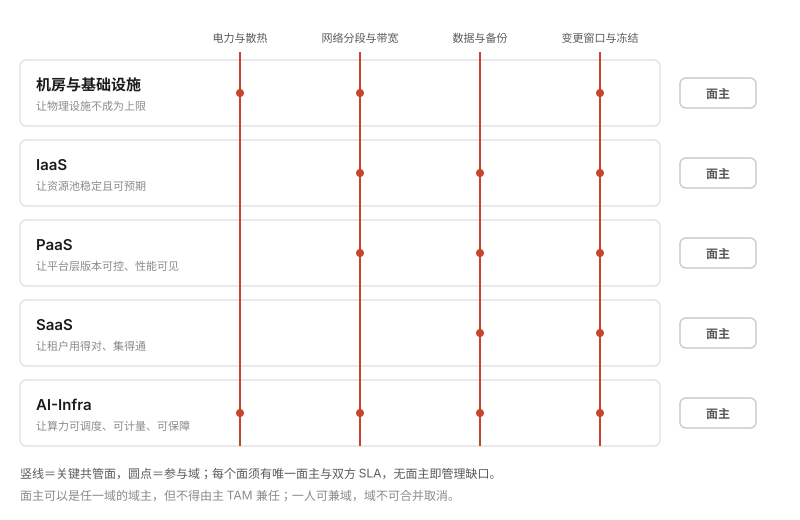

<!-- Diátaxis: Reference -->
# 附录 AB　TAM 团队分域分工与协作最佳实践（拟定稿）

> **文件状态**：本书公开草案 v0.1。无机构背书。无外部评审。无企业试点。条文可引用、可反驳、可替换。
>
> 覆盖范围：标杆项目的机房、IaaS、PaaS、SaaS、AI-Infra 五域共管面。
>
> 性质说明：本附录是 Reference（标准与判定线），不是操作教程，也不是组织设计手册。它回答两个问题：**标杆项目里一个主 TAM 带的子 TAM 团队怎么分域、域与域之间怎么合**。写法上按“最佳实践”组织，但每条实践都给出可检查的判定线与反例，因而可直接当团队标准执行；配套填写件见模板 22（域分工与共管面矩阵）。
>
> 与相邻文本的分工：第 2 章管 TAM 与 SA／PM／CSM 等**跨职能**边界；本附录管 TAM 团队**内部**的专业域分工；附录 AA 管报告怎么写、怎么衔接；附录 G 管评估、附录 O 管晋升；附录 I 管值班通用要求、附录 K 管应急、附录 T 管变更。指标口径以第 34 章为唯一事实源，本附录只引用不重定义。
>
> 字母说明：附录 A–W、Y、Z 均已占用，AA 用于报告体系，本附录取双字母 **AB**。正文只以"附录 AB"形式引用，不单独使用 AB 缩写；它与"A/B 测试"不是同一个记号。

---

## AB.0 引言

标杆项目有三个绕不开的特征：技术栈多（从机房到 GPU）、监管要求硬、重保常态化。一个人扛不住，于是团队必须分域。但分域本身不产生价值，**分域之后还能合成一个客户接口**才产生价值。

团队分域最常见的三种病：

| 病 | 表现 | 后果 |
| --- | --- | --- |
| 全栈英雄 | 一个 TAM 从机柜管到模型服务，谁都问他 | 深度不足，故障时只能"我找人问问"；人一走，客户知识清零 |
| 域墙 | 五个专家各守一段，问题在墙缝里掉 | 客户被迫重复描述；跨域故障无人拼时间线 |
| 重复劳动 | 同一变更三个域各写一份方案、各开一次会 | 客户被反复打扰；口径互相打架 |

三种病的病根是同一个：**按技术栈切分了人，却没按客户后果缝合判断**。技术栈的边界是天然的（电力、虚拟化、中间件、应用、GPU 各有一套语言），客户的后果却是一条链（电力抖动会变成交易失败）。分域标准的价值，就是把这条链上的判断责任分清楚，再把它缝回去。

本附录的两条基本主张：

1. **分域分的是判断责任，不是工位。** 域主对"本域的风险与证据"负责，不对"本域的所有操作"负责；操作可以授权，判断不能外包。
2. **域间靠共管面连接，不靠接口文档连接。** 文档写"我们与 IaaS 有接口"没有意义；有意义的是"电力与散热这个面，面主是谁，双方 SLA 是多少，出问题先找谁"。

## AB.1 范围

本附录适用于同时满足两个条件的团队：

- 客户属于标杆项目（AA 级、金融核心、专有云、智算集群等，口径见附录 AA 的 AA.11.2）；
- 主 TAM 带领 **3 名及以上**子 TAM，且技术栈跨两个以上专业域。

不适用于：单人 TAM（分工即自己，见附录 P／Q 的质量口径）、纯远程共享服务台（按工单队列分工，见附录 U）、售前方案团队（见附录 V）。介于两者之间的团队，可只取 AB.6 共管面与 AB.8 协作机制两节。

本附录覆盖五个专业域：机房与基础设施、IaaS、PaaS、SaaS、AI-Infra。这是"设施层 + 普算三层 + AI 算力一层"的切法，与客户侧运维组织、厂商产品线的常见切法都能对上，便于双方接口。

## AB.2 规范性引用文件

- 本书第 2 章（岗位边界与 RACI 读法）；
- 本书第 14 章（风险与合规）、第 16 章（项目与变革管理）、第 23 章（金融级可用性架构护航）、第 24 章（重大保障方法论）、第 25 章（金融级事件管理）；
- 本书第 27 章（AI 工作负载：GPU 容量、推理成本、上线闸门）；
- 本书第 30 章（服务模式跃迁与 AIOps 接入边界）、第 34 章（度量体系）、第 37 章（职业发展与团队建设）；
- 本书附录 AA（报告体系：子 TAM 的报告结构与衔接）、附录 G（评估三层）、附录 H（工具平台与知识库）、附录 I（值班）、附录 K（应急与演练）、附录 O（晋升）、附录 P／Q（服务质量双版本）、附录 T（变更）、附录 U（工单）、附录 W（金融标准与监管）；
- 模板 09（风险登记册）、模板 18（变更台账）、模板 20／21（报告四件套）、模板 22（本附录配套）。

## AB.3 术语和定义

| 术语 | 英文 | 定义与本书口径 |
| --- | --- | --- |
| 子 TAM | Sub-TAM | 主 TAM 团队内按专业域分工的成员 TAM；对分派客户执行，对本域判断负责（附录 AB） |
| 专业域 | Domain | 一组共享技术语言、共享故障模式、共享证据来源的责任范围；本书划为五域（AB.5） |
| 普算 | General-purpose Computing | 相对 AI 算力的通用计算资源与服务，本书指 IaaS／PaaS／SaaS 三层（附录 AB） |
| 域主 | Domain Owner | 对某专业域的风险与证据负责的子 TAM；不等于"最懂的人"，可轮值，须有备份（AB.7.2） |
| 备份域主 | Deputy | 域主缺席时行使域主判断职责的人；须能独立处置 P1 前 30 分钟 |
| 共管面 | Shared Surface | 两个及以上专业域必须共同负责的边界事项；须有唯一面主与双方 SLA（AB.6） |
| 面主 | Surface Owner | 对一个共管面负总责的人；可以是任一域的域主，但不得由主 TAM 兼任（避免自己和自己定 SLA） |
| 域手册 | Domain Playbook | 一个域的拓扑、版本矩阵、已知问题、SOP、演练记录五件套（AB.8.5） |
| 域间工单 | Cross-domain Ticket | 跨域协作的最小单元：问题 + 证据 + 期望 + 时限，四字段缺一不接（AB.8.1） |
| 域墙 | Domain Wall | 以"这不归我域"终止客户问题、不交接证据的行为（AB.12） |
| 一域一代表 | One Domain, One Delegate | 重保与 P1 作战室中，每个域只进一名有判断权的人，其余在域内待命（AB.7.3） |
| 三权分立 | Fact / Judgment / Process | 故障时域主掌握事实权、主 TAM 掌握判断权、升级经理掌握流程权（AB.8.3） |
| 算力三段 | Compute Stack | AI-Infra 的三段能力：算力设施（GPU／IB／存储）、调度平台（K8s／Slurm）、模型服务（推理网关／模型版本） |

## AB.4 设计原则

| 编号 | 原则 | 含义 | 反例 |
| --- | --- | --- | --- |
| DC1 | 按后果分域，不按产品分域 | 域的边界取"出问题时谁的判断决定客户后果"，不取厂商产品目录 | 按"买了哪家数据库"设域，结果同一个客户三个数据库三个域主 |
| DC2 | 一域一主，一主一册 | 每个域有唯一域主、唯一域手册；域主换人，手册先交接 | 域主三个人轮流当，手册两年没更新 |
| DC3 | 共管面必须具名 | 每个跨域面有唯一面主、双方 SLA、升级路径；无面主的面视为管理缺口 | "网络的事大家一起看"——出事没人认领 |
| DC4 | 故障时三权分立 | 域主给事实、主 TAM 做判断、升级经理管流程；三者不互相代行 | 五个专家在客户群里同时指挥，客户不知道听谁的 |
| DC5 | 证据只采一次 | 变更、演练、复盘证据一次采集入库，跨域按编号引用，不重复采集 | 同一变更，机房要一次截图、IaaS 要一次日志 |
| DC6 | 域可轮换，判断标准不轮换 | 人可以换域，判断标准、SLA、证据链不随人走 | 换域主后，同一类故障的处置口径全变 |

六条原则的优先级：DC3 与 DC4 是硬约束（涉及客户后果），DC1、DC2、DC5、DC6 可按团队规模裁剪。任何裁剪都不能裁掉"面主具名"与"故障时指挥单点"。

## AB.5 五域地图

五域不是组织架构图，是**判断责任图**。一个域可以被一个人兼管，但不能被合并取消——合并即失去边界，边界没了，共管面也就无从谈起。

### AB.5.1 机房与基础设施域

**责任对象**：客户与厂商机房内的物理设施、硬件生命周期与物理安全。

| 项 | 内容 |
| --- | --- |
| 核心交付 | 容量与空间（机柜、U 位、承重）、供电与制冷、综合布线、硬件故障与更换、动环告警、消防与门禁、供电／制冷演练 |
| 首要指标 | 机房可用率、PUE、硬件 MTTR、机柜利用率、动环告警平均响应时长 |
| 不负责 | 业务配置、应用发布、数据库参数；客户机房内的客户设备产权与操作授权 |
| 最常见越界 | 直接插拔客户设备、改动客户侧布线而不留变更记录 |
| 关键共管面 | 电力与散热（与 AI-Infra）、网络分段（与 IaaS／PaaS）、宿主与虚拟化（与 IaaS） |

金融级机房还有两项额外义务：变更留痕必须能拼出审计时间线（附录 W 的 GB 50174 口径），以及演练记录必须可被监管检查复现（第 23 章）。

### AB.5.2 IaaS 域

**责任对象**：虚拟化、宿主机、块／对象／文件存储、网络虚拟化、镜像与配额。

| 项 | 内容 |
| --- | --- |
| 核心交付 | 宿主健康与补丁、迁移与扩容、存储水位与时延、镜像基线、快照与备份、资源配额与超分管理 |
| 首要指标 | 宿主可用率、存储时延、备份成功率、超分比、配额超限次数 |
| 不负责 | 应用架构、数据库参数、业务容量规划（TAM 可给建议，不背设计） |
| 最常见越界 | 替客户改部署拓扑、未经授权调整客户配额 |
| 关键共管面 | 宿主与虚拟化（与机房）、中间件与宿主（与 PaaS）、数据与备份（与 PaaS／SaaS）、容量与成本（与 AI-Infra） |

### AB.5.3 PaaS 域

**责任对象**：中间件、数据库、容器平台、消息与缓存、API 网关。

| 项 | 内容 |
| --- | --- |
| 核心交付 | 版本矩阵与兼容性、参数基线、连接池与慢 SQL 治理建议、升级窗口与回退方案、平台容量水位 |
| 首要指标 | 中间件可用率、慢 SQL 占比、连接池水位、平台升级成功率、升级回退率 |
| 不负责 | 业务 SQL 改写（需客户授权并留痕）、模型效果、应用功能 |
| 最常见越界 | 未经授权直连生产库改数据；替客户承诺"改个参数就好了" |
| 关键共管面 | 中间件与宿主（与 IaaS）、租户与集成（与 SaaS）、数据与备份（与 IaaS／SaaS） |

### AB.5.4 SaaS 域

**责任对象**：多租户应用、租户隔离与权限、集成与单点登录、报表与数据导出。

| 项 | 内容 |
| --- | --- |
| 核心交付 | 租户配置基线、SSO 与集成联调、版本升级影响评估、数据导出与权限核查、租户级故障处置 |
| 首要指标 | 租户可用率、集成成功率、升级回退率、工单一次解决率、权限核查通过率 |
| 不负责 | 产品功能排期、商务条款、客户内部流程改造 |
| 最常见越界 | 向客户承诺"下个版本一定上"；绕过产品直接改租户配置 |
| 关键共管面 | 租户与集成（与 PaaS）、数据与备份（与 IaaS／PaaS）、安全与合规边界（五域共管） |

### AB.5.5 AI-Infra 域

**责任对象**：AI 算力三段——算力设施（GPU／加速卡、IB／RoCE 网络、并行文件系统）、调度平台（K8s 设备插件、Slurm、队列与抢占）、模型服务（推理网关、模型版本、量化与批处理）。

| 项 | 内容 |
| --- | --- |
| 核心交付 | 集群健康与分区隔离、驱动—CUDA—框架版本矩阵、训练任务保障与断点续训、推理 SLA（TTFT／TPOT／P99）、算力账本与配额 |
| 首要指标 | GPU 利用率、作业排队时长、NCCL 集合通信成功率、推理 P99、每千 token 成本、显存碎片率 |
| 不负责 | 模型效果调优、算法选型、训练数据质量 |
| 最常见越界 | 替客户承诺"准确率提升 X%"；把测试任务与生产推理混部在同一分区 |
| 关键共管面 | 电力与散热（与机房）、网络分段与带宽（与机房／IaaS）、容量与成本（与 IaaS／SaaS）、数据与备份（与 IaaS／PaaS） |

AI-Infra 域有三条与普算不同的纪律：

1. **算力是稀缺资源，配额即治理。** 没有配额与抢占策略的集群，最后一定被测试任务占满（第 27 章的 GPU 容量与排队口径）。
2. **版本矩阵比版本本身重要。** 驱动、CUDA、框架、推理引擎四层版本必须成矩阵管理，单层升级等于赌博。
3. **它同时受机房与平台约束。** GPU 功耗墙、液冷能力、IB 布线决定上限；只懂调度不懂电力，域主会在扩容时踩空。

### AB.5.6 五域一图

| 域 | 一句话职责 | 核心交付 | 首要指标 | 最常见越界 |
| --- | --- | --- | --- | --- |
| 机房与基础设施 | 让物理设施不成为上限 | 容量、供电制冷、硬件更换、演练 | 机房可用率、PUE、硬件 MTTR | 直接动客户设备 |
| IaaS | 让资源池稳定且可预期 | 宿主、存储、网络虚拟化、备份 | 宿主可用率、存储时延、备份成功率 | 替客户定架构 |
| PaaS | 让平台层版本可控、性能可见 | 版本矩阵、参数基线、升级回退 | 中间件可用率、慢 SQL、升级成功率 | 未授权改生产库 |
| SaaS | 让租户用得对、集得通 | 租户基线、集成联调、升级评估 | 租户可用率、集成成功率 | 承诺产品排期 |
| AI-Infra | 让算力可调度、可计量、可保障 | 集群健康、版本矩阵、推理 SLA、算力账本 | GPU 利用率、排队时长、推理 P99 | 承诺模型效果 |

## AB.6 共管面

### AB.6.1 十个共管面

共管面是分域之后"缝回去"的针脚。每个面必须有唯一面主与双方 SLA；没有面主的面，就是客户问题会掉下去的地方。

| # | 共管面 | 涉及域 | 必须共管的事 | 失败模式（真实会发生） |
| --- | --- | --- | --- | --- |
| 1 | 电力与散热 | 机房 × AI-Infra | GPU 功耗墙、液冷能力、机柜功率密度、扩容窗口 | 按整机柜均值估电力，GPU 满载即跳闸 |
| 2 | 网络分段与带宽 | 机房 × IaaS × PaaS × AI-Infra | VLAN／VPC、IB 与业务网隔离、跨域带宽与时延 | 训练网与业务网混跑，训练一起量业务就抖 |
| 3 | 宿主与虚拟化 | 机房 × IaaS | 硬件告警归属、宿主迁移、固件与驱动基线 | 硬件告警三个域都收到，都以为别人在处理 |
| 4 | 中间件与宿主 | IaaS × PaaS | 资源争抢、时钟同步、内核参数、宿主补丁影响 | 宿主批量打补丁，打崩中间件连接池 |
| 5 | 租户与集成 | PaaS × SaaS | 身份与 SSO、网关路由、消息与回调 | SSO 证书过期，两边都等对方续 |
| 6 | 数据与备份 | IaaS × PaaS × SaaS | RPO／RTO 跨层对齐、备份窗口、恢复演练 | 三层各备各的，恢复时点对不上 |
| 7 | 变更窗口与冻结 | 五域共管 | 变更日历、冻结期、回退责任、同夜变更互斥 | 两个域同夜变更，回退时互相踩 |
| 8 | 监控与告警口径 | 五域共管 | 告警归属、阈值口径、去重与升级路径 | 同一故障五个域各报一次，客户收到五条 |
| 9 | 容量与成本 | IaaS × AI-Infra × SaaS | 算力账本、超分与配额、扩容与采购节奏 | GPU 被测试任务占满，训练排队三天 |
| 10 | 安全与合规边界 | 五域共管 | 等保与数据分级、日志留存、审计取证 | 日志留存各域不一，审计拼不出时间线 |

### AB.6.2 面主的四条职责

1. 维护本面的清单、SLA 与升级路径，季度评审一次；
2. 裁决归属争议：两个域都说是对方的，面主在 1 个工作日内定，定不了升级给主 TAM；
3. 把本面写进相关域的域手册，并在跨域变更评审时出意见；
4. 对本面的失败模式做一次年度演练（至少桌演）。

面主不由主 TAM 兼任的原因很简单：主 TAM 是 SLA 的最终裁决者，自己定 SLA、自己裁决争议，等于没有争议机制。

### AB.6.3 共管面的三种通用失败

| 失败 | 症状 | 处方 |
| --- | --- | --- |
| 无面主 | "这个大家一起看" | 一周内指定面主，写进模板 22 的共管面矩阵 |
| 双面主 | 两个域都指定了人，互相等对方 | 只保留一个面主，另一域指定接口人而非面主 |
| 面主不懂邻域 | 归属判错，客户被踢皮球 | 面主上任前过邻域基础认证（AB.10.2 的邻域广度） |

## AB.7 编制模型

### AB.7.1 三档编制

| 团队规模 | 域覆盖 | 角色配置 | 硬约束 |
| --- | --- | --- | --- |
| 3–5 人 | 一人兼 1–2 域：机房＋IaaS 可合、PaaS＋SaaS 可合、AI-Infra 独立 | 主 TAM ＋ 3–4 名域主（兼面主） | 面主必须具名；AI-Infra 不得由纯机房或纯 PaaS 背景单独兼 |
| 6–10 人 | 五域各一域主 | 主 TAM ＋ 5 域主 ＋ 1 名一线值班 | 每域有备份；值班与域主 on-call 分离 |
| 10 人以上 | 五域，AI-Infra 内再分算力／调度／模型服务三段 | 主 TAM ＋ 域主 ＋ 段负责人 ＋ 值班组 ＋ 域协调人 | 段负责人向域主汇报；域协调人只管跨域节奏，不管人 |

编制可以按客户数量扩张，但不能按"客户数 ÷ 固定比"机械推导。判断依据是：**共管面数量 × 变更频率 × 重保时长**。一个客户两个域、每月两次变更，比三个客户一个域更轻。

### AB.7.2 域主与备份

域主的五项职责：

1. 对本域风险与证据负责：风险进模板 09，证据进域手册；
2. 维护域手册五件套，季度更新（AB.8.5）；
3. 跨域交接时提供四字段工单（AB.8.1），不转单；
4. 承担本域 on-call，P1 时进作战室（一域一代表）；
5. 带备份：备份须能在域主缺席时独立处置 P1 前 30 分钟。

备份触发条件（满足其一即启动）：休假超过 3 个工作日、离职或转岗、连续加班超过附录 S 的疲劳红线、连续两个月未休。备份不是"挂名"，启动时要完成一次域手册走读与一次桌面演练。

### AB.7.3 值班与重保排班

值班采用"1 + N"结构：1 名一线值班负责接单、分诊、客户沟通；N 名域主 on-call 负责本域判断。一线值班不替代域主判断，域主也不越过一线直接接单——否则分诊形同虚设。

重保期间执行"一域一代表"：每个域只派一名有判断权的人进作战室，其余人在域内待命。作战室里超过 6 人，通常说明有人在旁听而不是在决策（第 24 章的重保组织口径）。

排班与连续值守上限按附录 I 执行；跨零点重保与次日值班的间隔，按附录 S 的疲劳红线校验。

## AB.8 协作机制

### AB.8.1 域间工单：四字段

跨域协作不靠"喊一嗓子"，靠一张四字段工单。四字段缺一，接收方有权退回。

| 字段 | 要求 | 反例 |
| --- | --- | --- |
| 问题 | 一句话说清现象与影响面 | "网络有点问题" |
| 证据 | 时间、对象、日志／截图／编号，至少两项 | "客户说的" |
| 期望 | 要对方做什么判断或动作，做到什么程度 | "帮忙看下" |
| 时限 | 期望回复与完成时点，P1 立即 | "尽快" |

三条纪律：不转单（转问题不转责任）、不空转（退回必须说明缺哪个字段）、不越级（先找域主，域主缺席找备份，再找主 TAM）。接收方在 30 分钟内确认归属；P1 立即确认。

### AB.8.2 跨域变更：三问

任何跨域变更，评审时必须答上三问，答不上不批（与附录 T 的分级签批并行，不替代）：

1. 影响哪个共管面？面主是否知情？
2. 回退由谁执行、谁验证、多久回到原状？
3. 告警由谁认领？变更窗口内谁来盯？

三问的价值不在形式，而在逼出"没人认领"的部分。实践中最常见的漏洞是第 3 问：变更做了，告警没人看，客户先发现。

### AB.8.3 故障协同：三权分立

| 角色 | 掌握 | 在 P1 中的动作 | 不做什么 |
| --- | --- | --- | --- |
| 域主 | 事实权 | 给时间线、给证据、给本域判断与处置建议 | 不对外承诺恢复时间，不指挥他域 |
| 主 TAM | 判断权 | 定客户影响与优先级、定对外口径、协调资源、署名判断 | 不替代域主做技术判断 |
| 升级经理 | 流程权 | 开作战室、定节奏、管事件交接与升级 | 不评价技术方案对错 |

三权分立的反面是"抢麦"：五个专家同时在客户群里发言，客户收到三种口径。出现抢麦，主 TAM 必须立即收口：指定唯一对外发言人，其余人只在作战室发言。

### AB.8.4 跨域复盘

跨域故障的 RCA 必须由涉及域共同署名，不允许单域定责。定责只对流程与机制，不对个人情绪（附录 R 的复盘纪律）。每条改进项必须有面主或域主认领，否则不进台账。

跨域复盘多问一句："如果当时域间工单四字段齐全，能不能早 30 分钟？"这一问通常比根因分析更能暴露协作问题。

### AB.8.5 知识回流与域手册

域手册是域的"活档案"，五件套缺一不可：

| 件 | 内容 | 更新触发 |
| --- | --- | --- |
| 拓扑 | 本域架构图、依赖关系、共管面位置 | 架构变更后 5 个工作日内 |
| 版本矩阵 | 产品／驱动／中间件版本与兼容性 | 每次升级后 |
| 已知问题 | 现象、根因、绕行方案、修复版本 | 每次复盘后 |
| SOP | 高频操作与应急处置步骤 | 每季度复核 |
| 演练记录 | 演练场景、结果、改进项 | 每次演练后 |

域手册的读者不只是本域：新成员、备份、审计、AI 知识库都读它。手册不新鲜，RAG 就会答错；答错一次，团队就会失去对它的信任。

### AB.8.6 交接包

域主轮换、离职、长期休假，交接六件套：

1. 拓扑与账号清单（含权限回收时点）；
2. 待办与在途风险（编号、状态、下一步）；
3. 最近三次变更与回退记录；
4. 已知问题与绕行方案；
5. 客户侧关键人与沟通偏好（敏感信息按附录 B.3.6 管理）；
6. 域手册版本与未闭环改进项。

交接完成的标志不是"讲过了"，是接手人独立完成一次本域例行巡检并签字。

## AB.9 AI 时代的团队协作

分域团队最怕"信息在域内、判断在域外"。AI 在这里的作用不是替代域主，而是把域内信息变成全队可读的结构化输入。

### AB.9.1 五个 AI 杠杆

| 杠杆 | 做什么 | 人的位置 | 失败信号 |
| --- | --- | --- | --- |
| 智能分诊 | 按告警与工单文本自动路由到域 | 面主校正归属 | 混淆矩阵连续两月恶化 |
| 域手册 RAG | 新成员与值班用自然语言查手册，答案带出处 | 域主维护手册新鲜度 | 答案频繁指向过期章节 |
| 变更前检查 | 自动比对变更单与共管面清单，缺项拦截 | 评审人复核拦截理由 | 拦截被无理由跳过 |
| 值班副驾 | 告警聚类、建议域与 runbook、生成时间线草稿 | 值班确认后执行 | 值班不看建议直接点"同意" |
| 算力账本 | 按租户／项目／作业出账，异常用量告警 | 域主解释异常 | 账本与账单长期对不上 |

五个杠杆共用一个前提：**数据源结构化**。工单没有域标签、变更没有共管面字段、告警没有归属，AI 只会把混乱放大（附录 H 的工具验收口径）。

### AB.9.2 AI 协作的边界

- AI 不做定责：跨域故障的责任判断由人署名，AI 只提供时间线与证据索引；
- AI 不自动执行生产变更：变更执行仍需按附录 T 的签批与双人复核；
- AI 路由错误必须由面主校正并月度复盘，不能"错着错着就习惯了"；
- 域判断必须具名：与附录 AA 的 AI 红线一致，判断句后要有具体的人。

## AB.10 质量与评估

### AB.10.1 五个协作指标

| 指标 | 定义 | 口径 | 方向 |
| --- | --- | --- | --- |
| 域间工单一次交接成功率 | 四字段齐全、一次被接收的比例 | 按周统计，P1 单独看 | ↑ |
| 共管面告警归属准确率 | 告警首次分派到正确域的比例 | 月度抽样 30 条 | ↑ |
| 跨域变更回退率 | 跨域变更中触发回退的比例 | 按变更单统计（模板 18） | ↓ |
| 跨域复盘改进项 90 天闭环率 | 90 天内关闭的改进项占比 | 按复盘编号统计（模板 16） | ↑ |
| 域手册新鲜度 | 五件套最近更新时间距今 ≤ 90 天的比例 | 季度盘点 | ↑ |

五个指标之外不再加"域内工单量""响应字数"之类的过程指标——它们会立刻变成域墙的砖。

### AB.10.2 域主能力模型

域主不是"本域最懂的人"，是"本域判断能署名的人"。四项能力：

1. **本域深度**：能独立处置本域 P1 前 30 分钟，能评审本域变更；
2. **邻域广度**：能读懂相邻域的拓扑与告警，能判断问题是否越界；
3. **共管面知识**：知道自己域参与的每个面，面主是谁、SLA 多少；
4. **证据习惯**：所有判断能回链到日志、变更单、复盘编号。

四项中缺第 1 项不能当域主；缺第 2、3 项只能当"域内专家"，不能当面主；缺第 4 项不能署名。

### AB.10.3 与评估、晋升的衔接

- 协作指标进附录 G 的 L2 过程证据，不单独设"协作分"；
- 域主经历是附录 O 晋升"组织贡献"证据的合法来源，但必须具名项目、量化结果、可核验人；
- 不以域内工单量排名：工单量高的域，可能是分诊最差的域；
- 域主轮换不降职级：从主域换到邻域，能力等级按新域重新评定，原域经历保留为广度证据。

## AB.11 场景裁剪

| 场景 | 裁剪规则 |
| --- | --- |
| 公共云客户 | 机房域弱化为"厂商设施依赖管理"（关注厂商可用区与 SLA），IaaS 偏配额与通告；AI-Infra 按实际是否用 GPU 决定 |
| 专有云／私有云 | 五域全上，机房域权重最高；平台运行质量与合规留痕按附录 Q |
| 金融核心 | 共管面 7（变更窗口与冻结）与 10（安全与合规）升为一级面，双人复核、监管留痕（第 23 章、附录 W） |
| 智算集群 | AI-Infra 为主域，机房（电力／液冷）与 IaaS（宿主／存储）为强共管；算力账本进月度经营 |
| 混合云 | 增加"云间网络与身份"面（第 11 面），面主由 IaaS 域主担任，SaaS 域主为接口人 |
| 小团队（3 人以下） | 一人多域，但面主必须具名；AI-Infra 至少配一名外部专家支持 |
| 驻场项目 | 域主与客户侧对应专业接口人建立固定周会；交接按附录 B.3.9 的驻场自检执行 |

## AB.12 红线

1. **越域改配置**：未经面主与客户授权，直接改动邻域配置或数据；
2. **转单不转证据**：把问题丢给邻域而不带四字段，导致客户重复描述；
3. **隐瞒共管面风险**：域主已知面风险不上报、不写风险册；
4. **以域墙拒绝客户**：用"这不归我域"作为答复，不提供交接对象与时限。

四条红线与附录 AA 的报告红线、附录 G 的否决条款分开执行：报告红线管"说"，本附录红线管"做"。

## AB.13 版本与共建

- 本附录为拟定稿（v0.1，2026-10），与附录 AA 同批维护；修订走附录 E 的贡献流程；
- 五域划分如遇新产品形态（如边缘算力、模型托管服务），先在 AB.5 增补域或共管面，再改模板 22；
- 共管面清单每年复核一次，复核记录写入 HANDOFF；
- 与第 2 章、附录 AA、附录 G／O 的口径冲突时，以本附录的分工口径为准，评估与晋升口径仍以 G／O 为准。

---

## 本章要点回顾

- 分域分的是判断责任，不是工位；域主对本域风险与证据负责，操作可授权、判断不可外包；
- 五域 = 机房（设施）+ 普算三层（IaaS／PaaS／SaaS）+ AI-Infra（算力三段），一人可兼域，域不可合并取消；
- 分域之后靠十个共管面缝回去：每个面唯一面主、双方 SLA、升级路径；无面主即管理缺口；
- 协作靠四字段域间工单、跨域变更三问、故障三权分立（事实／判断／流程）、双域署名复盘、域手册五件套；
- 重保执行"一域一代表"，值班执行"1 + N"；AI 只做分诊、检索、检查与账本，不做定责、不自动改生产；
- 协作只看五个指标，域内工单量与报告字数不得用于排名。
