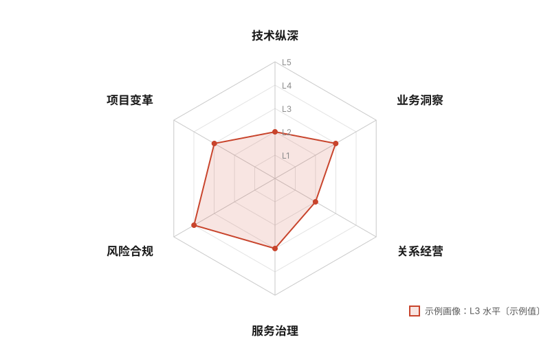

<!-- Diátaxis: Explanation -->
# 第 13 章　风险与合规

> 技术纵深回答"系统哪里有问题"，风险与合规回答"出事谁担责、现在要不要停"。这一维常被误当成填表工作。它实际是 TAM 在客户组织里的责任接口：识别风险、透明化上报、推动处置，但不替客户做合规判定。本章解释这项能力的构成与形成机制。操作步骤在[第 14 章](ch14-risk-compliance-practical.md)。

## 13.1 能力定义：识别与透明化，不代判

风险与合规能力，是把技术与业务信号转化为"有人签字的风险条目"并推动其闭环的能力。三个动词缺一不可：识别得早、写得清、推得动。

它有两条硬边界。

第一条：TAM 不作合规判定。监管条文是否满足、审计是否通过，判定权在客户的合规与审计团队。TAM 的职责是让风险信号在正确的时间到达正确的人。越权判定的代价是明确的：一旦 TAM 替客户签了"合规"，出事时责任随之转移过来，而 TAM 既没有授权也没有信息优势承担它。

第二条：TAM 不替客户接受风险。风险登记册上的每一条，接受与否是客户 Owner 的决定。TAM 要做的是让这个决定留下记录——谁、在何时、基于什么信息接受了什么。没有记录的口头接受，在事后复盘时等于没有发生。

因此，这一维的能力产出不是"风险少了"，而是"风险条目在闭环轨道上运转"。掩盖风险会让短期数字变好看，同时让下一次事故的代价变大。一个简单的分诊规则可以挡住多数自欺：如果一条风险写不出"谁在什么时候之前做什么"，它就还没被管理，只是被记下来了——记录不是管理，闭环才是。

## 13.2 能力结构：一条扫描线、一本登记册、一条上报通道

风险与合规能力由三个部件构成。

**三道扫描线**决定识别的覆盖面。技术扫描线盯系统信号：容量水位、依赖老化、证书与版本生命周期。流程扫描线盯动作信号：绕过闸门的变更、未演练的预案、单点值班。外部扫描线盯环境信号：监管新规、厂商通告、供应链变动。三道线的盲区互补——只做技术扫描的团队，会在"流程本来就不合规"上栽跟头。

三道线的运转节奏不同，混在一张表里管会把高频信号拖慢、低频信号漏掉：

| 扫描线 | 建议节奏 | 典型信号 | 单次产出上限 |
| --- | --- | --- | --- |
| 技术扫描线 | 每周〔建议值〕 | 水位、到期、EOL 公告 | 超过 10 条并入批量评审，不逐条开会〔建议值〕 |
| 流程扫描线 | 每月〔建议值〕 | 绕闸门变更、预案欠演、单点值班 | 与月度服务回顾合议 |
| 外部扫描线 | 每周集中一次〔建议值〕 | 监管新规、厂商通告 | 只登记有影响面的，纯资讯不入册 |

产出上限这条容易被忽略。扫描灵敏度调得过高，登记册会被低价值条目淹没，重大风险反而失去可见性——识别能力的强弱不看条目总量，看条目里"值得开会讨论"的占比。

**风险登记册**决定透明化的质量。一条合格的风险条目必须包含四要素：风险描述、影响估算、应对动作与 Owner、复审日期。缺任何一项，条目就退化成备忘录。登记册的核心纪律是"三缺一不入册"，这条纪律在[模板 09](tpl-09-risk-register.md)中落成字段。

**上报通道**决定推动力。风险按级别走不同通道，级别不是标签，是时限与收件人的函数：

| 级别 | 触发条件（示例） | 通道 | 时限 |
| --- | --- | --- | --- |
| 一般 | 影响限于单系统，已有缓解 | 进月度服务回顾议程 | 下次例会前〔建议值〕 |
| 重大 | 影响业务窗口或跨系统依赖 | 双方 Owner 会签 | 3 个工作日内〔建议值〕 |
| 红线 | 触碰监管、安全或数据红线 | 即时升级双方管理层 | 24 小时内〔建议值〕 |

通道设计的常见错误是把所有风险都走同一条慢通道——重大风险得不到紧迫性，日常风险淹没在升级噪声里。反向错误同样存在：把条条都标成重大，等于没有分级——三个月后团队会用脚投票，绕过通道私下处理。

三个部件互相依赖。扫描线产出条目，登记册承载条目，通道消化条目。任何一环断裂，能力都会退化成"填表给领导看"。检验三环是否真的在转，看一个组合指标：本周期新发现条目数、闭环条目数、超期未复审条目数。三个数一起看才有意义——发现多而闭环少是通道堵了，闭环多而发现少是扫描线停了，超期未复审堆积则是复审日期写下来就没人再看。任何一环的失灵都会先在这三个数里现形，等客户在服务回顾上问出来，已经晚了一个周期。

## 13.3 判断如何形成：从事实到可署名的风险表述

风险判断沿一条链条形成，每一环都可能失真。

第一步是确认事实。"数据库压力大"不是事实，"连接池峰值使用率连续三周超过 90%〔经验值〕"才是事实。事实层面最常见的失真是采样偏差：拿平均值当峰值，拿演练数据当生产数据。

第二步是估算影响。影响估算要落到业务语言：这笔风险兑现时，哪个业务功能停、停多久、波及多少交易。影响估算是 TAM 最容易被高估或低估的一环，因为它依赖客户业务上下文——这正是业务洞察维度向本维供给的能力。

第三步是评估概率与紧迫性。概率判断不需要精确小数，需要的是区间与触发条件："如果下个季度不做 X，则 Y 概率发生"。紧迫性由两个因子决定：风险兑现前的剩余窗口，以及兑现后的不可逆程度。

第四步是形成表述并署名。一条可署名的风险表述形如：「因<事实>，在<条件>下将导致<业务影响>；建议<动作>，Owner <谁>，复审于<日期>」。写不出这个句式，说明前三步有一步没走完。

判断失真有四类系统性来源：确认偏差（只收集支持直觉的证据）、新鲜度偏差（最近一次事故主导当前评估）、权威偏差（客户说没事就真信没事）、以及算术幻觉（用精确的乘法掩盖不确定的前提）。识别这四类来源，比背风险矩阵更有用。

一个走完四步的完整示例，说明每步产出什么：

| 步骤 | 输入 | 合格产出 | 常见坏产出 |
| --- | --- | --- | --- |
| 事实 | 监控与工单原始记录 | 连接池峰值使用率连续三周超过 90%〔经验值〕 | "数据库压力大" |
| 影响 | 客户业务日历与交易量 | 决算窗口停两小时将阻塞批量入账，波及日终对账 | "影响比较大" |
| 概率与紧迫 | 变更计划与容量曲线 | 下季度扩容未启动则兑现窗口在决算前，剩余窗口约 60 天〔建议值〕 | "有可能出事" |
| 表述 | 前三步合成 | 见下方句式，署名并定复审日 | 无 Owner 的备忘录 |

四步都写出产出，风险条目才具备被讨论的资格。任何一步交白卷，后面补的都是修辞。

## 13.4 与其他五维的关系：供给、约束与被约束

风险与合规不独立存在，它与其他五维形成稳定的方向性关系。

业务洞察向本维供给影响估算。脱离业务语境的风险条目只能写出"系统可能故障"，写不出"决算窗口停两小时意味着什么"。

技术纵深向本维供给事实底座。连接池、依赖图、容量水位的读数质量，决定扫描线的灵敏度。

服务治理与本维互相约束。登记册是例会体系的输入，例会是风险闭环的场所；反过来，风险纪律也是治理的验收项之一——一个变更绕过闸门无人过问的团队，治理评分不该及格。

项目变革是风险的兑现窗口。绝大多数风险在项目与变革动作中集中兑现：上线、迁移、切换。闸门评审（[第 16 章](ch16-project-change-practical.md)）是风险维度在流程中的具象化落点。

关系经营决定上报通道是否通畅。坏消息说给谁、怎么说、何时说，依赖平日积累的信任账户——信任薄的团队，风险上报会自然退化为"报喜不报忧"。

## 13.5 分级标准：从看得到风险到定得了标准

本维按可观察行为分级，锚点样式与[附录 G](appx-g-tam-work-evaluation-standard.md) 的 L1–L5 一致。六维雷达的读法见[第 36 章](ch36-maturity-model.md)：单维看本维的 L 级，六维合看成熟度定位。

| 级别 | 行为锚点 | 判据 |
|---|---|---|
| L1 能识别 | 在指导下识别风险信号，写出事实描述 | 扫描线有产出，条目含事实 |
| L2 能登记 | 独立完成四要素登记，影响估算落到业务语言 | 条目合格率稳定，复审不断档 |
| L3 能推动 | 独立完成影响估算与上报，推动条目闭环到关闭 | 闭环率与关闭验证成为常态 |
| L4 能建机制 | 设计三道扫描线、分级通道与例会节奏，让机制自己运转 | 机制在无人催促时仍闭环 |
| L5 能定标准 | 制定组织的风险纪律与红线，跨团队校准口径 | 标准被其他团队采用为基线 |

五个级别不是风险知识量的累积。L1 到 L3 的跃迁发生在**责任**上：L3 之前，TAM 把风险交给别人判断；L3 之后，TAM 自己形成可署名的风险表述并对建议负责。L4 到 L5 的跃迁发生在**杠杆**上：从自己闭环条目，变成让别人闭环的机制设计。

分级与职级不对应。一个把风险藏起来换短期安宁的资深员工，在本维可能停在 L1——分级看证据，不看年头。

分级落地时有两个量化纪律。其一，级别与登记册行为绑定：L2 以上的证据必须能在登记册里指出具体条目，说不出条目编号的自评不算数。其二，降级要有留痕：一条风险从重大降为一般，降级理由、降级人、降级时间三样齐全，否则按原级别继续跟踪——降级机制一旦没有成本，分级就会在一个月内退化成全员一般〔经验值〕。

## 13.6 AI 时代的变化与不变

AI 改变本维的三件事。**发现速度**：从三道人工扫描线到日志与工单的持续比对，信号到条目的延迟以小时计被压缩。**草稿质量**：四要素条目的初稿可以由 AI 生成，TAM 转为校准者——修事实、补业务影响、定 Owner。**覆盖广度**：跨系统关联风险（A 系统的变更撞上 B 系统的容量窗口）由人肉拼图变成持续扫描。

没变的三件事。**判定没变**：合规与否、风险接不接受，仍由有授权的人签字，AI 不进入签字链。**责任没变**：条目署名的是 TAM，AI 草稿中的失实由署名人承担——这意味着校准环节不能省。**红线没变**：瞒报、降级处理、拖延上报，工具再智能也不构成豁免理由。

一条边界要说清：AI 生成的风险表述必须逐条回对事实源。模型会把相关性写成因果，把历史规律写成当前事实——「监控显示 A 与 B 同时升高」被写成「A 导致 B」的风险条目，会把排查引向错误方向。AI 提升的是发现与起草的效率，校准与签字的成本没有下降，反而因为条目数量上升而增加。

这里有一个容易被忽略的量变：扫描自动化后，条目产量可能从每月十几条涨到每月几十条〔经验值〕。产量涨三倍而校准人力不变，每条分到的核对时间就只剩三分之一——省下来的发现时间，会原样变成校准时间的欠账。所以引入 AI 扫描的第一年，真正的瓶颈不是工具，是"谁来逐条回对事实源"这个没有变过的问题。工具选型时把校准人力算进总账，比比较召回率更重要。

## 13.7 六个常见误区

**误区一：把风险当免责声明。** 风险写成"如出现问题与我方无关"不是风险管理，是免责企图。合格的风险条目必须有应对动作与去向，否则登记册只是事故后的翻案材料。

**误区二：追求数字归零。** 关闭率长期 100% 是危险信号：要么风险被降级处理，要么关闭没有验证。真实机制里，登记册总有一定存量，关闭必须过验证。

**误区三：把合规判定揽到自己身上。** "我检查过了，没问题"这句话越过了职责边界。正确表述是"按清单核对，X、Y 已满足，Z 待贵方合规团队确认"。

**误区四：只在事故后扫描。** 事故驱动的扫描让组织永远慢一步。三道扫描线的价值在于平时——平时每多发现一条，事故清单就少一条。一个可对照的信号：如果登记册里的条目全部诞生于故障复盘会，说明扫描线只存在于纸面上。某次事故后补建扫描线的团队，头一个月往往能挖出十几条存量风险〔经验值〕——那不是扫描线灵敏，是过去欠账太多。

**误区五：条目没有业务影响。** "数据库有风险"无法推动任何决策。写不出业务影响，说明业务洞察维度的供给断了，先回[第 7 章](ch07-business-insight.md)补影响翻译。

**误区六：把 AI 扫描当全部能力。** AI 压缩发现与起草的时间，但判定、签字、推动闭环仍要人做。只部署工具不建机制的团队，条目会涨、闭环不会涨——噪声放大而非风险化解。一个可对照的信号：引入工具后连续两个月闭环率不升反降〔经验值〕，说明瓶颈在校准人力，不在发现速度。此时继续加扫描维度只会让欠账更厚，正确动作是先砍低价值信号源，把人力留给回对事实源。

## 13.8 学习效果清单

- [ ] 能用自己的话解释"识别、透明化、推动"三个动词与两条硬边界
- [ ] 能说明三道扫描线各自的盲区，以及为什么需要三道
- [ ] 能写出含四要素的合格风险条目，并识别四要素缺失的坏条目
- [ ] 能沿事实→影响→概率→表述的链条复述一次风险判断，并指出四类失真来源
- [ ] 能说明风险与其他五维的供给与约束方向
- [ ] 能对照 L1–L5 锚点判断自己所处级别，并说出 L3 的责任跃迁意味着什么
- [ ] 能说明 AI 改变了本维的哪三件事、没改变哪三件事
- [ ] 能识别并规避六个常见误区

---

**本章要点回顾**

1. 风险与合规能力是把信号转化为有人签字的条目并推动闭环的能力。TAM 识别与透明化，不作合规判定、不替客户接受风险。
2. 能力结构是三道扫描线、四要素登记册、分级上报通道。三环断裂，能力退化成填表。
3. 判断沿事实、影响、概率、表述四步形成。失真来自确认、新鲜度、权威偏差与算术幻觉。
4. 本维向项目变革输出闸门输入，被业务洞察与技术纵深供给事实，被关系经营决定通道通畅度。
5. 分级看证据不看年头。L3 是责任跃迁，L4–L5 是机制与标准的杠杆跃迁。
6. AI 改变发现、草稿与覆盖；判定、签字、红线没有改变。AI 草稿必须逐条回对事实源。

---

**延伸阅读**

- [第 14 章　风险与合规实战](ch14-risk-compliance-practical.md)：登记册、扫描线、审计配合的操作步骤
- [模板 09：风险登记册](tpl-09-risk-register.md)：四要素字段与月度过册记录
- [第 36 章：成熟度模型](ch36-maturity-model.md)：六维级别与 M1–M5 的映射
- [附录 W：金融运维标准汇编](appx-w-financial-ops-standards.md)：监管要求的风险条线坐标
