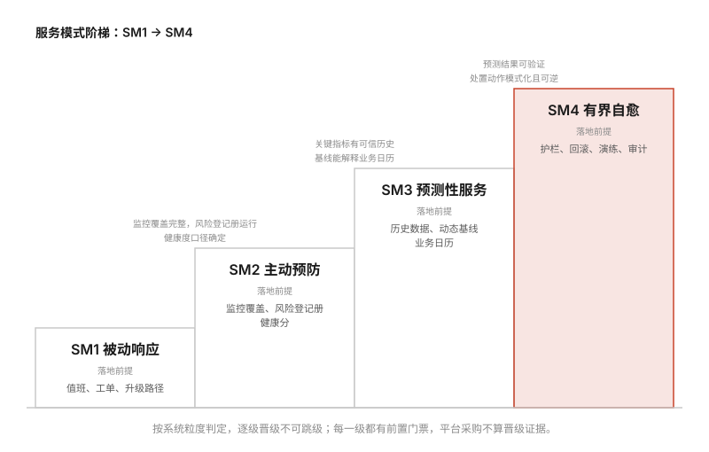

<!-- Diátaxis: Explanation -->
# 第 30 章　服务模式的跃迁

> 第 27 章回答客户 AI 负载怎么护航。第 28 章回答 TAM 怎么用 AI。本章回答第三个问题：AI 把“服务”本身变成什么样。核心不是采购一个人工智能运维（Artificial Intelligence for IT Operations，AIOps）平台。核心是服务模式的跃迁。服务要脱离被动响应，走向主动预防。成熟后再走向预测性服务和有边界的自愈。本章解释这条阶梯的成因、晋级条件和红线。服务模式用 SM1–SM4 表示。它不同于[第 36 章](ch36-maturity-model.md)的个人成熟度 M1–M5。

## 30.1 为什么服务模式必须跃迁

被动响应模式有三个限制。它们不是某个团队的态度问题。它们来自模式本身的结构。

### 30.1.1 三堵墙

| 限制 | 形成机制 | 业务后果 |
| --- | --- | --- |
| 成本墙 | 服务量增长主要靠增加值班和工程师 | 人力随客户数上升，规模化困难 |
| 体验墙 | 客户报障后才开始处置 | 响应再快，损失也已经发生 |
| 期望墙 | AI 让异常发现和预警变得可见 | “没提前发现”从意外变成质疑 |

成本墙说明只靠加人不可持续。体验墙说明只压缩响应时间有上限。期望墙说明客户的比较基准已经改变。[第 4 章](ch04-ai-era-tam-redefined.md)提出“可观测运行、可降级恢复”。这三堵墙的解法，在服务模式层面就是这两项能力。

### 30.1.2 AI 改变的是可行性

AI 并不自动创造服务模式跃迁。它改变三件事：

- 服务方可以持续学习历史数据，不只是做事后报告；
- 异常趋势可以在人工阈值前得到提示；
- 已知处置可以进入编排和约束。

可行性不等于成熟度。AI 需要监控质量、数据关联和处置纪律支撑。缺少这些条件，AI 只会把噪声更快地送到人面前。

## 30.2 服务模式阶梯：SM1–SM4

服务模式阶梯按**系统粒度**判定，不按团队或公司粒度判定。同一个客户的门户系统可能处于 SM2。支付清算链路可能处于 SM3。某个内部测试系统可能仍处 SM1。

| 级别 | 名称 | 运行特征 | 主要证据 | 客户感受 |
| --- | --- | --- | --- | --- |
| SM1 | 被动响应 | 工单驱动，客户报障后处置 | 工单记录、值班记录、服务等级协议（Service Level Agreement，SLA）结果 | “态度不错，但总是出事才知道” |
| SM2 | 主动预防 | 巡检、风险扫描和健康度运营常态化 | 风险登记册、健康分、隐患闭环 | “他们会提前提醒隐患” |
| SM3 | 预测性服务 | 动态基线和预测结果进入处置安排 | 基线、预测命中、提前处置记录 | “问题在影响业务前已安排处理” |
| SM4 | 有界自愈 | 已知模式可自动处置并闭环 | 护栏、演练、自动处置台账 | “很多事不需要客户催问” |

SM4 的“自愈”不是无边界自动修复。它只覆盖已知、可逆、影响有界的场景。

### 30.2.1 每一级的核心能力

| 级别 | 核心能力 | 必备基础 | 典型失效 |
| --- | --- | --- | --- |
| SM1 | 接报、定位、恢复 | 值班、工单、升级路径 | 只处理单点，不消除复发 |
| SM2 | 发现趋势、管理风险 | 监控覆盖、风险登记册、健康分 | 巡检变成表格打卡 |
| SM3 | 建立基线、预测和安排消化 | 历史数据、动态基线、业务日历 | 预测很多，处置很少 |
| SM4 | 约束自动化、快速闭环 | 护栏、回滚、演练、审计 | 自动动作扩大爆炸半径 |

### 30.2.2 晋级条件

跃迁是爬楼梯，不是坐电梯。每一级都有前置门票。

| 跃迁 | 前置条件 | 证据包 |
| --- | --- | --- |
| SM1 → SM2 | 监控覆盖完整，风险登记册运行，健康度口径确定 | 监控覆盖清单、风险闭环记录 |
| SM2 → SM3 | 关键指标有可信历史，基线能解释业务日历 | 至少六个月数据、基线与峰值对照 |
| SM3 → SM4 | 预测结果可验证，处置动作模式化且可逆 | 预测命中率、演练记录、回退方案 |

这里的“六个月”是常见起步基线，不是数学门槛。数据质量比时长更重要。如果采集口径频繁变化，更长时间也无法支撑预测。

### 30.2.3 定级时避免三个错误

第一，不要按团队最高能力定级。要按生产链路的实际运行状态定级。第二，不要按试点系统定级核心链路。试点证明的是可行性，不是普及度。第三，不要把采购平台当成晋级证据。平台只有产生可审计结果时，才计入能力。

## 30.3 跃迁的因果机制

### 30.3.1 SM1 → SM2：从处置单点到看见趋势

SM1 的典型循环是“告警—恢复—关闭工单”。它能恢复服务，但很少回答“为什么会反复发生”。

进入 SM2 后，服务方建立三类记忆：

- 风险记忆：隐患进入风险登记册，并有 Owner 和复审日期；
- 健康记忆：容量、错误、延迟和业务指标形成趋势；
- 处置记忆：服务方要将历史事件结构化。这些记录不能只留在聊天记录里。

这三类记忆改变服务的判断方式。服务不再只回答“这次修好了”。服务要回答“同类问题是否还会发生”。风险扫描方法见[第 14 章](ch14-risk-compliance-practical.md)，健康度口径见[第 34 章](ch34-measurement-system.md)。

### 30.3.2 SM2 → SM3：从看见趋势到提前安排

SM2 能发现水位上升、错误率抬升和重复告警。SM3 要回答三个问题：

1. 这个趋势是否异常？
2. 它什么时候可能影响业务？
3. 现在应采取什么消化动作？

动态基线因此必须吃业务日历。决算日、大促、批处理窗口和节假日都会改变正常范围。离开业务语境的“异常”，只是统计离群值。

预测的价值不在报告中，而在安排里。预测到容量不足后，应有扩容评审。预测到组件劣化后，应有变更窗口和回退方案。预测与消化动作之间断开，服务仍停留在 SM2。

### 30.3.3 SM3 → SM4：从提前安排到受控闭环

SM4 不是让 AI 自由处置。它把已经稳定的人机分工固化下来：

- 判据已经明确；
- 动作已经演练；
- 影响范围已经限定；
- 回退路径已经验证；
- 执行结果可以审计。

只有这些条件成立，自动处置才能从“建议”进入“执行”。

## 30.4 AIOps 接入的前提与顺序

### 30.4.1 三个接入前提

AIOps 的上限由数据质量决定。接入前应确认三项基础。

| 前提 | 含义 | 不满足时的结果 |
| --- | --- | --- |
| 监控覆盖 | 关键链路、依赖和业务指标可观测 | 模型只看见局部故障 |
| 告警质量 | 告警有效率建议不低于 80% | AI 学习并放大噪声 |
| 数据可关联 | 指标、日志、变更和依赖拓扑可互证 | 只能单点报警，难以解释根因 |

“告警有效率”应按客户和业务口径定义。通常要看三项。第一，告警是否对应真实异常。第二，是否需要人工行动。第三，能否在规定时限内得到确认。

数据可关联不要求所有系统统一存储。它要求事件分析时能回答四个问题。哪个指标变了？哪条日志相关？哪个变更触发？哪段依赖受影响？

### 30.4.2 推荐接入顺序

推荐顺序是：告警降噪与聚类 → 异常检测 → 根因推荐 → 故障预测。

| 阶段 | 解决什么 | 前置条件 | 失败表现 |
| --- | --- | --- | --- |
| 降噪与聚类 | 减少重复和低价值告警 | 告警结构化、依赖关系基本清楚 | 真信号漏掉 |
| 异常检测 | 在固定阈值前发现趋势 | 指标历史和业务日历 | 误报风暴或漏报 |
| 根因推荐 | 缩小排查范围 | 工单、RCA 和知识库语料 | 把相关性当成根因 |
| 故障预测 | 给消化动作留时间 | 长期数据、预测闭环和处置授权 | 预测无人消费 |

这个顺序不是技术难度排序，而是信任建立顺序。前一阶段没有产生可靠证据时，后一阶段不应承担生产决策。

### 30.4.3 平台不是跃迁本身

常见反面模式是先采购平台，再补数据治理。结果是平台上线即闲置。AIOps 是能力建设，不是软件安装。判断是否跃迁要看三件事。告警是否更准？处置是否更快？预测是否有人消费？控制台数量不是证据。

## 30.5 三条运行边界

### 30.5.1 告警降噪不能变成静默

降噪常用手段有四类。它们是同源合并、依赖关联、维护窗口抑制和重复告警压缩。目标不是把告警压到最少。目标是让值班人把注意力留给需要行动的信号。

| 边界 | 口径 |
| --- | --- |
| 降噪目标 | 告警量可设计为下降 50%–80%，但必须以不漏关键信号为前提 |
| 低频高危 | 低频高危告警永不静默 |
| 重保窗口 | 告警策略回切到宁可误报模式 |
| 可审计 | 合并、抑制或降级后的告警可回放 |
| 责任人 | 每条降噪规则有 Owner、生效范围和复审日期 |

降噪规则本身也是变更。规则上线、调整和停用都应留痕。重保期纪律见[第 24 章](ch24-major-assurance.md)。

### 30.5.2 异常检测必须双轨

动态基线适合有周期性的指标。常见对象包括交易量、在线人数和接口调用量。批处理时长、低频任务和变化很少的指标，样本往往不足。采用前要先判断适用性。

金融核心链路应采用双轨制：

- 静态阈值兜底，保证明确红线不漏；
- 动态异常检测提前，争取处置时间；
- 任一轨触发都进入响应，不互相替代。

误报和漏报的代价不对称。误报消耗人力，漏报消耗业务。核心链路不能为了降低误报而取消静态兜底。

### 30.5.3 预测必须闭环到消化动作

预测性服务不是输出更多预测报告。一个预测结果只有进入消化安排，才产生服务价值。

> 预测发现 → 影响评估 → 消化动作 → 窗口安排 → 执行验证 → 模型修正

容量预测应连接扩容评审。劣化预测应连接变更窗口。季节性压力预测应连接重保安排。变更窗口和台账纪律见[附录 T](appx-t-online-change-standard.md)，重保组织见[第 24 章](ch24-major-assurance.md)。

预测指标应至少观察三类：命中率、提前量和消化率。只有命中率而没有消化率，说明组织看见了风险。但组织没有处理风险。

### 30.5.4 自愈必须先有护栏

自愈的准入判据有三条，三条同时满足才允许自动执行。

| 判据 | 口径 | 示例 |
| --- | --- | --- |
| 已知模式 | 故障有预案，出现过，处置有效 | 已验证的磁盘清理或会话重置 |
| 可逆操作 | 动作可回滚，不会造成不可恢复变化 | 扩容、切换、重启副本 |
| 影响有界 | 爆炸半径预先圈定 | 只作用于一个单元或一个租户组 |

不满足三条的自动化只能到“建议”层。人确认后执行。四类动作保留人工确认。它们是高危写操作、数据删除、跨系统联动和资金相关动作。

自愈动作也是变更。它必须按[附录 T](appx-t-online-change-standard.md)进入变更台账。台账要记录触发条件、执行对象、结果和回退状态。紧急自动处置不免除留痕。

自动化按爆炸半径分三批开放。每一批都要先建护栏，再扩能力。

| 批次 | 可开放范围 | 前置护栏 |
| --- | --- | --- |
| 第一批 | 处置建议、单点可逆动作 | 判据明确、日志完整、执行人可回退 |
| 第二批 | 单系统或单单元内自动处置 | 阈值演练、影响边界、自动回退 |
| 第三批 | 核心链路或跨系统联动 | 人工确认、联合演练、审计与监管口径 |

扩批不是线性升级。任一批次出现误处置，应先收缩范围，复盘后再评估开放。

护栏先于能力。没有护栏的自愈，只是把人工事故变成自动事故。

## 30.6 组织、客户与信任的跃迁

### 30.6.1 预防价值必须可见

SM2 以后，很多成果表现为“没有发生的事故”。这会带来一个特有风险。客户看不见预防，预算季就会问“要你们做什么”。

服务报告应设置“主动预防成果”栏。它不只写巡检次数，而要写业务语言下的结果。示例如下：提前处置多少隐患；避免了哪些峰值风险；缩短了多少潜在中断时间。价值翻译方法见[第 7 章](ch07-business-insight.md)，价值证据原则见[第 3 章](ch03-value-proposition.md)。

### 30.6.2 指标跟着级别走

用 SM1 的指标考核 SM3 团队，会把它拉回被动响应。不同级别应有不同关注点。

| 服务模式 | 重点指标 | 不应单独使用 |
| --- | --- | --- |
| SM1 | 平均修复时间（MTTR）、响应达标率、首次恢复成功率 | 不能证明预防能力 |
| SM2 | 平均故障间隔时间（MTBF）、隐患发现数、风险闭环率、健康分趋势 | 数量可能虚高 |
| SM3 | 预测命中率、提前量、消化率 | 需要业务影响佐证 |
| SM4 | 自动处置成功率、回退率、爆炸半径合规率 | 必须结合审计 |

指标定义以[第 34 章](ch34-measurement-system.md)为唯一事实源。指标数量不必随级别增加。重点是它能否驱动当前级别的行为。

### 30.6.3 团队工作重心迁移

服务模式跃迁改变值班和工程的重心：

| 级别 | 工作重心 | 组织能力 |
| --- | --- | --- |
| SM1 | 接警、定位、恢复 | 稳定的值班和升级路径 |
| SM2 | 风险扫描、隐患闭环、规则维护 | 治理和数据记录 |
| SM3 | 基线维护、预测评估、窗口安排 | 数据分析和跨团队协同 |
| SM4 | 护栏设计、演练、自动化审计 | 变更控制和系统工程 |

这不是取消值班。即使进入 SM4，仍需要人来处理未知模式。人还要判断业务取舍，并承担决策责任。AI 辅助方法见[第 28 章](ch28-ai-for-tam.md)，模型风险边界见[第 31 章](ch31-ai-risk-governance.md)。

## 30.7 一个常见起步周期的阶段含义

有些组织会用季度窗口启动跃迁。90 天不是承诺工期，而是能力建立的因果顺序。

| 阶段 | 能力含义 | 阶段产出 |
| --- | --- | --- |
| 前 30 天 | 看清数据和降低噪声 | 数据审计结果、告警降噪第一版 |
| 中间 30 天 | 让趋势和预防可见 | 核心指标基线、主动预防成果栏 |
| 后 30 天 | 在小范围验证闭环 | 一到两个受控试点及复盘 |

后 30 天能否进入自愈试点，取决于三级判据。它不取决于季度是否结束。试点失败也有价值。它能暴露数据、预案或授权缺口。这类暴露比未经演练的全量上线更可控。

## 30.8 六个常见误区

### 误区一：一步到自愈

数据和信任没有积累时，直接做自动处置很危险。一次误动作就可能清零客户信任。晋级应按 SM 阶梯逐级验证。

### 误区二：降噪降成静默

为压低告警量而吞掉低频高危信号，会产生假安静。监控系统表面上变安静。实际风险仍在累积。降噪必须可审计，关键信号永不静默。

### 误区三：把异常检测当替代品

动态基线不能替代静态红线。核心链路应双轨运行，避免为了减少误报而漏掉明确风险。

### 误区四：把预测报告当预测服务

报告只说明“可能发生”。服务要求说明“何时处理、谁来处理、如何验证”。预测不进入变更或重保安排，就不是 SM3。

### 误区五：把 AIOps 当采购项目

平台只是载体。数据治理、场景选择、规则维护和团队训练才是能力。平台上线而流程未变，服务模式没有跃迁。

### 误区六：把系统级别当作团队级别

SM1–SM4 描述服务系统的运行形态。同一个团队可能维护多个不同级别系统。个人成长另行使用[第 36 章](ch36-maturity-model.md)的 M1–M5。

## 30.9 学习效果清单

- [ ] 能解释成本墙、体验墙和期望墙如何推动服务模式变化
- [ ] 能说明 SM1–SM4 的运行特征、证据和边界
- [ ] 能解释服务模式按系统粒度定级，而非按团队定级
- [ ] 能说明每次跃迁的前置条件与证据包
- [ ] 能解释 AIOps 的三个接入前提和推荐顺序
- [ ] 能说明低频高危告警为何永不静默
- [ ] 能解释关键链路为何采用静态阈值加异常检测双轨
- [ ] 能说明预测必须闭环到消化动作
- [ ] 能判断一个自动处置是否满足已知、可逆、有界三判据
- [ ] 能解释预防价值为何需要主动呈现
- [ ] 能区分服务模式 SM1–SM4 与个人成熟度 M1–M5

---

**本章要点回顾**

1. 被动响应有三堵墙：成本墙、体验墙和期望墙。AI 提供可行性，不提供自动跃迁。
2. 服务模式用 SM1–SM4 表示，按系统粒度判定。被动响应、主动预防、预测性服务和有界自愈不可跳级。
3. AIOps 接入前提是监控覆盖、告警质量和数据可关联。推荐顺序是降噪、异常检测、根因推荐、故障预测。
4. 降噪不能变成静默。低频高危告警永不静默。重保期回切保守策略。抑制告警必须可审计。
5. 异常检测采用双轨制。静态阈值负责兜底。动态基线争取提前量。核心链路任一轨触发都要响应。
6. 预测必须进入消化安排。预测发现要连接评估、变更窗口、执行验证和模型修正。
7. 自愈必须满足已知模式、可逆操作和影响有界。自愈动作也是变更，必须留痕。
8. 预防价值要主动呈现，指标跟着服务模式走。TAM 的角色从消防员逐步转向护栏设计者。