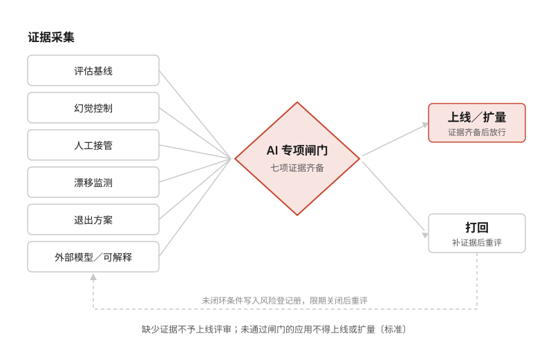

<!-- Diátaxis: How-to -->
# 第 32 章　AI 风险治理动作

> 本章把[第 31 章](ch31-ai-risk-governance.md)的风险解析转成可执行治理动作。目标有三层。先建立应用台账并识别高风险场景。再守住上线闸门和漂移监测。最后保护数据边界，保留问责证据，并把风险纳入治理节奏。本章为 How-to。监管坐标以第 31 章的 2026-10-23 时点为基础。落地前由客户合规部门确认最新口径。

## 32.1 前置条件与目标

开始前确认以下输入。缺项时先补齐，或登记为治理风险。

| 前置条件 | 检查内容 | 缺项处理 |
| --- | --- | --- |
| AI 应用台账 | 场景、模型、版本、提供方、环境和 Owner | 先建立最小台账 |
| 风险分级 | 高、中、低风险判定口径 | 与客户风险合规确认 |
| 数据分级 | 输入、输出、训练和留存的授权范围 | 建立数据流图 |
| 评估基线 | 幻觉率、合格率、拒答率、分群效果 | 补测评或暂停高风险上线 |
| 变更记录 | 模型、提示词、知识库和检索配置 | 纳入版本管理 |
| 人工节点 | 复核、否决、接管和停用岗位 | 书面指定并验证真实性 |
| 监管接口 | 客户合规、风控、法务和报送路径 | 与客户接口确认 |
| 供应商证据 | 备案、数据条款、集中度和退出能力 | 纳入选型评审 |
| 事件复盘 | AI 相关事件的根因分析（Root Cause Analysis，RCA）口径 | 使用[模板 07](tpl-07-rca-template.md)并加 AI 专项 |

完成标志有六项。应用在册。风险分级。闸门有证据。漂移有监测。边界有控制。责任有链路。

| 目标 | 完成标志 | 主要证据 |
| --- | --- | --- |
| 应用可见 | 每个 AI 应用有 Owner 和风险级别 | AI 应用台账 |
| 上线可控 | 高风险应用通过闸门 | 评估、审批和回退记录 |
| 漂移可测 | 基线、复测和分布监控运行 | 评估报告与告警 |
| 数据合规 | 训练、推理、提示词和检索链路受控 | 数据流图与授权记录 |
| 问责可追 | 输入、输出、复核和版本可还原 | 留痕链路 |
| 风险在册 | AI 风险进入风险登记册 | 风险条目与缓解措施 |

## 32.2 操作一：建立台账并识别高风险

### 操作步骤

1. 盘点生产、试点和影子运行的 AI 应用。
2. 记录场景、用户、决策类型、模型来源、版本和 Owner。
3. 标记数据范围：公开、内部、客户、个人信息或生产数据。
4. 标记动作类型：只读、生成、辅助决策、直接执行或资金相关。
5. 识别高风险场景。重点覆盖资金交易、资产评估、信贷审批、承保理赔和风险管理。直接影响客户权益的场景一并纳入。
6. 对高风险应用核对三项治理证据。它们是风险管理委员会审批、人工监督节点、退出与替代流程。
7. 对面向公众或高风险场景的生成式应用，确认监管报告状态。
8. 每月刷新台账。模型、场景、Owner 或数据范围变化时即时刷新。

### 判定表

| 问题 | 是 | 否 |
| --- | --- | --- |
| 是否直接影响客户权益或金融合约？ | 按高风险处理 | 进入中低风险评估 |
| 是否涉及资金、信贷、理赔、定价或风控？ | 按高风险处理 | 继续下一问 |
| 错误输出是否可能造成资损或合规后果？ | 按高风险处理 | 继续下一问 |
| 是否面向公众或自动执行？ | 提高复核强度 | 可按中低风险试点 |

## 32.3 操作二：守住上线闸门

高风险应用必须过 AI 专项闸门。缺少证据不予上线评审。

| 闸门项 | 通过标准 | 证据 |
| --- | --- | --- |
| 评估基线 | 业务评估集达到约定红线，且不劣于现版本 | 评估报告 |
| 幻觉控制 | 锚定、引用、拒答和人工兜底策略明确 | 策略签字与抽测 |
| 人工接管 | 接管点真实存在，坐席和权限可承载 | 流程与容量测算 |
| 漂移监测 | 基线、复测频率和输入分布监控就绪 | 监测配置 |
| 退出方案 | 紧急停用和替代流程已定义 | 预案与演练记录 |
| 外部模型 | 备案、数据条款和集中度评估完成 | 供应商证明 |
| 可解释性 | 高风险决策能说明依据并保留轨迹 | 样例追溯记录 |

### 操作步骤

1. 核对评估集是否来自客户业务样本。
2. 核对判定标准是否由业务和风险合规签署。
3. 检查幻觉率、事实合格率、拒答率和人工接管率。
4. 检查降级链路：主模型、备用模型、规则引擎或人工通道。
5. 检查紧急停用开关、授权人和替代流程。
6. 对外部模型索取备案或合规证明。
7. 将未闭环条件写入风险登记册，指定 Owner 和期限。
8. 未通过闸门的应用不得上线或扩量。

## 32.4 操作三：监测漂移与版本变化

### 操作步骤

1. 上线时冻结评估集版本，记录基线分数。
2. 记录指标：事实合格率、拒答率、分群效果、人工接管率和成本。
3. 对关键输入建立分布监控。可用群体稳定性指数（Population Stability Index，PSI）等指标提示变化。
4. 按风险级别设定复测频率。高风险建议周度或双周，中低风险可月度或季度。
5. 模型、提示词、知识库或检索配置变更后，重新执行回归评估。
6. 厂商模型升级、降级或停用时，按新版本重新过基线。
7. 劣化超阈值即触发预案。可选动作有收窄流量、切换版本、启用人工通道或回退。
8. 将漂移事件写入事件记录，并联动风险登记册。

### 判读口径

| 信号 | 可能含义 | 处理方向 |
| --- | --- | --- |
| 评估分数下降 | 模型或任务分布变化 | 复测、回退或重训 |
| 输入分布变化 | 客群、渠道或上游口径变化 | 核对业务和上游系统 |
| 拒答率上升 | 知识、策略或检索变化 | 检查知识库和拒答策略 |
| 分群效果恶化 | 样本偏差或特征偏差 | 分群评估并暂停高风险扩量 |
| 成本异常上升 | 循环调用或上下文膨胀 | 联动容量与成本治理 |

## 32.5 操作四：评审数据流与提示词边界

### 操作步骤

1. 画两张图：训练数据流图和推理提示词流图。
2. 逐节点标注数据级别、系统、授权和留存期限。
3. 对照三档边界检查三类环境。它们是公网模型、企业隔离模型和客户环境内自建模型。
4. 确认训练链路不含禁止使用的个人信息和隐私数据。
5. 确认推理链路的数据使用范围、脱敏方式和授权记录。
6. 检查提示词是否携带客户文档、日志、账号或业务数字。
7. 检查检索内容是否来自网页、邮件或工单等不可信来源。
8. 验证指令隔离、内容过滤、来源引用和越权阻断。
9. 对提示词、检索配置、知识库和评估集做版本管理。
10. 将边界缺口写入风险登记册，并指定整改期限。

### 数据边界判定

| 问题 | 不通过的处理 |
| --- | --- |
| 数据是否进入未授权模型？ | 停用链路，删除记录并上报 |
| 是否有客户书面授权？ | 不得接入真实数据 |
| 脱敏是否可验证？ | 不得进入试点或生产 |
| 输出是否会外发给客户或第三方？ | 增加人审和口径控制 |
| 检索内容是否包含不可信外部文本？ | 增加过滤、隔离和注入测试 |

## 32.6 操作五：检查人工复核与退出能力

### 操作步骤

1. 对每个高风险决策点画人工节点。
2. 确认复核人有权限、时间和能力否决 AI 结果。
3. 抽查复核记录：谁复核、何时复核、依据是什么。
4. 观察效率压力是否架空复核节点。
5. 定义紧急停用条件、授权人和通知路径。
6. 定义模型退出后的替代流程：旧模型、规则引擎或人工通道。
7. 将退出预案写入应急预案库。
8. 纳入年度演练。演练后修订停用和替代步骤。

### 检查表

| 检查项 | 通过标准 |
| --- | --- |
| 复核授权 | 复核人可否决 AI 结果 |
| 复核真实性 | 有记录、有时间、有依据 |
| 坐席能力 | 转人工量可承载 |
| 停用授权 | 停用人、条件和通知路径明确 |
| 替代流程 | 停用后业务可继续 |
| 演练 | 至少完成桌面或实战验证 |
| 证据留存 | 输入、输出、复核和版本可回放 |

## 32.7 操作六：完成 AI 事件复盘

### 操作步骤

1. 先冻结证据。范围包括输入、输出、复核记录，以及模型、提示词和知识库版本。
2. 核对事件时点前后的变更记录。范围包括模型、提示词、知识库和检索配置。
3. 检查输入分布是否偏离基线。
4. 检查幻觉、漂移、偏见、注入或权限问题。
5. 检查人工复核节点是否实际执行。
6. 按 RCA 模板完成根因、影响、时间线和改进项。
7. 每类根因配一类改进项，并指定验证方式。
8. 将同类风险扫描结果写入风险登记册。

### AI 事件必查表

| 检查项 | 判读问题 |
| --- | --- |
| 版本 | 当时模型、提示词、知识库和检索配置是什么？ |
| 输入 | 当时输入是否离开基线？ |
| 输出 | 错误输出是否有人引用、执行或外发？ |
| 复核 | 人工节点是否存在并实际执行？ |
| 边界 | 是否触犯数据、提示词或供应商边界？ |
| 变更 | 事件前是否有模型、知识或配置变更？ |

## 32.8 操作七：管理供应商与合同证据

### 操作步骤

1. 建立外部 AI 供应商清单。
2. 核对备案证明、安全资质、数据条款和支持窗口。
3. 确认供应商是否使用客户数据训练自有模型。
4. 确认模型版本通知、停用通知和迁移支持义务。
5. 评估集中度风险。关键业务不要依赖单一不可替代供应商。
6. 核对退出成本、数据导出格式和历史迁移能力。
7. 将供应商证据保存到选型和年度复验档案。
8. 供应商变更、停服或条款变化时，触发风险登记册复审。

## 32.9 操作八：纳入风险登记册与治理节奏

### 操作步骤

1. 为每类 AI 风险建立至少一条在册风险。覆盖幻觉、漂移、偏见、注入和供应商集中度。
2. 每条风险写明影响场景、Owner、缓解动作、验证方式和复审日期。
3. 将高风险应用状态纳入月度服务评审。
4. 将漂移监测、复核抽检和供应商复审纳入季度治理。
5. 将 AI 相关事件纳入复盘机制。
6. 将闸门证据、留痕链路和退出演练纳入年度审计。
7. 治理口径变化时，刷新台账和风险条目。
8. 监管材料以[第 31 章](ch31-ai-risk-governance.md)时点声明为准，正式引用前由合规部门复核。

## 32.10 验收标准

| 验收项 | 通过标准 | 验证方式 |
| --- | --- | --- |
| 应用台账 | AI 应用全覆盖，Owner 和风险级别明确 | 抽查台账与生产系统 |
| 高风险识别 | 高风险场景有审批、报告和人工节点 | 核对判定表与审批记录 |
| 上线闸门 | 评估、回退、接管和外部模型证据齐备 | 抽查闸门记录 |
| 漂移监测 | 基线、复测和分布监控运行 | 核对报告与告警 |
| 数据边界 | 训练、推理、提示词和检索链路受控 | 核对数据流图 |
| 人工复核 | 复核真实、记录完整、节点未架空 | 抽查复核记录 |
| 退出能力 | 停用和替代流程有授权并演练 | 核对预案与演练 |
| 供应商治理 | 备案、条款、集中度和退出有档案 | 核对供应商清单 |
| 留痕链路 | 输入、输出、复核和版本可还原 | 抽样回放 |
| 风险在册 | AI 风险进入风险登记册并有缓解措施 | 核对[模板 09](tpl-09-risk-register.md) |

关键项有六项：高风险识别、上线闸门、数据边界。人工复核、退出能力和留痕链路同样关键。任一关键项未通过，不得视为 AI 风险治理合格。

## 32.11 执行故障排查

| 症状 | 常见原因 | 处理动作 |
| --- | --- | --- |
| AI 应用数量说不清 | 无台账或影子应用 | 停止扩量，先盘点 |
| 高风险场景漏识别 | 判定口径不清 | 用判定表逐项过筛 |
| 上线后发现幻觉 | 评估集不代表业务或无抽检 | 补业务样本并加强抽检 |
| 效果缓慢变差 | 漂移监测缺失 | 补基线、复测和分布监控 |
| 复核形同虚设 | 效率压力或授权不清 | 重建节点并抽查记录 |
| 事件无法解释 | 输入、输出或版本缺失 | 修复留痕链路 |
| 外部模型停用影响业务 | 无退出预案或备模型 | 启用人工通道，补演练 |
| 数据边界说不清 | 训练与推理链路未分开画图 | 重建两张数据流图 |
| 供应商条款冲突 | 合同未约定训练与留存 | 提交采购与法务复审 |
| 风险登记册无 AI 条目 | 治理未进入例行节奏 | 建立最低五类风险条目 |

反复出现的问题进入复盘流程。

## 32.12 执行检查清单

- [ ] AI 应用台账覆盖生产、试点和影子应用
- [ ] 高风险场景已识别并完成审批
- [ ] 上线闸门包含评估、人工接管、退出和外部模型证据
- [ ] 漂移基线、复测和分布监控已运行
- [ ] 模型、提示词、知识库和检索配置有版本记录
- [ ] 训练与推理数据链路均已过边界评审
- [ ] 提示词按数据级别管理，注入测试有记录
- [ ] 人工复核有授权、记录和抽检
- [ ] 紧急停用与替代流程已演练
- [ ] 外部模型有备案、数据条款和集中度评估
- [ ] 输入、输出、复核和版本可回放
- [ ] AI 风险已进入风险登记册

---

**本章要点回顾**

1. 治理从台账开始。没有应用清单，就没有风险分级和问责链。
2. 高风险应用必须过闸门。评估、人工接管、退出和外部模型证据不可缺失。
3. 漂移靠基线、复测、分布监控和版本复评发现。
4. 数据治理要分别评审训练链路和推理提示词链路。
5. 人工节点必须真实有效。复核记录是问责链的核心。
6. 退出能力必须部署前具备，并纳入演练。
7. AI 事件复盘要检查版本、输入漂移和配置变化。它还要确认人工节点实际执行。
8. 治理终点不是报告。终点是风险登记册中的在册条目，以及可验证的缓解措施。