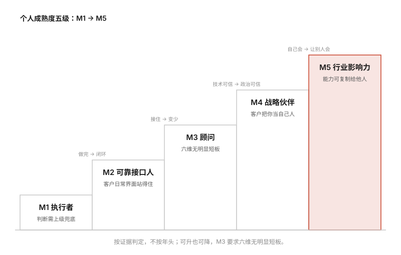

<!-- Diátaxis: Reference -->
# 第 36 章　TAM 成熟度模型

> [第 34 章](ch34-measurement-system.md)解决了“怎么量”，本章解决“量完怎么读”。成熟度模型是全书的通用标尺。[附录 G](appx-g-tam-work-evaluation-standard.md) 的评估等级（S–D）锚定在本章的个人五级（M1–M5）上。[附录 N](appx-n-tam-onsite-certification.md) 的驻场认证（C1–C3）同样锚定。[附录 O](appx-o-tam-onsite-promotion-standard.md) 的晋升通道、[附录 J](appx-j-enablement-training-standard.md) 的培训分级（T1–T3）也一样。[模板 12](tpl-12-tam-self-assessment.md) 的自检得分率也锚定这里。[附录 AD](appx-ad-career-lifecycle-guide.md) 的职业周期六级（CL1–CL6）同样对齐本章 M 级。本章定义标尺本身，别处只映射、不另立。

## 36.1 定位与三原则

没有成熟度模型的团队，谈论人的成长只用两个词：“行”和“不行”。这导致三个系统性问题。晋升靠年头和感觉。能者多劳到职业倦怠（burnout，分层处置见[附录 AD](appx-ad-career-lifecycle-guide.md)）。培训一刀切。

成熟度模型的价值不是给人贴标签，而是提供一套**共同语言**。让团队能具体讨论“他还差什么”。客户分配、排班授权、培训投入由此有据可依。

三条定位原则：

1. **成熟度是能力标尺，不是职称体系**。它描述“你能可靠承担多大的场面”。它不与薪酬等级直接挂钩。薪酬接口是 HR 体系的事（[第 37 章](ch37-career-team-building.md)谈接口）；
2. **成熟度按证据判定，不按年头**：五年重复一年经验的人仍是 M2。判定依据是可核验的行为与结果证据。[附录 O](appx-o-tam-onsite-promotion-standard.md) 的晋升证据标准与本章同源；
3. **成熟度是动态的**：可以升，也可以降。长期脱离一线、证据链断裂的 M4 应回到 M3 重新积累。降档不是惩罚，是对客户负责。

## 36.2 个人五级：M1–M5

| 级别 | 名称 | 一句话定义 | 可独立承担 |
| --- | --- | --- | --- |
| M1 | 执行者 | 按指令和模板完成标准动作，判断需上级兜底 | 长尾客户辅岗；不可独立值班 M2 以上班次 |
| M2 | 可靠接口人 | 流程执行可靠、升级及时，客户日常界面站得住 | 独立承担一般客户；独立值 M2 班（[附录 I](appx-i-on-duty-standard.md)） |
| M3 | 顾问 | 主动预防、能设计服务方案，六维无明显短板 | 独立承担重点客户；架构评审与重保骨干 |
| M4 | 战略伙伴 | 高层对话、跨厂商仲裁、风险预判，客户把你当自己人 | 金融级/旗舰级客户；Go/No-Go 唱票权 |
| M5 | 行业影响力 | 方法论输出者与标准制定者，能力可复制给他人 | 带团队、定标准、对外发声（本书附录系列即 M5 产出形态） |

**各级的跃迁标志与常见误判**：

- **M1 → M2：从“做完”到“闭环”**。行动项不用人催。交接不用人问。异常知道升级。误判：把“态度好、响应快”当 M2。流程闭环证据为零的不算；
- **M2 → M3：从“接住问题”到“问题变少”**。风险登记册里有他主动录入的项。健康检查产出获客户采纳。误判：把“工龄够、客户熟”当 M3。只会救火不会预防的仍是 M2；
- **M3 → M4：从“技术可信”到“政治可信”**。客户高层决策前会私下问他的意见。跨团队冲突中各方接受他的仲裁。误判：把“技术最强”当 M4。M4 的核心增量在判断力与信任资产（[第 4 章](ch04-ai-era-tam-redefined.md)）；
- **M4 → M5：从“自己会”到“让别人会”**。有沉淀的方法论。有可复制的打法。有带出来的 M3。误判：把“名气大、PPT 好”当 M5。没有可核验的他人成长证据不算。

**各级证据口径**：

| 级别 | 典型证据 | 不算证据 |
| --- | --- | --- |
| M1 | 模板动作完成记录、工单闭环记录 | 态度评价、加班时长 |
| M2 | 闭环率、升级及时记录、客户日常反馈 | 工龄、客户熟悉度 |
| M3 | 主动录入的风险条目、获采纳的健康检查、评审报告 | 救火次数、技术难题攻关 |
| M4 | 高层互动记录、仲裁案例、预判命中记录 | 单项技术深度、内部人气 |
| M5 | 方法论文档、带教成长记录、对外输出记录 | 知名度、演讲场次 |

**六维与级别的关系**：要分清内容维度与综合高度。六维能力（[第 5 章](ch05-technical-depth.md)–[第 16 章](ch16-project-change-practical.md)）与 AI 杠杆是评价的内容维度。M1–M5 是综合高度。M3 要求六维无短板。单项最低 3 分，对齐[附录 G](appx-g-tam-work-evaluation-standard.md) 的 B 级线。M4 以上允许有短板。但必须有明确长板，且短板不触红线。

## 36.3 标尺映射表（全书唯一映射事实源）

各体系与 M1–M5 的对齐关系统一在本表，修订只改这里：

| 体系 | 映射 | 出处 |
| --- | --- | --- |
| [附录 G](appx-g-tam-work-evaluation-standard.md) 评估等级 | S ↔ M5；A ↔ M4；B ↔ M3；C ↔ M2；D ↔ M1 及以下 | 附录 G.6.2 |
| [附录 N](appx-n-tam-onsite-certification.md) 驻场认证 | C1 ↔ M1–M2；C2 ↔ M3；C3 ↔ M4 | 附录 N.1 |
| [附录 O](appx-o-tam-onsite-promotion-standard.md) 晋升通道 | C3（≈M4）后分专家/现场管理双通道，晋升看四块证据 | 附录 O |
| [附录 J](appx-j-enablement-training-standard.md) 培训分级 | T1 → 达成 M1、辅岗 M2；T2 → 稳固 M3（B 级）；T3 → 冲击 M4–M5（A/S 级） | 附录 J.4 |
| [模板 12](tpl-12-tam-self-assessment.md) 自检得分率 | <50% ≈ M1；50–70% ≈ M2；70–85% ≈ M3；85–95% ≈ M4；>95% ≈ M5 候选 | 模板 12 计分表 |
| 服务模式（Service Model，SM）阶梯 | SM 评“服务系统跑到哪级”，M 评“你能把它推到哪级”，两轴独立 | [第 30 章](ch30-service-model-evolution.md) |
| 六维行为锚点（L1.1–L1.6，各维 L1–L5） | M1 → 六维在指导下产出；M2 → 六维独立执行；M3 → 各维 ≥ L3 且无短板；M4 → 长板 ≥ L4、短板不触红线；M5 → 至少一维 L5 可复制 | [第 5 章](ch05-technical-depth.md)–[第 16 章](ch16-project-change-practical.md) 各维分级节；逐格证据见 36.8 |

**分工一句话**：M1–M5 是标尺，本章定义。[附录 G](appx-g-tam-work-evaluation-standard.md) 管成绩，回答干得怎么样。[附录 N](appx-n-tam-onsite-certification.md)/[附录 O](appx-o-tam-onsite-promotion-standard.md) 管授权与发展，回答能放多大场面、往哪走。[模板 12](tpl-12-tam-self-assessment.md) 管自查，回答自己在哪。四者同源不同用，禁止用任一替代其他。

## 36.4 团队五级

个人有标尺，团队也有。团队成熟度不看个体之和，看**体系是否大于个体**：

| 级别 | 名称 | 判定特征 |
| --- | --- | --- |
| 一级 | 应急队 | 服务质量系于个别骨干，骨干休假质量塌方 |
| 二级 | 标准化 | 有流程有模板，新人能按图索骥；执行质量仍看人 |
| 三级 | 体系化 | 流程闭环有度量（[第 34 章](ch34-measurement-system.md)口径落地），质量不依赖个人在场 |
| 四级 | 数据驱动 | 健康分、质量记分卡驱动资源分配与预防动作；指标防异化机制在运转 |
| 五级 | 行业输出 | 方法论对外输出（标准、白皮书、行业分享），团队成为招聘磁石 |

团队级别判定看三样：骨干依赖度、流程闭环率、指标取数方式。跃迁纪律与个人同理：按证据不按年头。最常见的自欺是把“买了平台”当三级。平台闲置率 80% 的团队仍是二级。

## 36.5 使用纪律

1. **评定与校准**：个人级别由直属主管初评。跨主管校准会定级。与[附录 G](appx-g-tam-work-evaluation-standard.md) 年度评估合并进行，一次证据两处使用。自评（[模板 12](tpl-12-tam-self-assessment.md)）是输入不是结论；
2. **客户分配挂钩**：M3 以下不独立承担 AA 级/金融核心客户。授权例外须服务总监书面批准并限期。边界与[附录 N](appx-n-tam-onsite-certification.md) 一致；
3. **降级机制**：连续两年证据不足的，降级重评。触发[附录 G](appx-g-tam-work-evaluation-standard.md) 否决条款的同样处理。降级记录不公开示众。但对排班与客户分配即时生效；
4. **禁止拔苗**：为填客户坑把 M2 推上 M4 场面，是双重不负责。对员工和客户都是。场面缺口靠组织资源补。增援、驻场组、服务模式调整都算。不靠个人越级硬扛。

## 36.6 常见误区

1. **把成熟度当年功**：到年限就提名，证据链空空。[附录 O](appx-o-tam-onsite-promotion-standard.md) 已明确：破格只破年限，不破证据；
2. **用 M5 标准要求所有人**：团队健康结构是正态分布。全员 M4 的幻觉以职业倦怠收场；
3. **级别终身制**：评上 M4 就永久占据旗舰客户，能力退化无人问津。降级机制是模型可信的前提；
4. **团队级别贴金**：汇报材料写“四级团队”。翻开指标全是手工填报。先过[第 34 章](ch34-measurement-system.md) 的取数纪律，再谈级别。

## 36.7 成熟度模型的三类失效

模型有前提。前提不成立，模型就退化成标签。三类失效，各给识别信号。

**失效一：变成职称。**

成熟度一旦与薪酬硬挂钩，评审会就变成谈判桌。讨论焦点从“证据够不够”滑向“年限到了没有”。

识别信号：评审记录里出现“今年该轮到他了”。这句话一出现，模型已经失效。处置办法是把定级与调薪拆成两个会。定级会只看证据。调薪会另开。

**失效二：证据表演化。**

按证据判定，前提是证据可信。会写材料的人升级快，是这类模型的通病。述职材料做得漂亮，客户访谈一问三不知。

识别信号：候选人的材料厚度与客户侧评价对不上。处置办法只有一条。客户访谈独立做，不问主管要名单。

**失效三：标尺落后于业务。**

五级定义写于云服务时代。“能独立承担多大场面”的“场面”在变。AI 原生服务进场后，M3 要面对的场面变了。可能是一场没有先例的模型效果争议。旧定义里没有这一项。

识别信号：连续两届评审，评委都在讨论定义之外的情况。这说明标尺该修订。

**模型还有一个隐含假设。**

它假设组织有稳定的岗位序列。项目制、外包制、矩阵制的组织里，“级别”本身就不稳定。此时模型的用处不是定级，是提供一套讨论能力的词。别硬套。

三条都失效时怎么办？回到模型的初衷。它只是让人能具体讨论“还差什么”。讨论能发生，模型就有用。讨论变成走过场，就该推倒重来。

## 36.8 六维 × M1–M5 证据口径表

M 级量综合高度，六维量内容短板，两把尺要钉在一起读。本节给出逐格证据口径。六维锚点由各维主章自定义，本节只引用、不重述。出处 [第 5 章](ch05-technical-depth.md)（5.5）、[第 7 章](ch07-business-insight.md)（7.6）、[第 9 章](ch09-relationship-management.md)（9.5）、[第 11 章](ch11-service-governance.md)（11.6）、[第 13 章](ch13-risk-compliance.md)（13.5）、[第 15 章](ch15-project-change.md)（15.5）。权重不在本节争：六维与 AI 杠杆的权重以[附录 G](appx-g-tam-work-evaluation-standard.md) 评分表为准。

| 维度（锚点出处） | M1 | M2 | M3 | M4 | M5 |
| --- | --- | --- | --- | --- | --- |
| 技术纵深（5.5） | 指导下读懂图与大盘 | 评审中提问获认可 | 独立评审可署名 | 规范获客户采用 | 跨客户复用并带教 |
| 业务洞察（7.6） | 业务会议不卡壳 | 项目挂上业务目标 | 管理层引用其翻译 | 动作先于客户提出 | 建议进入预算规划 |
| 关系经营（9.5） | 关键人地图在手 | 三层覆盖到位 | 决策前获征询 | 获引荐进更大决策圈 | 多客户网络可复制 |
| 服务治理（11.6） | 按模板执行记录齐 | 计划质检自运转 | 口径清晰、系统取数 | 数据驱动预判 | 框架推广为多客户标准 |
| 风险与合规（13.5） | 指导下识别、写出事实 | 四要素独立登记 | 署名条目推闭环 | 机制无人催仍闭环 | 风险纪律红线成基线 |
| 项目与变革（15.5） | 按时提交交付物 | 闸门记录完整不丢项 | 关键闸门有署名意见 | 高压下仍守闸门 | 治理标准获多项目采用 |

格怎么读：格内证据成立，该维才算够到对应档。M 级由六维合读得出。M3 有无短板门，单维高分抬不过这道门（36.2）。

风险与合规、项目与变革是后加入的两维，最易空心。它们的证据再放一层细目：

| M 级 | 风险与合规要看到什么（锚 13.5） | 项目与变革要看到什么（锚 15.5） |
| --- | --- | --- |
| M1 | 条目含事实，扫描线有产出记录 | 交付物按时且完整，提交记录可查 |
| M2 | 四要素独立成条，复审不断档 | 闸门记录完整，条件项零丢失 |
| M3 | 条目可署名，闭环到关闭且过验证 | 关键闸门有其署名的技术意见 |
| M4 | 三道扫描线与例会节奏，无人催仍闭环 | 节奏、闸门、仲裁规则在高压下仍守得住 |
| M5 | 风险纪律与红线获其他团队采用为基线 | 治理标准获多项目采用为基线 |

两维的跃迁同构：L3 分责任，L4 分杠杆（[第 13 章](ch13-risk-compliance.md) 13.5、[第 15 章](ch15-project-change.md) 15.5）。其余四维在 M3 的证据各是一句话。可署名的评审（5.5）、管理层引用的翻译（7.6）。关系与治理看运行：决策前征询（9.5）、系统取数的闭环（11.6）。

此表管证据读法，不管权重。样本不足的维度按证据不足处理，不按成立处理。一个季度只见一两个场景，撑不起一档。就低不就高，下季再评。

## 36.9 跃迁的量化判据

升级不是一次打分，是证据期的结论。判据有四件：时间窗、证据量、复核人、回退规则。四件全为〔建议值〕，各团队可自校准。缺任何一件，升级就退回凭感觉。

| 判据 | 口径 | 失效时的处置 |
| --- | --- | --- |
| 证据时间窗 | 连续两个季度〔建议值〕证据成立才可定级；单季证据只算提名 | 窗口中断，重新起算 |
| 证据量 | 每次跃迁至少 3 项〔建议值〕可核验证据；来源至少 2 处〔建议值〕，其中至少 1 处〔建议值〕来自客户侧 | 证据同源，合为 1 项计 |
| 复核人 | 直属主管初评，跨主管校准会复核；评委中非直属者至少 2 人〔建议值〕 | 有利害关系，回避换人 |
| 推翻回退 | 校准会推翻初评后，一律按低级别执行；已承诺的场面即时收回 | 重新积累至少一个季度〔建议值〕再提名 |
| 降级窗口 | 沿用 36.5 的连续两年口径，短窗不适用 | 见 36.5 |

两个窗口故意不对称。升级窗口短，收益快兑现。降级窗口长，偶发低谷不误伤。代价是退化判定慢一拍。窗口期内，场面授权按季复评收紧（36.5），不让代价落到客户身上。

推翻不止发生在升级。初评 M4、校准降为 M3 的，同样按低者对外。理由写进纪要，避免两级说法。

## 36.10 团队五级的量化阈值

36.4 给了团队五级的特征。本节把三样判定要素换成可算的数。三样是骨干依赖度、流程闭环率、指标取数方式。下表阈值全为〔建议值〕，按团队规模与客户等级自校准。

口径先立三条。单点依赖率的分子，是仅骨干能处置的场景数。分母是关键场景总数，相除即得（算术可复算）。流程闭环率沿用[第 34 章](ch34-measurement-system.md) 的取数口径，不另立。指标取数方式先分两档：人工填报、系统直出。介于两档之间的，记为人工填报加抽样回源。

| 级别 | 单点依赖率 | 流程闭环率 | 指标取数方式 |
| --- | --- | --- | --- |
| 一级（应急队） | ≥50% | 无台账，无口径 | 人工估报 |
| 二级（标准化） | ≤40% | ≥60% | 人工填报加抽样回源 |
| 三级（体系化） | ≤20% | ≥80% | 系统直出 ≥80% |
| 四级（数据驱动） | ≤10% | ≥90% | 系统直出 ≥95% |
| 五级（行业输出） | ≤5% | ≥95% | 全部系统直出，防异化机制在运转 |

三级是分水岭。翻转发生在取数方式上。从人报翻到系统取，数字才有作证资格。买了平台不翻转取数方式。36.4 说闲置平台的团队仍是二级，根子在这。

阈值不是自然常数。五人小队的单点依赖率天然偏高，一人休假即成单点。这类团队标观察中，不硬评级别（36.13）。个人与团队也不必同频：全组 M3、团队二级正常——体系没跟上而已。

## 36.11 双人背对背评分与校准

单人打分，级别随打分人漂移。背对背是最低成本的防漂移装置。流程四步，时限与目标值全为〔建议值〕。

| 阶段 | 动作 | 时限与口径〔建议值〕 |
| --- | --- | --- |
| 独立打分 | 两名评委按同一版证据清单各自打分，互不通气 | 校准会前 3 个工作日完成 |
| 差 ≤1 级 | 按就低原则取值，差异写入纪要 | 当场定案 |
| 分歧 >1 级 | 暂停定级；两人各列证据引用；第三评委复核原始证据后仲裁 | 会后 5 个工作日内完成 |
| 一致率复盘 | 校准会主席汇总本周期一致率并公示 | 每周期 1 次 |

就低不就高，理由写在明处。定级虚高的代价落在客户身上，与 36.5 禁止拔苗同向。仲裁期间按低者授权：客户分配与排班不等结论。

一致率的口径是道算术题。一致率 = 分歧 ≤1 级的子项数 ÷ 评分子项总数（算术可复算）。目标 ≥80%。连续两周期低于 70%，评委重做校准培训。该周期的定级结果全量复核。

一致率高不等于打得准。两个评委沿同一份有偏证据打分，会高度一致。所以一致率只管分歧大小，不替代客户访谈。36.7 失效二的解法仍然有效。

## 36.12 三则误判反例

反例比定义更能划清边界。三则取自评审实录，已脱敏。每则对应模型的一条规则。读时对号入座，比背定义快。

**反例一：把证书当 M 级证据。** 四张认证，材料厚厚一叠。答辩时讲不清自家客户的架构与台账。证书记录考试成绩，不记录工作场面。附录 J 管培训等级，M 级管场面，36.3 写明两把尺的换算。拿证书充证据，评审会只能退回。当事人补了两个季度现场证据，才过 M3。

**反例二：一次大项目成功直接跳级。** 骨干做完一次重保，直接提名 M4。项目确实成功，成功却靠全组兜底，他执行分到的环节。单次事件是特例，级别看稳定面。36.9 的两个季度窗口里，这一回只算一项证据。它撑不起 M4 要的机制与信任。全组兜底的成功，记在团队账上，记不到个人 M4 账上。先按 M3 跑满窗口再评。

**反例三：团队平均分掩盖单点依赖。** 五人团队的平均分压着三级线。拆开看：两名新人停在 L1，全部关键系统系于一人。平均分抹平分布，体系化看的偏偏是短板与单点。36.10 的单点依赖率一票否决——均值过线、单点 ≥50%〔建议值〕，仍是二级。想上三级，先拆单点，再谈平均。

## 36.13 适用边界：模型不评什么

标尺只量该量的。越界使用，共同语言会变成误导工具。三条不适用，各给替代出口。

**一不评技术深度本身。** M 级量岗位综合高度，技术深浅由附录 G 的 L1.1 锚点与 5.5 分维评定。拿 M 级反推技术，会重演 36.2 的误判：把技术最强读成 M4。替代出口是技术答辩，结论回填附录 G。

**二不替代绩效考核。** 绩效回答这期产出多少，成熟度回答能承担多大场面。M4 淡季产出平平，绩效低不构成降级理由。降级只认 36.5 的证据链断裂。两者混用，评审会重演 36.7 失效一的谈判桌。

**三不硬评样本不足的新团队。** 样本不足有两条判据。其一，团队成立不足两个季度〔建议值〕。其二，可评关键场景 ≤3 个〔建议值〕。样本不足的团队标观察中，注明缺哪类样本。观察期不进汇报口径。硬评出来的不是级别，是随机数。

观察不是免检。观察期照常攒证据，样本一够即评。把观察中拖成常驻标签，等于换姿势不评。

## 36.14 AI 对成熟度判定的增量

AI 改变判定的作业方式，不改变判定的权力结构。先说三件改变，再说三件没变，最后一条边界。改变的都关于效率，不变的都关于授权。

**改变的三件事。** 其一，证据自动归集。工单闭环、评审结论、闸门记录从系统直出。述职季的手工整理退场，证据从自述转为台账。其二，行为锚点更可观察。L 级锚点本要可观察行为。响应时长、条目质量与参与轮次开始留痕。其三，校准会材料预生成。每人证据摘要与评分差异表先出，评委时间只花在分歧上。

**没变的三件事。** 判定权没变：AI 出材料，定级是校准会的合议结论，AI 不进签字链。回溯要求没变：摘要每条点回原始工单，回不去的不算证据。降级机制没变：活跃度替代不了证据链，推荐级别无授权效力。

**一条边界。** AI 归集的证据要抽查回源〔建议值：每周期每人至少抽查 3 条〕。模型会把“活跃”当“有效”：发言多只说明出现得多，不说明证据强。活跃是过程量，证据是结果量。摘要与原始记录对不上的，当期该条作废，按手工证据重计。这与[第 15 章](ch15-project-change.md) 15.6 的回源纪律同构——自动化最怕精确地错。

---

**本章要点回顾**

1. 成熟度模型是共同语言。让“还差什么”可讨论，让客户分配、授权、培训有据。按证据不按年头，可升也可降。
2. 个人五级：执行者、可靠接口人、顾问、战略伙伴、行业影响力。跃迁标志是四个转变。做完→闭环、接住→变少。技术可信→政治可信、自己会→让别人会。
3. 36.3 映射表是全书唯一映射事实源。附录 G（S–D）、N（C1–C3）、O、J（T1–T3）、模板 12 得分率与六维锚点统一锚定 M1–M5。标尺、成绩、授权、自查四者同源不同用。
4. 团队五级看体系是否大于个体。应急队、标准化、体系化、数据驱动、行业输出。买平台不等于体系化。
5. 使用纪律四条：校准定级、分配挂钩、降级机制、禁止拔苗。
6. 四件配套让标尺可操作：六维逐格证据（36.8）、跃迁四判据（36.9）、团队三阈值（36.10）、双人背对背校准（36.11）。
7. 三则反例划出三条禁线：证书不是证据、单次成功不跳级、平均分不抵单点（36.12）。
8. 模型有三条不适用：不评技术深度、不替绩效、不硬评样本不足的新团队（36.13）。AI 改变归集与预生成，不变判定权、回溯与降级（36.14）。
