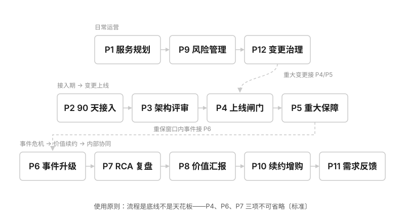

<!-- Diátaxis: Reference -->
# 附录 B　TAM 体系流程与规范

> 本附录是全书 TAM 流程与规范的速查索引。每条流程给出目的、触发、步骤速查、交付物与度量。完整打法见对应章节。可复制实体见 `templates/` 目录。流程编号 P1–P12 全书通用。正文引用“P5”即指重保流程。落地动作与建设顺序见[附录 B](appx-b-tam-process-system.md)。

## B.1 流程地图：一张表看全

十二项核心流程按客户生命周期与协同域分组：

| 编号 | 流程 | 所属域 | 一句话目的 | 对应章节 | 对应模板 |
| --- | --- | --- | --- | --- | --- |
| P1 | 服务规划（Service Planning） | 日常运营 | 把一年的服务动作落成可承诺的计划 | [第 11 章](ch11-service-governance.md) | 模板 01 |
| P2 | Onboarding 90 天 | 接入期 | 新客户或新系统 90 天内进入稳态 | [第 17 章](ch17-customer-lifecycle.md) | 模板 02 |
| P3 | 架构评审 | 变更上线 | 上线或变更前形成独立技术判断 | [第 5 章](ch05-technical-depth.md) | 模板 03 |
| P4 | 上线闸门（Go/No-Go） | 变更上线 | 上线决策有据可依、有人担责 | [第 16 章](ch16-project-change-practical.md) | 模板 04 |
| P5 | 重大保障（重保） | 变更上线 | 确定性窗口内兑现零重大事故 | [第 24 章](ch24-major-assurance.md) | 模板 05 |
| P6 | 事件管理与升级（Escalation） | 事件危机 | 分钟级响应、有序升级、不失控 | [第 18 章](ch18-escalation-crisis.md)、[第 25 章](ch25-financial-incident.md) | 模板 06 |
| P7 | RCA 与事后复盘 | 事件危机 | 根因闭环，把事故变成资产 | [第 25 章](ch25-financial-incident.md) | 模板 07 |
| P8 | QBR/EBR 价值汇报 | 价值续约 | 把技术价值翻译成业务语言 | [第 21 章](ch21-commercial-synergy.md) | 模板 08 |
| P9 | 风险管理 | 日常运营 | 风险在爆发前进入登记册 | [第 14 章](ch14-risk-compliance-practical.md) | 模板 09 |
| P10 | 续约与增购协同 | 价值续约 | 技术信号驱动续约预测与增购识别 | [第 21 章](ch21-commercial-synergy.md) | 模板 10 |
| P11 | 需求与产品反馈回路 | 内部协同 | 客户声音有组织地进入产品路线 | [第 19 章](ch19-internal-collaboration.md) | — |
| P12 | 变更与发布治理 | 日常运营 | 变更可预期、可回退、可追溯 | [第 11 章](ch11-service-governance.md)、[第 23 章](ch23-financial-availability.md) | 模板 04（复用） |

**使用原则：流程是底线，不是天花板。** 十二项是金融级场景的完整集。中小客户可以裁剪投入强度。P4、P6、P7 三项不可省略。它们对应“不可逆损失”场景。

## B.2 核心流程逐项速查

### P1　服务规划（Service Planning）

- **目的**：把服务水平承诺、年度重点、例会节奏写成一份计划；风险处置计划一并纳入，双方签认。
- **触发**：新客户接入后 60 天内首建；此后每半年滚动修订；客户组织或系统重大变化时即时修订。
- **步骤速查**：现状盘点 → 目标对齐 → 动作设计；双方签认 → 例会跟踪。
- **交付物**：《服务计划》（[模板 01](../templates/01-service-plan.md)）。
- **度量**：计划项按期完成率；QBR 是否引用服务计划。没人引用的计划是死文档。

### P2　Onboarding 90 天

- **目的**：在信任窗口期完成三件事。环境可控、关系就位、基线建立。
- **触发**：新客户签约；新系统接入；TAM 换人接手。
- **步骤速查**：1–30 天摸清家底；31–60 天建立机制；61–90 天交付首个价值点。
- **交付物**：90 天清单（[模板 02](../templates/02-onboarding-90d-checklist.md)）；客户技术档案初稿；关键人地图初稿（[模板 11](../templates/11-key-person-map-canvas.md)）。
- **度量**：90 天清单完成率；第 90 天关键人能否说清“TAM 做成了什么”。

### P3　架构评审

- **目的**：对评审对象形成独立技术判断；输出风险与建议，不替客户做设计。
- **触发**：核心系统上线前；重大变更前；年度健康体检；重大事故之后。
- **步骤速查**：输入收集 → 六维评审 → 风险分级；整改跟踪闭环。六维是可用性、扩展性、安全、可运维、成本、合规。
- **交付物**：评审 Checklist 与评审纪要（[模板 03](../templates/03-architecture-review-checklist.md)）。
- **度量**：评审发现项整改闭环率；事故回溯中“评审遗漏”的次数。

### P4　上线闸门（Go/No-Go）

- **目的**：让上线从技术动作升级为共同担责的决策点。
- **触发**：任何生产环境的上线、切换与大规模数据迁移。
- **步骤速查**：检查清单全绿；回退实测过；值守就位；唱票归档。
- **交付物**：Go/No-Go 清单与结论记录（[模板 04](../templates/04-go-nogo-gate-checklist.md)）。
- **度量**：拦住一次问题上线是功劳；Go 后 72 小时事件数看决策质量。

### P5　重大保障（重保）

- **目的**：在确定窗口期，以超常规投入兑现零重大事故。
- **触发**：六类场景。核心上线或切换；周期性业务峰值；重大版本变更；重大活动窗口；监管相关窗口；外部高风险期。
- **步骤速查**：立项 T-30 → 体检 T-21 至 T-7 → 预案演练；值守 T 日 → 复盘 T+7。分级 L1–L4；体检与预案不可裁剪。
- **交付物**：立项书、体检报告、预案与值守手册、复盘报告（[模板 05](../templates/05-major-assurance-checklist.md)）。
- **度量**：窗口内 P1/P2 事件数；预案命中率；复盘改进项闭环率。

### P6　事件管理与升级（Escalation）

- **目的**：事件按时到达正确的人；客户任何时刻都知道状态。
- **触发**：监控告警；客户报障；内部风险信号。
- **步骤速查**：定级 P1–P4 → 首响 → 作战室启动；定时通报 → 恢复确认 → 转 P7。首响时限见 B.3.4。
- **交付物**：事件时间线、客户通报记录、升级矩阵（[模板 06](../templates/06-major-incident-communication-matrix.md)）。
- **度量**：首响达标率、升级及时率、通报及时率。通报延迟比故障更伤信任。

### P7　RCA 与事后复盘

- **目的**：找到系统性根因并闭环改进。根因分析（Root Cause Analysis，RCA）止步于“重启好了”不算数。
- **触发**：P1/P2 事件强制；P3 抽样；客户要求时。
- **步骤速查**：时间线还原 → 根因分析 → 改进项分级；客户汇报 → 闭环跟踪。方法含 5 Whys 与故障树。
- **交付物**：金融级 RCA 报告（[模板 07](../templates/07-rca-template.md)）。
- **度量**：RCA 出具及时率（建议 5 个工作日内）；同类故障复发率应为零。

### P8　QBR/EBR 价值汇报

- **目的**：把服务等级协议（Service Level Agreement，SLA）达成与优化成果翻译成业务价值；事件处置一并纳入叙事。支撑续约决策。
- **触发**：季度业务回顾（Quarterly Business Review，QBR）固定季度节奏；高管业务回顾（Executive Business Review，EBR）按需半年或年度。
- **步骤速查**：数据准备 → 价值叙事 → 会议交付；行动项跟踪。叙事先说业务结果。
- **交付物**：QBR/EBR 材料（[模板 08](../templates/08-qbr-ebr-template.md)）；价值实现报告（Value Realization Report，VBR）。
- **度量**：行动项闭环率；客户高管出席率。出席率是关系温度的硬指标。

### P9　风险管理

- **目的**：让风险在爆发前进入登记册。别等爆发后进通报群。
- **触发**：持续运行；评审、体检、重保立项时集中刷新。
- **步骤速查**：识别 → 登记分级 → 处置计划；例会跟踪 → 关闭或升级。
- **交付物**：风险登记册（[模板 09](../templates/09-risk-register.md)）。
- **度量**：处置后关闭的比例；事件对应已登记风险的比例。

### P10　续约与增购协同

- **目的**：TAM 不背销售指标。技术信号共享给销售与续费团队。
- **触发**：续约前 180 天启动跟踪；用量或健康度异常时即时通报。
- **步骤速查**：健康度评分 → 风险信号识别 → 信号同步；增购技术验证。信号含采用度下降、关键人变动、竞品接触。
- **交付物**：健康度评分卡（[模板 10](../templates/10-customer-health-scorecard.md)）、续约风险评估。
- **度量**：续约预测准确率；技术信号先行发现的占比。

### P11　需求与产品反馈回路

- **目的**：客户声音进入产品路线图。反馈有回音，形成正循环。
- **触发**：客户需求与缺陷；QBR 诉求；行业趋势判断。
- **步骤速查**：场景化记录 → 通道提交 → 状态跟踪；结果反馈客户。结论是“不做”也要说清为什么。
- **交付物**：需求台账、反馈闭环记录。
- **度量**：反馈闭环率；需求进入路线图的比例。

### P12　变更与发布治理

- **目的**：变更可预期、可回退、可追溯。杜绝悄悄改、出事才知道。
- **触发**：持续运行；版本发布、配置变更、参数调整均在内。
- **步骤速查**：申请含回退方案 → 评审分级 → 窗口执行；确认记录；重大变更接 P4/P5。
- **交付物**：变更记录、发布日历。
- **度量**：变更引发事件的比例；冻结期违规变更应为零。

## B.3 运营规范汇编

规范是流程运转的“交通规则”。以下九项为金融级标准。其他场景可按严度裁剪。

### B.3.1 例会体系规范

| 会议 | 频率 | 参加人 | 固定议程 | 产出 |
| --- | --- | --- | --- | --- |
| 日站会 | 重保/项目期每日 | 双方值班与执行层 | 昨日事件、今日变更、风险预警 | 行动项 |
| 周例会 | 每周 | TAM + 客户运维负责人 | 事件回顾、变更日历、风险登记册刷新 | 周报 |
| 月度服务评审 | 每月 | TAM + 客户技术经理 | SLA 达成、改进项跟踪、容量水位 | 月度服务报告 |
| QBR | 每季 | 双方管理层 | 价值回顾、路线图、续约信号 | QBR 纪要与行动项 |
| 年度服务规划 | 每年 | 双方管理层 | 服务计划修订、年度目标对齐 | 新版服务计划 |

纪律：例会无纪要不散会；行动项无负责人不落笔。例会产出按[附录 AA](appx-aa-tam-reporting-standard.md) 双轨分层（主 TAM RP1–RP4／成员 RP5–RP8）。本规范只管节奏。报告结构以附录 AA 为准。

### B.3.2 SLA/OLA/XLA 规范

- **服务等级协议（Service Level Agreement，SLA）**：对客户承诺。可用性、响应与恢复时限量化到数字；与客户业务峰值日历挂钩；
- **运营等级协议（Operational Level Agreement，OLA）**：对内部承诺。每个 SLA 指标拆到内部团队；否则 SLA 是裸奔；
- **体验等级协议（eXperience Level Agreement，XLA）**：体验层。金融客户逐步引入，度量主观体验；例如通报及时性满意度；
- **SLA 赔偿（SLA Credit）**：抵扣规则事前写进服务计划。事后不谈感情。

### B.3.3 文档与客户档案规范

一客户一档。档案必备项：架构图、配置基线、版本清单、故障史索引；容量水位、关键人地图、服务计划、风险登记册。档案按月刷新。换人接手以档案交接为准。**人走档留，档在服务水平就在**。

### B.3.4 沟通与升级规范

| 事件级别 | 首响时限 | 通报频率 | 升级到 | 金融场景附加要求 |
| --- | --- | --- | --- | --- |
| P1 | 15 分钟 | 每 30 分钟 | 双方高管 + 作战室 | 按监管口径准备事件上报材料 |
| P2 | 30 分钟 | 每 2 小时 | 服务总监 | 评估是否触发监管报告义务 |
| P3 | 2 小时 | 每日 | 研发团队 | — |
| P4 | 1 个工作日 | 每周汇总 | 常规流程 | — |

通报纪律：先说影响面；再说当前动作；再说下次通报时间。没结论也要按时通报。沉默是信任的第一杀手。

### B.3.5 变更与冻结规范

- 变更窗口事前公示。紧急变更走独立审批，事后补审；
- 重保窗口、年终决算、监管检查期为冻结期。冻结期内零变更，无例外；
- 变更必须附回退方案。回退方案必须验证过。写过不等于能退。

### B.3.6 数据安全与合规边界

- 客户生产数据不出客户环境。排障取数按最小化原则并留痕；
- 监管报送与审计配合，口径以客户合规部门为准。TAM 不替客户做合规结论；
- 本书案例均已脱敏虚构。对外引用客户信息同样适用脱敏规范。

### B.3.7 AI 使用规范

- AI 产出（纪要、报告初稿、RCA 草稿）必须人工复核后发出。署名责任在人；
- 客户数据不进公网模型。用客户环境内或企业级隔离的模型服务；
- 提示词遵守数据分级边界。金融场景另见[第 31 章](ch31-ai-risk-governance.md)；
- AI 参与的分析如实标注。不伪装成纯人工成果。

落到执行层，AI 先改记录的归集方式。例会纪要与自检台账的散件，先由 AI 聚成草稿。散件指录音转写、聊天记录与表格截图。人复核后归档，条文本身不动。这样纪要当天成稿，台账当日清账。

两处最实用。一处是 AI 起草例会纪要，与上期行动项自动对账。发言与决议对齐到流程号，行动项带上负责人与承诺时间。另一处是 AI 比对自检台账，标出漏填项与逾期项。两处产出都只算草稿，归档前人工过一遍。

AI 还做规范执行巡检。模型按频次表扫台账，逾期未办的项自动提醒。提醒挂在原条目上，点开即见依据。提醒只催办，不改条文，也不改合格标准。巡检发现的问题仍进风险登记册。三底线的判定不交给 AI。流程 P4、P6、P7 怎么判，仍由责任人按本附录裁定。

### B.3.8 度量与报告规范

- 健康分、NPS/CSAT、SLA 达成、MTTR/MTBF 口径全书统一，见[第 34 章](ch34-measurement-system.md)；
- 对外报告口径一致。同一指标不允许两个数字；
- 警惕指标异化。指标改进服务，不粉饰服务。

### B.3.9 驻场组内自检任务标准

驻场（On-site）服务的特殊性：TAM 坐在客户现场。客户会先于你发现问题。自检的逻辑是**先于客户发现问题**。组内自检不是绩效考核，是内部闸门。客户可见的每份产出、每次承诺，先过自检这关。

**自检任务标准表**（驻场组按频率执行，组长对结果负责）：

| 频率 | 自检任务 | 合格标准 | 留痕要求 |
| --- | --- | --- | --- |
| 每日 | 值班交接核对 | 未闭环事件、当日变更、未清零告警三项逐条过，无口头交接 | 交接记录（书面或系统） |
| 每日 | 客户未闭环问题清单更新 | 每条有负责人、有下一步、有承诺时间 | 清单当日版本 |
| 每周 | 工单质量抽检 | 抽检比例 ≥ 10%，记录完整性（现象/定级/时间线/结论）逐项核 | 抽检记录 |
| 每周 | 风险登记册刷新（接 P9） | 新增风险有登记，存量风险有推进，无“挂起两周无动作”项 | 登记册版本 diff |
| 每周 | SLA 达成核算 | 当周数据核算完毕，异常项有原因说明 | 核算底稿 |
| 每月 | 客户档案核对（接 B.3.3） | 架构图、配置基线、版本清单与实际环境无漂移；漂移项当日修正 | 档案修订记录 |
| 每月 | 知识库回写检查 | 当月 RCA、重保复盘、典型处理经验已全部入库 | 入库清单 |
| 每月 | 安全与合规自查（接 B.3.6/B.3.7） | 权限无越界、数据无违规带离、AI 产出均有复核记录 | 自查表 |
| 每季 | QBR 数据口径交叉核对（接 B.3.8） | 对外报告数字与底稿一致，同一指标无两个数字 | 核对记录 |
| 每季 | 应急预案有效性抽查 | 随机抽 1–2 份预案，关键联系人、回退步骤实测有效 | 抽查记录 |
| 每季 | 流程成熟度自评（接 B.4） | 对照 L1–L5 逐项自评，识别下一级差距项并入改进计划 | 自评表（[模板 12](../templates/12-tam-self-assessment.md)） |

**三条铁律**：

1. **自检问题进风险登记册（P9），不进微信群**。口头消化掉的问题等于没发现；
2. **自检结果适度透明**。月度服务报告附质量声明。客户知道你自检，信任加分；
3. **自检不替代客户验收**。客户检查与审计配合义务一项不减。

## B.4 流程成熟度分级

十二项流程按五级渐进。与服务模式阶梯、成熟度模型呼应（[第 30 章](ch30-service-model-evolution.md)、[第 36 章](ch36-maturity-model.md)）。

> 注：B.4 的 L1–L5 是流程成熟度。与[附录 G](appx-g-tam-work-evaluation-standard.md) 的 L1–L3 评估层、[第 36 章](ch36-maturity-model.md) 的 M1–M5 个人成熟度无关。

| 级别 | 名称 | 流程特征 | 标志性表现 |
| --- | --- | --- | --- |
| L1 | 无序响应 | 无流程，靠个人英雄主义 | 同一个坑反复掉 |
| L2 | 流程化 | P4/P6/P7 三底线流程建立 | 事故有升级、事后有 RCA |
| L3 | 标准化 | 十二项流程齐备，模板统一 | 换人不换服务水平 |
| L4 | 主动预防 | 风险扫描、健康度驱动动作 | 风险登记册先于事件单 |
| L5 | 预测性服务 | 智能运维（Artificial Intelligence for IT Operations，AIOps）与 AI 辅助决策融入流程 | 客户还没感知，问题已处置 |

建设顺序见[附录 B](appx-b-tam-process-system.md)。任何一级不要跳级。没有 L2 的升级机制，L5 的预测告警只会变成没人接的工单。

---

> 本附录与 `templates/` 目录同步共建，流程编号与模板编号保持稳定；新增流程或规范时，先改本附录。再同步正文相关章节与[附录 A](appx-a-glossary.md) 术语表。

## B.5 执行落地

> 本节把本附录条文转成可照做的动作：前置条件、操作步骤、验收与检查清单。条文定义见上文各节，不重复；时限与锚点以本附录条文为准。

### B.5.1 前置条件与目标

开始前确认以下输入。缺项先补齐，或登记为风险。

| 前置条件 | 检查内容 | 缺项处理 |
| --- | --- | --- |
| 流程地图 | P1–P12 清单已获双方认可 | 先对齐范围 |
| 模板 | 对应模板 01–12 可用 | 先补模板 |
| 人员 | 三条底线流程有明确 Owner | 指定 Owner |
| 客户共识 | 客户理解流程投入的必要性 | 先开共识会 |

完成标志有四项：底线立住、骨架成型、价值层运转、规范落地。

| 目标 | 完成标志 | 主要证据 |
| --- | --- | --- |
| 底线立住 | P4/P6/P7 有流程有执行 | 闸门记录、升级记录、RCA 报告 |
| 骨架成型 | P1/P2/P12 按节奏运转 | 服务计划、90 天清单、变更记录 |
| 价值层运转 | P5/P8/P9/P10/P11/P3 有产出 | 重保报告、QBR、风险登记册 |
| 规范落地 | B.3 九项规范有执行记录 | 自检台账、会议纪要 |

### B.5.2 操作一：立三条底线（1 个月内）

#### 操作步骤

1. P6 事件升级先行。定级标准、首响时限、升级矩阵一周内定稿。
2. P7 RCA 跟上。P1/P2 强制复盘，5 个工作日内出具报告。
3. P4 上线闸门收口。检查清单全绿、回退实测、唱票归档。三件缺一不上线。
4. 三条底线先跑通，再谈其他流程。

#### 预期结果

出事有升级、事后有复盘、上线有闸门。

#### 常见错误

先买工具后立流程。底线写完不演练。闸门会议变成通报会。

### B.5.3 操作二：建日常骨架（3 个月内）

#### 操作步骤

1. P1 服务计划首建。接入后 60 天内签认，半年滚动修订。
2. P2 Onboarding 按 90 天清单推进。出口是客户说得出“做成了什么”。
3. P12 变更治理上线。申请、评审、窗口、记录四步不缺。
4. 三流程与例会体系（B.3.1）绑定。议程里有固定席位。

#### 预期结果

服务有计划、接入有清单、变更有记录。

#### 常见错误

服务计划签完锁抽屉。变更走口头审批。Onboarding 只交清单不交价值点。

### B.5.4 操作三：铺价值层（6–12 个月）

#### 操作步骤

1. P9 风险管理先行。评审、体检、重保立项都刷新登记册。
2. P8 QBR 每季出价值叙事。先说业务结果，再说技术动作。
3. P5 重保按五阶段跑。T-30 立项，T-7 前预案，T+7 复盘。
4. P10 续约信号 T-180 启动。P11 反馈回路要有回音。P3 评审出独立判断。
5. 每季度核对价值层产出是否进了 QBR 与风险登记册。

#### 预期结果

风险先于事件。价值可讲述。信号有共享。

#### 常见错误

QBR 变成念指标。重保只留值守不留预案。反馈回路单向不回音。

### B.5.5 操作四：运营规范落地

#### 操作步骤

1. B.3.1 例会规范：五类会议排进日历。无纪要不散会。
2. B.3.2 承诺拆解：SLA 拆到 OLA。XLA 试点选一个体验指标。Credit 规则写进服务计划。
3. B.3.3 档案：一客户一档，按月刷新。换人以档案交接。
4. B.3.4/B.3.5 时限与冻结：首响时限表贴到值班台。冻结期日历提前公示。
5. B.3.6/B.3.7 数据与 AI：取数留痕。AI 产出复核后发出。
6. B.3.8 口径：对外报告先对口径，再出数字。
7. B.3.9 自检：日/周/月/季台账跑起来。问题进风险登记册（P9）。

#### 预期结果

九项规范有执行记录。自检台账可抽查。

#### 常见错误

规范贴墙不执行。自检变成绩效考核。口径两张皮。

### B.5.6 操作五：流程成熟度升级

#### 操作步骤

1. 对照[附录 B](appx-b-tam-process-system.md) B.4 五级自评。每季一次。
2. 差距项写入改进计划。指定 Owner 与期限。
3. 建设顺序：底线 → 骨架 → 价值层。不跳级。
4. L5 之前先保证告警有人接。预测能力不配响应机制，只会积压工单。

#### 预期结果

每季有自评。差距项有改进计划。级别上升有证据。

#### 常见错误

跳级建高级流程。买平台当升级。自评只报喜。

### B.5.7 验收标准

| 验收项 | 通过标准 | 验证方式 |
| --- | --- | --- |
| 三条底线 | P4/P6/P7 有执行记录 | 抽查闸门、升级、RCA 记录 |
| 日常骨架 | P1/P2/P12 按节奏运转 | 核对服务计划与变更记录 |
| 价值层 | P5/P8/P9/P10/P11/P3 有产出 | 核对 QBR 与风险登记册 |
| 规范执行 | B.3 九项均有留痕 | 抽查自检台账与纪要 |
| 口径一致 | 对外报告无同指标两数字 | 交叉核对底稿 |
| 自检运转 | 铁律三条落实 | 抽查问题去向 |
| 成熟度 | 每季自评，差距有计划 | 核对自评表 |

关键项是三条底线、规范执行和自检运转。任一关键项未通过，流程体系不得视为合格。

### B.5.8 执行故障排查

| 症状 | 常见原因 | 处理动作 |
| --- | --- | --- |
| 流程清单对不上 | P 编号引用混乱 | 回到附录 B 地图对齐 |
| 闸门拦不住上线 | 唱票走过场 | 重建闸门纪律 |
| RCA 停在表面 | 赶时限出报告 | 补根因验证再闭环 |
| 计划无人引用 | 服务计划脱离例会 | 绑定 B.3.1 议程 |
| 变更总出事故 | 回退未实测 | 强制回退演练 |
| QBR 客户缺席 | 价值叙事缺失 | 改为业务结果先行 |
| 风险登记册空转 | 扫描不主动 | 绑定评审与体检入口 |
| 自检台账造假 | 自检绑绩效 | 解绑，改抽查复核 |
| 口径两张皮 | 各报告各算 | 先对口径再出数 |

反复出现的问题进入复盘流程。

### B.5.9 执行检查清单

- [ ] P1–P12 清单双方确认
- [ ] P4/P6/P7 三条底线有 Owner 并已演练
- [ ] 服务计划 60 天内签认并绑定例会
- [ ] 90 天清单按阶段推进
- [ ] 变更四步（申请/评审/窗口/记录）不缺
- [ ] 风险登记册有主动扫描入口
- [ ] QBR 每季有价值叙事
- [ ] SLA 拆到 OLA，Credit 规则写进计划
- [ ] 一客户一档，按月刷新
- [ ] 冻结期日历提前公示
- [ ] AI 产出有复核记录
- [ ] 自检台账按频率运转，问题进登记册
- [ ] 成熟度每季自评，差距进改进计划

---
