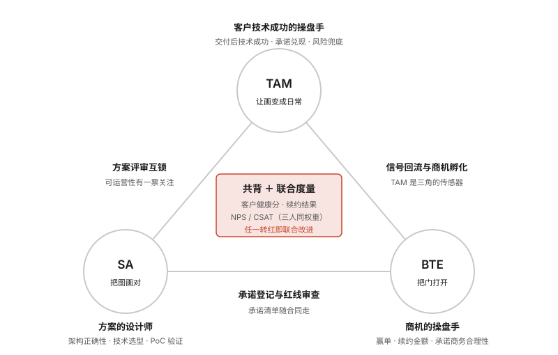

<!-- Diátaxis: Reference -->
# 附录 V　TAM-BTE-SA 铁三角协同最佳实践

> 性质说明：本文件是本书发起的**协同最佳实践汇编（v0.1，2026-10 拟稿）**。它不是任何官方机构发布的标准。它把第 2、7、11、13、15 章中售前—交付—运营协同的要求，收敛为一份可操作的协同手册。供服务组织建立"铁三角"运作机制时引用、裁剪。它也是开源共建的底稿。修订请走附录 E 的贡献流程。落地执行动作见本附录 V.10 节。

---

## V.0 引言

客户从不区分"售前的人"和"售后的人"。他只记得"你们公司说过什么"。BTE（技术销售）在商机期讲的故事、SA（架构师）在方案期画的图、TAM 在运营期兜的底，在客户眼里是同一份承诺的三个段落。三个角色各自优秀，拼起来却可能是一场事故：BTE 为了赢单把能力讲满，SA 的方案没考虑过谁半夜来运维，TAM 进场时面对的是一份自己从没见过的承诺清单。

协同最常见的掉棒有四种。**售前过度承诺**，交付团队进场第一天就背上技术债务。**方案不可运营**，架构评审没有人代表"运行期"说话。**移交走过场**，一封邮件三个附件就算交接。承诺清单和风险清单无人认领。**运营期信号浪费**，TAM 握着一手续约与增购信号，BTE/SA 却在别处找商机。

本实践的目的有三：

1. 给客户一张连续的脸：从第一次交流到续约，口径一致、承诺可追溯；
2. 给三个角色一套接缝打法：承诺怎么管、方案怎么互锁、移交怎么办、信号怎么回流；
3. 给管理者一组联合度量：铁三角按共同的客户结果考核，而不是各算各的账。

## V.1 范围

本实践规定了 TAM、BTE（技术销售）、SA（解决方案架构师）三个角色的分工界面。覆盖商机期、方案期、交付期、运营期四个阶段的协同动作。也规定联合例会、联合度量与行为红线。

本实践不适用于：纯线索阶段的市场活动（尚无客户技术界面）；公司内部研发侧的协作（见第 19 章）。

## V.2 规范性引用文件

下列文件的内容构成本实践必不可少的条款：

- 本书第 2 章（TAM 与售前 SA、交付 PM 的岗位边界与 RACI）；
- 本书第 7 章（业务价值翻译与价值账本）；
- 本书第 9 章（关键人地图与信任账户）；
- 本书第 17 章（客户全生命周期四阶段）；
- 本书第 19 章（内部协同接口与销售信号共享纪律）；
- 本书第 21 章（商业化协同与 VBR）；
- 本书附录 G（技术信号导向的评估口径）；
- 本书附录 L（项目导入四阶段闸门 S1–S4）；
- 模板 01（服务计划）、模板 02（Onboarding 90 天清单）、模板 08（QBR/EBR 模板）。

## V.3 术语和定义

下列术语和定义适用于本实践。完整术语表见附录 A。

**铁三角（Iron Triangle）**：以客户成功为共同目标的客户界面最小作战单元。由 BTE（商务与技术线索）、SA（方案与技术设计）、TAM（交付与持续运营）三方组成。

**承诺清单（Commitment List）**：对客户作出的全部口头与书面承诺的登记台账。含承诺内容、承诺人、兑现时点、验证方式。

**可运营性（Operability）**：方案在真实运行环境中可监控、可变更、可处置故障、可管理容量的属性。它是 TAM 在方案评审中的一票关注点。

**移交仪式（Handover Ceremony）**：售前向交付/运营转移客户责任的正式交接动作。以三件套齐备与会签为完成标志。不是邮件通知。

**信号回流（Signal Loopback）**：TAM 在运营期捕获的续约风险与增购机会信号。按约定通道与频率回传 BTE/SA，并跟踪处置。

## V.4 铁三角的角色与分工

### V.4.1 三个角色一句话

| 角色 | 一句话定位 | 对什么负责 | 不对什么负责 |
| --- | --- | --- | --- |
| BTE（技术销售） | 商机的操盘手 | 客户关系商务面、赢单、续约金额、承诺的商务合理性 | 方案技术正确性、交付兑现 |
| SA（架构师） | 方案的设计师 | 架构正确性、技术选型、PoC 验证、方案可交付 | 商务条款、运行期值守 |
| TAM | 客户技术成功的操盘手 | 交付后的技术成功、承诺的运营期兑现、风险兜底 | 报价折扣、合同条款 |

一句话记住分工：**BTE 把门打开，SA 把图画对，TAM 让画变成日常**。

### V.4.2 全周期 RACI

| 阶段 | 关键动作 | BTE | SA | TAM |
| --- | --- | --- | --- | --- |
| 商机期 | 需求挖掘、客户技术预研 | R | A | C（存量客户） |
| 商机期 | 承诺登记与红线审查 | R | C | A（一票关注：不可交付承诺） |
| 方案期 | 架构设计与方案评审 | C | R | A（一票关注：可运营性） |
| 方案期 | PoC 与上线前验证 | C | R | C（验收口径参与） |
| 交付期 | 项目导入（S1–S4） | I | C | R（闸门评审，附录 L） |
| 交付期 | 移交仪式 | R | C | A（三件套签收方） |
| 运营期 | 服务计划执行与健康度运营 | I | C | R |
| 运营期 | 信号回流与商机孵化 | A | C | R（信号源） |
| 续约期 | 续约方案与 VBR | R | C | C（技术背书，第 19.3 节纪律） |

两条总则如下。**一个客户同一时刻只有一个牵头人**，阶段切换以移交仪式为标志。**客户面前不出现内部分工**，灰度地带先接住再划界（第 19.4 节）。

## V.5 四个关键接缝的协同打法

### V.5.1 售前承诺管理：把"说过的话"变成台账

1. **承诺即登记**：BTE/SA 作出的任何超出标准产品文档口径的承诺，48 小时内进承诺清单。覆盖性能指标、交付日期、定制能力、人员投入。含承诺场景与原话。口头承诺也是承诺；
2. **TAM 前置介入**：存量客户的增购商机、明确会转入交付的新商机，TAM 在方案定稿前参与一次承诺审查。对"不可交付/不可运营"条款行使一票关注。关注不是否决权。它强制把风险写下来，由 BTE 带着知情客户确认；
3. **承诺随合同走**：签约时承诺清单随合同留痕，作技术附件或会议纪要。交付期逐条对账。**没进清单的承诺，运营期不认；进了清单的承诺，三角共背**。

### V.5.2 方案评审互锁：可运营性有一票

1. SA 的方案评审必须有一位"运行期代表"。通常由 TAM 担任，无人指派时由 TAM 团队轮值；
2. TAM 的评审清单四项：监控告警怎么接、变更窗口怎么排（附录 T）、故障时谁来处置与回退路径（附录 K）、容量与成本怎么管（第 5 章、FinOps）；
3. 评审结论三态：通过、带条件通过、退回。带条件通过的条件进移交三件套的风险清单。**带条件通过是常态，无条件通过才可疑**。它通常意味着没人认真看。

### V.5.3 移交仪式：三件套不齐不移交

售前→交付/运营的移交以移交会议为标志。三件套齐备、三方会签才算完成：

1. **方案基线**：签约版本架构图、配置基线、容量假设、PoC 验证记录。客户环境日后的每一次变更以此为原点。它是模板 01 服务计划的输入；
2. **承诺清单**：V.5.1 的台账全量移交，逐条标注兑现状态与时点，TAM 签收即承接；
3. **风险清单**：方案评审遗留条件、客户侧未决事项（网络改造、数据迁移依赖）、关键人地图初稿（第 9 章）。

移交后 30 天为**伴随期**。BTE/SA 保持每周一次三方同步。TAM 提出的基线疑问由原 SA 负责澄清。移交不是切割，是接力棒的并排跑段。

### V.5.4 运营期信号回流：TAM 是三角的传感器

TAM 握着客户最真实的技术信号（第 19.3 节），回流按三类分道：

| 信号类型 | 典型证据 | 回流对象 | 时限 |
| --- | --- | --- | --- |
| 续约风险 | 健康分走低、关键人变动、竞对 POC、预算收缩 | BTE | 发现后 5 个工作日内书面化 |
| 增购机会 | 容量水位持续上涨、新业务上线、AI 项目立项 | BTE + SA | 识别后移交，机会归属留痕 |
| 方案反哺 | 现网架构缺陷、产品能力缺口、高频工单模式 | SA | 季度 QBR 前汇总 |

信号给的是事实与证据，不是"我感觉"。商务动作由 BTE 决定，TAM 不越位报价、不夹带催促（第 19.3 节两条纪律）。

## V.6 例行协同机制

1. **铁三角周会**（30 分钟，商机活跃期每周，稳态期双周）：三件事——承诺清单对账、信号回流对账、下阶段客户动作排期；不讨论单点技术问题（那是工单的场子）；
2. **联合客户拜访**：重要节点（方案定稿、上线、续约前 180 天）三角同框出现，客户看到的是一支队伍；日常拜访谁去都行，但口径以承诺清单与服务计划为准；
3. **联合复盘**：丢单必复盘（BTE 牵头）。重大故障必复盘（TAM 牵头，附录 R）。续约成功必复盘（BTE 牵头）。三种复盘互邀另外两角参加，经验跨阶段流动；
4. **客户高层沟通**：CIO/CTO 级拜访（第 9 章高层对话）原则上 BTE 与 TAM 同往。BTE 谈关系与商业，TAM 带价值账本与风险地图（第 7 章）。SA 按需出席讲架构演进。

## V.7 联合度量

铁三角的共同目标是客户生命周期价值。考核按"共背 + 分背"设计：

- **共背指标**（三人同权重挂钩）：客户健康分（模板 10）、续约结果、NPS/CSAT（第 34 章口径）；
- **分背指标**：BTE 背赢单率与承诺清单兑现率；SA 背方案一次通过率与 PoC 转交付率；TAM 背附录 G 的 L1–L3 指标；
- **防异化条款**：共背指标任何一项转红，三角联合出改进计划。不允许"那是售后/售前的事"的单角色撇清。度量设计就是让撇清在制度上不成立（第 34 章反异化条款）。

## V.8 红线

1. 明知不可交付仍对客户承诺（含默认客户的误解），一经查实，承诺人按组织质量事故处理；
2. 移交隐瞒承诺或风险（清单外另有一套口头说法），接收方有权拒签并上报；
3. 为赢单压低方案配置或绕过方案评审，SA 与 TAM 均有义务上报，不因商机金额豁免；
4. 截留运营期信号（TAM 压信号、BTE 压丢单复盘），纳入个人诚信记录并联动附录 G 否决条款。

## V.9 AI 时代的铁三角

AI 改变了三角的内部分工，没有改变接缝：

- **BTE 侧**：AI 生成方案初稿与竞品对比的速度快了十倍，承诺清单反而更重要。生成内容里"看起来很合理"的能力描述，必须经 SA 核实才能进承诺；
- **SA 侧**：AI 辅助架构设计与容量估算（第 27 章 AI 工作负载）。但可运营性评审不能交给 AI。运行期的坑在数据分布的尾部，不在平均水平里；
- **TAM 侧**：信号回流因 AI 聚类与健康分自动化（第 28、34 章）变得高频而廉价。瓶颈从"发现信号"移向"三角对信号的处置速度"。周会对账的价值因此上升。

一句话：**AI 让每一边都更强，接缝处的信任仍然只能人肉交付**（第 33 章）。

执行侧落到两张清单上。第一张是承诺清单。方案改了、配置变了，AI 比对差异并更新条目状态。周会上三方直接看最新盘子，不用会前互对表格。状态变更留痕，谁改的、何时改的都能回查。差异清单推给 BTE 与 SA，各认各的条目。第二张是交接包。模板 19 要求的件数逐项点验，缺件在移交前亮出来。完整性核对交给模型跑，带病交接到此为止。

状态同步只同步“到哪了”，不同步“认不认”。AI 搬运状态，不搬运判断。条目背后的承诺内容变没变，仍要三方在周会上当面对齐。

一条边界：承诺的确认与接受仍是双方人签。AI 不进承诺链。它可以备料，不能替 BTE 承诺，也不能替客户点头。签字笔不交给模型，承诺链上每一环都有人名。双方没签，条目就停在待确认。

## V.10 执行落地

> 本节把本附录条文转成可照做的动作：前置条件、操作步骤、验收与检查清单。条文定义见上文各节，不重复；时限与锚点以本附录条文为准。

### V.10.1 前置条件与目标

| 前置条件 | 检查内容 | 缺项处理 |
| --- | --- | --- |
| 客户清单 | 存量客户与活跃商机列出 | 先盘客户 |
| 三角到人 | 每个客户 BTE/SA/TAM 均到人 | 先补位再启动 |
| 模板就绪 | 模板 19 承诺清单与三件套可用 | 先领模板 |
| 例会排期 | 周会日历与时长已定 | 先定节奏 |

完成标志有五项：承诺零游离、评审有一票。移交有仪式、信号有时限。度量共背落地。

| 目标 | 完成标志 | 主要证据 |
| --- | --- | --- |
| 承诺零游离 | 超口径承诺全入账 | 承诺清单 |
| 评审有一票 | 运行期代表必到 | 评审记录 |
| 移交有仪式 | 三件套齐、三方会签 | 移交记录 |
| 信号有时限 | 5 个工作日内书面化 | 信号台账 |
| 度量共背 | 共背指标挂钩三人 | 考核方案 |

### V.10.2 操作一：机制组建与启动

#### 操作步骤

1. 按客户列三角名单。每个客户明确 BTE、SA、TAM 三人到人。
2. 认定牵头人。按阶段定牵头，切换以移交仪式为标志（V.4.2）。
3. 立 30 分钟周会。商机活跃期每周，稳态期双周（V.6）。
4. 议程固定三件事：承诺对账、信号对账、下阶段排期。单点技术问题转工单。
5. 约定联合拜访节点。方案定稿、上线、续约前 180 天三角同框（V.6）。

#### 预期结果

三角到人。周会立起。口径统一。

#### 常见错误

- 只建群不开会。协同停在聊天记录里。
- 牵头人长期不换届。阶段变了牵头没变。

### V.10.3 操作二：承诺清单运转

#### 操作步骤

1. 建账。按模板 19 第 1 节起账，CM 编号连续。
2. 宣贯登记纪律。超出口径的承诺 48 小时内登记，含场景与原话（V.5.1）。
3. 组织承诺审查。方案定稿前 TAM 过一遍全部超口径条款。
4. 一票关注书面化。不可交付/不可运营条款写关注记录，由 BTE 带知情客户确认。
5. 签约对账。清单随合同留痕。交付期逐条对账销项。

#### 预期结果

承诺全入账。关注有留痕。交付能对账。

#### 常见错误

- 口头承诺不入账。运营期无从承接。
- 关注记录没有客户确认。风险悬空。

### V.10.4 操作三：方案评审互锁

#### 操作步骤

1. 指派运行期代表。默认 TAM，无人指派时团队轮值（V.5.2）。
2. 过四项清单：监控告警、变更窗口（[附录 T](appx-t-online-change-standard.md)）、故障处置与回退（[附录 K](appx-k-incident-emergency-drill-standard.md)）、容量与成本（第 5 章）。
3. 出三态结论。带条件通过的条件写入风险清单。
4. 无条件通过要追问。确认评审没有走过场。
5. 退回件限期整改。重评留痕。

#### 预期结果

评审有一票。条件有去处。结论留痕。

#### 常见错误

- 运行期代表长期缺席。评审只剩设计视角。
- 带条件通过后无人跟踪条件。

### V.10.5 操作四：移交仪式执行

#### 操作步骤

1. 会前备齐三件套：方案基线、承诺清单、风险清单（含关键人地图初稿）。
2. 开移交会。逐条过承诺与风险，三方到场。
3. 三方会签。TAM 签收即承接承诺与风险。
4. 清单外的口头说法当场对账。隐瞒可拒签并上报（V.8 红线 2）。
5. 跑 30 天伴随期。每周三方同步，基线疑问归原 SA 澄清（V.5.3）。

#### 预期结果

三件套齐。会签留痕。伴随期闭环。

#### 常见错误

- 一封邮件代替移交会。风险无人认领。
- 伴随期名存实亡。TAM 独自消化基线疑问。

### V.10.6 操作五：信号回流与联合度量

#### 操作步骤

1. 按三类分道回流（V.5.4）：续约风险给 BTE。增购机会给 BTE + SA。方案反哺给 SA。
2. 信号单只写事实与证据。续约风险 5 个工作日内书面化。
3. 周会对账处置。只收不复的信号记入问题台账。
4. 接入共背指标。健康分、续约结果、NPS/CSAT 三角同权重（V.7）。
5. 共背转红即联合改进。不允许单角色撇清。

#### 预期结果

信号按道回流。处置可追溯。度量共背生效。

#### 常见错误

- 信号口头传。无台账、无时限。
- 共背指标挂空档。考核仍各算各的账。

### V.10.7 验收标准

| 验收项 | 通过标准 | 验证方式 |
| --- | --- | --- |
| 三角到人 | 每客户三角齐、牵头明确 | 核对名单 |
| 承诺登记 | 超口径承诺 48 小时入账 | 核对承诺清单 |
| 一票关注 | 有记录、有客户确认 | 核对关注记录 |
| 评审一票 | 运行期代表出席并表态 | 核对评审记录 |
| 移交仪式 | 三件套齐、三方会签 | 核对移交记录 |
| 伴随期 | 四周同步有记录 | 核对周会纪要 |
| 信号时限 | 5 个工作日书面化 | 核对信号台账 |
| 度量共背 | 共背指标挂钩三人 | 核对考核方案 |

关键项是承诺登记、移交仪式和信号时限。任一关键项未通过，协同机制不得视为已落地。

### V.10.8 执行故障排查

| 症状 | 常见原因 | 处理动作 |
| --- | --- | --- |
| 承诺清单空转 | 登记纪律没宣贯 | 48 小时红线贴到人 |
| 评审一票失声 | 代表没指派或轮值断档 | 指派落到排班表 |
| 移交后基线扯皮 | 伴随期没跑满 | 四周同步写进移交记录 |
| 信号石沉大海 | 只收不复无台账 | 周会对账、问题台账兜底 |
| 周会流于形式 | 议程不固定 | 三件事议程模板化 |
| 共背指标空转 | 考核方案没改 | 先改考核再谈协同 |

反复出现的问题进入复盘流程（[附录 R](appx-r-problem-retrospective-standard.md)）。

### V.10.9 执行检查清单

- [ ] 每个客户三角到人、牵头明确
- [ ] 周会日历已定、议程三件事
- [ ] 超口径承诺 48 小时入账
- [ ] 一票关注有记录、客户确认
- [ ] 评审有运行期代表、结论三态
- [ ] 带条件通过的条件入风险清单
- [ ] 移交三件套齐、三方会签
- [ ] 30 天伴随期每周同步
- [ ] 信号三类分道、5 个工作日书面化
- [ ] 共背指标挂钩三人、转红联合改进

---

## 版本与共建

- v0.1（2026-10-23）：首版发布。2026-11-04 收敛为 Reference 单类型，落地动作拆至附录 V。
- 修订与共建：见附录 E《开源贡献指南》。承诺清单与移交三件套的表格化模板见[模板 19](../templates/19-commitment-handover-kit.md)。

## 本章要点回顾

1. 铁三角分工一句话：BTE 把门打开，SA 把图画对，TAM 让画变成日常；一个客户同一时刻只有一个牵头人。
2. 四个接缝四种打法：承诺管理（台账化）、方案评审（可运营性一票）、移交仪式（三件套 + 30 天伴随期）、信号回流（三类分道、时限刚性）。
3. 例行机制四件套：铁三角周会、联合拜访、联合复盘、高层同框。
4. 度量按"共背 + 分背"设计，让"撇清"在制度上不成立；四条红线全部指向诚信而非能力。
5. AI 放大了每一边的能力，接缝处的信任仍需人肉交付。
