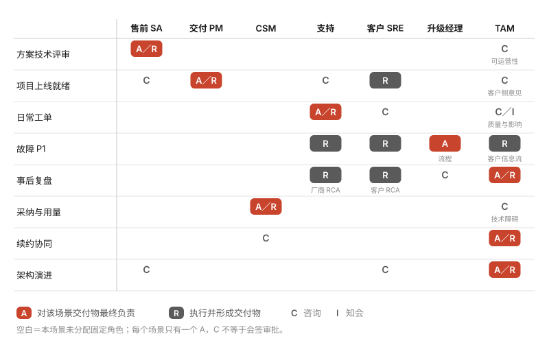

<!-- Diátaxis: Reference -->
# 第 2 章　岗位边界与协作图谱

> 本章用责任对象定义 TAM 的岗位边界。核心口径是：**TAM 对客户长期技术健康负责。** TAM 不替代相邻岗位的专业责任。六组岗位边界回答“谁对什么负责”。RACI 图回答“具体场景由谁交付”。接缝目录回答“责任转移时交接什么”。本章采用本书的统一岗位定义。它不宣称所有厂商都使用相同 title 或组织设置。岗位术语以[附录 A](appx-a-glossary.md)为准。

## 2.1 边界坐标与适用范围

岗位边界由四个坐标共同确定。只看技能清单，无法区分这些岗位。TAM、SA 与客户 SRE 都可能懂架构。三者仍可对不同结果负责。

| 坐标 | 本书定义 | 典型分类 | 可观察的责任证据 |
| --- | --- | --- | --- |
| 责任对象 | 岗位承诺维护的结果 | 方案、项目、工单、账户、系统、危机流程 | 目标文件、验收对象、考核口径 |
| 时间轴 | 主责任开始与结束的位置 | 商机期、项目期、运营期、单次事件 | 启动条件、退出条件、伴随期 |
| 交付单元 | 验收责任的最小对象 | 一份方案、一个闸门、一张工单、一份复盘 | 交付物、签收人、完成标志 |
| 权限范围 | 岗位可决定或执行的事项 | 建议、会签、审批、生产操作、客户通报 | 授权记录、操作权限、签字权限 |

四个坐标不能相互替代。技术能力强，不等于拥有审批权。参与会议，也不等于承担 A。能修复故障，更不自动等于对客户关系负责。

### 2.1.1 TAM 的责任内核

本书将 TAM 定义为“客户技术成功的操盘手”。其责任对象是客户账户的长期技术健康。主要时间轴从交付前介入延伸至持续运营。核心交付不是单张工单。它包括服务计划、风险清单、技术建议和复盘结论。

| TAM 负责 | 对应交付物 | TAM 不替代 |
| --- | --- | --- |
| 客户技术风险识别与透明化 | 风险登记册、健康度信号 | 客户自身的风险接受决策 |
| 服务机制与跨团队协同 | 服务计划、例会结论、升级记录 | 各专业团队的内部管理 |
| 架构演进与可运营性建议 | 评审意见、演进建议、容量信号 | SA 的方案设计责任 |
| 客户侧技术信息流 | 通报、事实包、复盘交付 | 升级经理的危机流程指挥 |
| 技术价值与商业信号供应 | 价值证据、书面信号单 | BTE 或销售岗位的金额责任 |

“负责”不等于“亲自完成”。TAM 可以组织客户 SRE 执行演练。TAM 不因此取得生产操作权。TAM 可以提供续约技术信号。TAM 不因此承担续约金额。

### 2.1.2 本章的适用边界

本章覆盖六个最易混淆的相邻岗位。BTE 的商务边界在[附录 V](appx-v-tam-bte-sa-triangle.md)展开。研发与产品的需求接口见[第 19 章](ch19-internal-collaboration.md)。伙伴和总集成分包关系见[第 20 章](ch20-partner-ecosystem.md)。

客户安全与合规团队也不列入六对边界。这类团队对监管规则与内部制度的符合性负责。TAM 对风险信号的识别、透明化与上报负责。TAM 不作合规判定，也不替客户接受风险。该边界的完整口径见[第 14 章](ch14-risk-compliance-practical.md)（14.1.3 节）。金融客户决策中的合规角色见[第 22 章](ch22-financial-industry.md)（22.3.1 节）。AI 场景的数据与问责边界见[第 31 章](ch31-ai-risk-governance.md)。

甲方其余岗位不在本章展开。这包括业务 Owner、客户架构师、采购与监管接口人。本书是厂商侧 TAM 的接口地图。甲方岗位的职责应由客户自身定义，本书不赋予其权威口径。需要读甲方决策链时，见[第 22 章](ch22-financial-industry.md)（22.3.1 节）的科技—业务—风险合规三角；需要读客户业务语境时，见[第 7 章](ch07-business-insight.md)。

本章的 CSM 口径属于本书约定。不同组织可能合并 CSM 与 TAM。也有组织把 CSAM、PFE 或服务经理纳入同类职责。title 不改变责任坐标的读法。兼任场景见 2.7。

主 TAM（Lead TAM）与成员 TAM 不是相邻岗位，而是同一岗位序列的两级：主 TAM 对一个客户或一摊客户组合负总责并带队，成员对分派客户执行。两级之间的授权、报告与回传属于团队内部治理，见[附录 AA](appx-aa-tam-reporting-standard.md)（RP1–RP8 的决策槽与回传义务）。本章不把它列为第七对边界，以免把"上下级"误读成"跨职能分界"。团队内部的专业域分工（机房／IaaS／PaaS／SaaS／AI-Infra）与共管面机制见[附录 AB](appx-ab-subtam-domain-collaboration.md)。

## 2.2 六对岗位边界

六对边界都按“对什么负责”划分。主责任期表示责任重心，不表示机械切断。SA 可以在运营期继续支持。TAM 也可以在方案定稿前介入。接缝以交付物和完成证据闭合。

| 对照岗位 | 相邻岗位的主责任 | TAM 的主责任 | 主要分界坐标 | 不可相互替代的事项 |
| --- | --- | --- | --- | --- |
| 售前 SA | 赢单与方案期的方案正确性 | 交付与运营期的技术成功 | 时间轴、责任对象 | SA 设计技术方案；TAM 维护长期运行结果 |
| 交付 PM | 有明确终点的项目交付 | 无固定终点的账户技术健康 | 时间轴、交付单元 | PM 管项目基线；TAM 管持续服务基线 |
| CSM | 采纳、使用与业务价值实现 | 技术稳定、技术风险与技术决策支持 | 结果类型 | CSM 管采纳结果；TAM 管技术结果 |
| 支持工程师 | 单个工单的诊断与解决 | 客户级故障治理与经验回流 | 交付单元、影响范围 | 支持管队列；TAM 管账户全景 |
| 客户 SRE／运维 | 客户自有系统的稳定运行 | 帮客户提升系统运行质量 | 系统归属、操作权限 | SRE 执行授权操作；TAM 组织与翻译 |
| 升级经理 | 单次重大危机的处置流程 | 客户在危机中的全局与事后信任 | 事件范围、客户范围 | 升级经理管流程；TAM 管客户连续性 |

### 2.2.1 TAM 与售前 SA

SA 的责任对象是技术方案。其交付单元包括架构设计、技术选型、POC 结论和方案基线。TAM 的责任对象是方案进入运行后的技术健康。其关注点包括监控、变更、容量和故障处置。

两者的时间轴存在重叠。TAM 前置参与，不改变 SA 的方案责任。SA 在移交伴随期答疑，也不替代 TAM 的运营责任。TAM 的“一票关注”属于风险揭示。它不是对全部技术方案承担 A。

| 界面属性 | SA 侧 | TAM 侧 |
| --- | --- | --- |
| 核心问题 | 方案是否正确且可交付 | 方案是否可运营且可持续 |
| 典型交付 | 方案基线、POC 结论 | 可运营性意见、运行风险清单 |
| 主要接缝 | 方案评审、移交答疑 | 运行期评审、移交签收 |
| 越界表现 | 只交架构图，不交运行假设 | 越过 SA 重画方案并自担正确性 |

全周期协同与移交要求见[附录 V](appx-v-tam-bte-sa-triangle.md)和[模板 19](../templates/19-commitment-handover-kit.md)。

### 2.2.2 TAM 与交付 PM

PM 的责任对象是项目。项目具有范围、进度、成本、质量和终点。TAM 的责任对象是客户账户。账户关系不因单个项目结束而终止。项目期可以出现多个 PM。客户仍需要一个连续的 TAM 接口。

项目上线不是全部责任的终点。PM 的交付责任以约定验收为准。本书的项目导入以 S4 稳态验收为出口。TAM 在项目期提供客户上下文。TAM 也反馈资源约束和运行风险。PM 不因此把项目计划转给 TAM。

| 界面属性 | PM 侧 | TAM 侧 |
| --- | --- | --- |
| 管理基线 | 范围、进度、成本、项目质量 | 服务范围、技术健康、长期风险 |
| 典型交付 | 项目计划、上线闸门、验收记录 | 服务计划、客户风险与资源信号 |
| 退出条件 | 项目验收与遗留项安排完成 | 无项目式终点，持续服务或正式移交 |
| 越界表现 | 上线即撤场，不留稳态出口 | 代管项目任务，失去账户全景 |

项目侧闸门见[附录 L](appx-l-project-onboarding-standard.md)。上线决策见[第 16 章](ch16-project-change-practical.md)和[模板 04](../templates/04-go-nogo-gate-checklist.md)。

### 2.2.3 TAM 与 CSM

CSM 的责任对象是产品采纳和业务价值实现。TAM 的责任对象是技术稳定和技术决策质量。两类结果相关，但不能互相代替。高用量不必然代表低风险。高可用也不必然代表业务采纳充分。

本书把采纳漏斗归 CSM 主责。TAM 提供阻碍采纳的技术证据。技术证据包括性能瓶颈、集成障碍和容量限制。CSM 不因此承担根因分析。TAM 也不因提供用量数据而承担采纳目标。

| 界面属性 | CSM 侧 | TAM 侧 |
| --- | --- | --- |
| 核心结果 | 用得上、用得全、用得深、用得广 | 稳得住、看得清、改得动、风险透明 |
| 典型证据 | 采纳漏斗、业务价值、使用反馈 | 健康分技术项、工单模式、架构风险 |
| 商业接口 | 价值实现与续约协同 | 技术信号与价值证据供应 |
| 越界表现 | 把技术故障归为培训不足 | 把用量提升全归为技术任务 |

采纳深度见[第 17 章](ch17-customer-lifecycle.md)。商业信号边界见[第 21 章](ch21-commercial-synergy.md)。

### 2.2.4 TAM 与支持工程师

支持工程师的责任对象是工单。其工作单元具有受理、诊断、解决和关闭状态。TAM 的责任对象是客户账户的故障治理。其视野覆盖多张工单、重复故障和跨团队根因。

TAM 不以接管工单证明重视客户。支持工程师也不以关闭工单代替客户级治理。单次恢复可以关闭一张工单。重复发生仍需进入问题管理。两类交付的完成标志不同。

AI 工具正在改写这条接缝的位置。智能客服与 AI 运维先接走浅层问答和模板化排障。支持队列里剩下复现困难、跨产品耦合这类判断题。因为 AI 答得快却答不准客户上下文，含糊的升级仍会推回人工。于是 TAM 与支持的交界整体上移。TAM 要接住的不再是单点报错，而是跨工单模式与客户影响判断。分界坐标不变，判定原则也不变。谁对交付物签字，谁就对结果负责。AI 分流只抬高接缝，不改写责任归属。

| 界面属性 | 支持侧 | TAM 侧 |
| --- | --- | --- |
| 工作队列 | 工单队列与优先级 | 客户风险与跨工单模式 |
| 典型交付 | 诊断结论、解决方案、工单记录 | 质量反馈、根因回传、问题管理输入 |
| 完成标志 | 按工单规则解决并确认关闭 | 客户风险已揭示，治理事项已有归属 |
| 越界表现 | 只回单点状态，不传根因 | 绕过队列抢单，破坏支持责任链 |

工单接口见[第 19 章](ch19-internal-collaboration.md)和[附录 U](appx-u-ticket-management-standard.md)。重复故障的复盘入口见[附录 R](appx-r-problem-retrospective-standard.md)。

### 2.2.5 TAM 与客户 SRE／运维

客户 SRE 对客户授权范围内的系统负责。其权限来自客户的生产管理制度。TAM 帮助客户理解厂商产品、风险与改进路径。TAM 的默认权限不包括代客操作生产环境。

双方都关注可用性，但交付物不同。客户 SRE 交付监控、变更、演练和恢复动作。TAM 交付产品语境、厂商协同和技术建议。客户系统的最终运行责任不因购买 TAM 服务而自动转移。

| 界面属性 | 客户 SRE／运维侧 | TAM 侧 |
| --- | --- | --- |
| 系统关系 | 运营自己获授权的系统 | 支持客户运营客户的系统 |
| 操作权限 | 按客户授权执行生产操作 | 默认无客户生产操作授权 |
| 典型交付 | 监控、变更、演练、恢复 | 评审、协调、解释、风险建议 |
| 越界表现 | 把自有运行责任整体外包 | 未经授权直接修改客户生产环境 |

客户变更与演练见[附录 K](appx-k-incident-emergency-drill-standard.md)和[附录 T](appx-t-online-change-standard.md)。技术转移见[附录 M](appx-m-product-introduction-standard.md)。

### 2.2.6 TAM 与升级经理

升级经理的责任对象是单次危机的处置流程。其关注点包括指挥、资源调度、升级节奏和纪律。TAM 的责任对象是特定客户的危机全局。其上下文包括历史故障、关键人、业务日历和信任状态。

两种责任可以在故障 P1 中同时存在。升级经理不必重建客户全部历史。TAM 也不另建一套指挥链。前者维护处置秩序。后者维护客户信息的准确与连续。

| 界面属性 | 升级经理侧 | TAM 侧 |
| --- | --- | --- |
| 工作范围 | 单次事件或作战室 | 单一客户的完整事件上下文 |
| 典型交付 | 指挥节奏、资源协调、流程纪律 | 客户通报、事实补充、历史与业务影响 |
| 事件后责任 | 危机流程关闭与内部交接 | 复盘交付与信任重建 |
| 越界表现 | 只按通用流程处理客户差异 | 绕过指挥官直接调度全部资源 |

作战室角色与沟通纪律见[第 18 章](ch18-escalation-crisis.md)。金融事件的响应时钟见[第 25 章](ch25-financial-incident.md)。

## 2.3 RACI 的读法与约束

RACI 描述具体交付场景的角色分配。它不是岗位说明书，也不是汇报关系图。同一个岗位可以在不同场景中承担不同字母。字母只对表中写明的交付物有效。

| 字母 | 本书定义 | 数量与位置约束 | 典型证据 |
| --- | --- | --- | --- |
| A（Accountable） | 对该场景交付物最终负责 | 每个场景一个 A；不能把整行写成共同负责 | 验收、签收、关闭或结论确认 |
| R（Responsible） | 执行工作并形成交付物 | 可以有多个 R；各自范围应可辨认 | 方案、记录、通报、处置动作 |
| C（Consulted） | 决策或交付前必须征求意见 | 双向沟通；意见应在结论前进入 | 评审意见、会签、风险条件 |
| I（Informed） | 需要获知结论或状态 | 单向知会；不承担交付责任 | 纪要、状态通报、通知记录 |
| A／R | 同一角色兼具最终责任与执行 | 仍只计一个 A | 责任与交付记录同属该角色 |
| — | 本场景未分配固定角色 | 不等于禁止临时协助 | 场景外或按需参与 |

RACI 有三条边界约束。第一，A 必须绑定交付物。离开交付物谈“A 最大”，没有可验收含义。第二，C 不等于会签审批。需要审批权时，应在治理制度中另行定义。第三，R 不等于拥有全部权限。客户生产操作仍以授权为准。

下表是本书的通用参考模型。组织裁剪时可以调整角色。调整后仍须保持每个场景只有一个 A。客户业务 Owner、监管联系人和供应商研发不在本表展开。其责任不能由空白列推定。

## 2.4 八个典型场景的 RACI

| 场景与责任对象 | 售前 SA | 交付 PM | CSM | 支持 | 客户 SRE | 升级经理 | TAM |
| --- | --- | --- | --- | --- | --- | --- | --- |
| 方案技术评审：方案基线 | A／R | — | — | — | — | — | C（可运营性） |
| 项目上线就绪：项目闸门结论 | C | A／R | — | C | R | — | C（客户侧意见） |
| 日常工单：单张工单解决 | — | — | — | A／R | C | — | C／I（质量与影响） |
| 故障 P1：作战室处置流程 | — | — | — | R | R | A（流程） | R（客户信息流） |
| 事后复盘：对客户复盘交付 | — | — | — | R（厂商 RCA） | R（客户 RCA） | C | A／R |
| 采纳与用量：采纳改进结果 | — | — | A／R | — | — | — | C（技术障碍） |
| 续约协同：技术信号供应 | — | — | C | — | — | — | A／R |
| 架构演进：长期技术建议 | C | — | — | — | C | — | A／R |

### 2.4.1 场景口径与完成标志

RACI 字母必须与场景口径一起读取。以下定义限定了每行的 A。它们也防止把相邻场景混成一个责任包。

| 场景 | A 的责任边界 | 完成标志 | 不包含的责任 |
| --- | --- | --- | --- |
| 方案技术评审 | SA 对方案技术基线负责 | 评审结论和遗留条件已记录 | TAM 不接管方案设计；商务承诺另列 |
| 项目上线就绪 | PM 对项目就绪结论负责 | 闸门结论、条件和责任人齐备 | 客户授权人的投产决策不在本行 |
| 日常工单 | 支持对单张工单解决负责 | 按工单规则解决并获确认 | 客户级重复故障治理另列 |
| 故障 P1 | 升级经理对处置流程负责 | 指挥、节奏与事件交接完成 | TAM 不对全部技术处置动作负责 |
| 事后复盘 | TAM 对面向客户的复盘交付负责 | 事实、根因、改进与客户反馈齐备 | 各团队仍对各自 RCA 证据负责 |
| 采纳与用量 | CSM 对采纳改进结果负责 | 采纳目标与改进行动形成闭环 | TAM 不背全部用量目标 |
| 续约协同 | TAM 对技术信号质量负责 | 信号书面移交且证据可追 | BTE 或销售对金额与商务动作负责 |
| 架构演进 | TAM 对长期技术建议负责 | 建议、依据、风险和决策记录齐备 | 客户保留最终架构与投资决策 |

“项目上线就绪”不等于“业务投产批准”。前者检查项目交付条件。后者由客户授权体系决定。“架构演进咨询”也不等于替客户决策。TAM 对建议质量负责。客户对选择和风险接受负责。

## 2.5 接缝类型与交接对象

边界描述稳定责任。接缝描述责任或信息的转移。一个接缝至少包含四项属性：上游、下游、交接对象和完成证据。缺少完成证据的移交，只能视为信息发送。

| 接缝 | 上游与下游 | 必交对象 | 完成证据 | 详细口径 |
| --- | --- | --- | --- | --- |
| 商机承诺 → 交付 | BTE／SA → 交付与 TAM | 承诺清单、原话、时点、验证方式 | 清单随合同或纪要留痕 | [附录 V](appx-v-tam-bte-sa-triangle.md) |
| 方案设计 → 运行 | SA → TAM 与客户运行团队 | 方案基线、容量假设、可运营性条件 | 评审结论与遗留条件会签 | [附录 V](appx-v-tam-bte-sa-triangle.md) |
| 售前 → 交付／运营 | BTE／SA → TAM | 方案基线、承诺清单、风险清单 | 移交三件套齐备并完成签收 | [模板 19](../templates/19-commitment-handover-kit.md) |
| 项目交付 → 稳态运营 | PM → TAM 与服务团队 | 验收记录、遗留项、服务输入 | S4 稳态验收及遗留安排完成 | [附录 L](appx-l-project-onboarding-standard.md) |
| 产品导入 → 客户自运行 | 厂商团队 → 客户运维 | 技术资产、操作能力、联合值守记录 | 独立运营准入通过 | [附录 M](appx-m-product-introduction-standard.md) |
| 运营信号 → 商务与方案 | TAM → BTE／SA | 事实、证据、建议、时间敏感度 | 信号移交记录与接收反馈 | [第 21 章](ch21-commercial-synergy.md) |
| 危机处置 → 事后治理 | 作战室 → TAM 与问题管理 | 时间线、处置记录、未决风险 | RCA 与复盘改进项有归属 | [附录 R](appx-r-problem-retrospective-standard.md) |

移交三件套是本书的固定术语。它指方案基线、承诺清单和风险清单。客户档案可以作为服务输入。它不能替代三项中的任何一项。风险清单至少保留未决条件、Owner 和复审时点。具体字段以[模板 19](../templates/19-commitment-handover-kit.md)为准。

交付到运营的出口也有明确口径。“上线”只表示一个技术或项目事件。“稳态”表示验收条件已经达到。PM 的主责任按约定验收关闭。TAM 的持续服务责任按正式移交切换。两者不能共用一句“上线后再说”。

## 2.6 未列场景的归属分类规则

职责表无法穷举新场景。未列事项沿用三轴分类。三轴分别识别客户接口、责任期限和执行资格。它们是分类规则，不是额外授权流程。

| 分类轴 | 判断问题 | 归属含义 | 限制条件 |
| --- | --- | --- | --- |
| 客户责任轴 | 客户依据承诺会找哪个具名接口 | 默认确定首要响应者和至少一个 R | 客户感知不能替代正式授权 |
| 时间轴 | 交付物有明确终点，还是持续存在 | 有终点偏项目逻辑；无终点偏账户逻辑 | 阶段重叠时仍以交付物定 A |
| 恢复能力轴 | 谁有知识、权限和资源完成修复 | 确定 R、执行团队与必要升级对象 | 能兜底不自动等于对全局承担 A |

三轴冲突时采用统一优先级。客户已获承诺的具名接口先承接响应。随后按交付物和授权确定 A。执行能力用于分配 R，不用于掩盖责任空缺。任何临时承接都不自动改写长期岗位边界。

| 新场景形态 | 责任分类 | 典型归属 |
| --- | --- | --- |
| 一次性迁移项目 | 有终点的项目交付 | PM 对项目交付承担 A；TAM 提供运行期输入 |
| 持续容量健康 | 无终点的账户技术治理 | TAM 维护信号与建议；客户 SRE 执行授权变更 |
| 单一产品缺陷工单 | 有编号的支持交付单元 | 支持对工单承担 A／R；TAM 跟踪客户影响 |
| 跨产品反复故障 | 超出单工单的账户级问题 | TAM 组织治理；各专业团队承担各自 R |
| 新产品无人认领 | 尚未定义交付物与授权的灰度项 | 先保持客户接口连续，再补充正式责任定义 |

客户体验的确定性优先于内部划分的整齐。该原则不等于“所有事项都归 TAM”。它要求客户始终知道当前接口。内部仍需补齐唯一 A、执行范围和退出条件。

## 2.7 常见责任误配模式

责任误配是可辨认的结构问题。它不靠个人态度命名。下表给出本书统一使用的六类误配口径。

| 误配模式 | 定义 | 可观察信号 | 校正后的边界口径 |
| --- | --- | --- | --- |
| TAM 万能胶 | 无明确 Owner 的事项持续流向 TAM | 临时任务无终点，并挤压核心交付 | 临时响应与长期归属分开记录 |
| RACI 当城墙 | 用字母拒绝客户或隐瞒空档 | 只证明“不归我”，无人保持接口 | 边界不取消首问响应与升级 |
| 多 A 共责 | 同一场景设置多个最终负责人 | 结论无人签收，争议无人裁决 | 每个明确交付物只保留一个 A |
| 把 C 当成审批 | 把咨询角色写成实际否决者 | 评审权责不清，结论长期悬置 | 咨询、会签与审批分别定义 |
| 兼任不换角色 | 同一人混淆不同交付目标 | 谈采纳时漏报风险，谈故障时催续约 | 按当前交付物标明角色与责任 |
| 口头接缝 | 只发送消息，没有交接完成证据 | 人员变动后承诺和风险失踪 | 以交接对象和签收证据定义完成 |

一人兼多角不改变 RACI 的基本约束。兼任者可以在同一行承担两个角色。组织仍需辨认各角色的交付物。CSM 与 TAM 兼任时，采纳目标与技术风险要分别记录。PM 与 TAM 兼任时，项目终点与账户持续责任也要分别记录。

“小组织可以兼任”不等于“小组织无需边界”。人员越少，越需要明确当前角色。否则同一个决定会同时受赢单、项目进度和长期风险驱动。责任冲突也会失去可见性。

## 2.8 交叉引用速查

本章只定义责任结构。具体操作和度量保留在对应章节与附录。

| 主题 | 本章提供 | 后续入口 |
| --- | --- | --- |
| 铁三角协同 | SA 与 TAM 的方案／运行边界 | [附录 V](appx-v-tam-bte-sa-triangle.md)、[模板 19](../templates/19-commitment-handover-kit.md) |
| 项目与产品导入 | PM、TAM 与客户运维的责任出口 | [附录 L](appx-l-project-onboarding-standard.md)、[附录 M](appx-m-product-introduction-standard.md) |
| 危机与复盘 | 升级经理、支持和 TAM 的场景分工 | [第 18 章](ch18-escalation-crisis.md)、[附录 R](appx-r-problem-retrospective-standard.md) |
| 内部协同 | 支持、研发和销售接口 | [第 19 章](ch19-internal-collaboration.md) |
| 风险与合规接口 | TAM 的风险上报责任与合规判定的分界 | [第 14 章](ch14-risk-compliance-practical.md)、[第 22 章](ch22-financial-industry.md)、[第 31 章](ch31-ai-risk-governance.md) |
| 甲方视角 | 本章不展开；甲方决策链与客户业务语境的读法 | [第 22 章](ch22-financial-industry.md)、[第 7 章](ch07-business-insight.md) |
| 商业化协同 | 技术信号与金额责任的分界 | [第 21 章](ch21-commercial-synergy.md) |
| 人员评估 | 责任边界对应的评价口径 | [附录 G](appx-g-tam-work-evaluation-standard.md) |
| 团队内部接口 | 主 TAM 与成员 TAM 的授权、报告与回传 | [附录 AA](appx-aa-tam-reporting-standard.md)、[模板 20](../templates/20-lead-tam-reporting-set.md)、[模板 21](../templates/21-team-member-reporting-set.md) |
| 专业域分工 | 子 TAM 五域边界、共管面与协作动作 | [附录 AB](appx-ab-subtam-domain-collaboration.md)、[模板 22](../templates/22-subtam-domain-collaboration-matrix.md) |

---

**本章要点回顾**

1. 岗位边界由责任对象、时间轴、交付单元和权限范围确定。技能重叠不代表责任相同。
2. TAM 对客户长期技术健康负责。六组边界分别切分方案、项目、采纳、工单、系统和危机流程。
3. RACI 只对指定交付物有效。每个场景一个 A，R 可以多个，C 不是审批，I 不是执行。
4. 八个场景各自限定 A 的范围。项目就绪不等于投产批准，架构建议不等于替客户决策。
5. 接缝必须写清上游、下游、交接对象和完成证据。移交三件套是方案基线、承诺清单和风险清单。
6. 新场景按客户责任、时间和恢复能力分类。兼任与灰度不取消唯一 A 和明确交付物。
