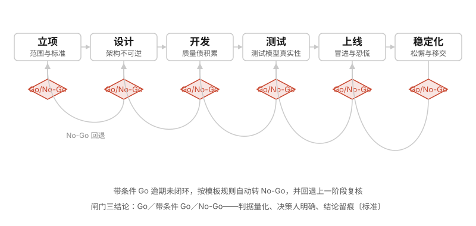

<!-- Diátaxis: How-to -->
# 第 16 章　项目与变革管理实战

> 本章解决一个大项目从启动到稳态的执行问题。目标产物有四项。清晰的阶段节奏。可追责的上线闸门。可收敛的跨厂商仲裁机制。可度量的变革采用结果。TAM 不管计划表，但对技术决策质量与变革落地负责。本章为 How-to。边界背景见[第 2 章](ch02-role-boundary-map.md)，训练方法见[附录 Y](appx-y-training-tutorial.md)。

## 16.1 前置条件与目标

大项目开始时，先确认以下输入。缺少任一关键输入，先补齐或将其列为项目风险。

| 前置条件 | 检查内容 | 缺项处理 |
| --- | --- | --- |
| 项目章程与成功标准 | 目标、范围、验收口径 | 推动客户补充量化标准 |
| 里程碑基线 | 阶段划分与关键日期 | 与 PM 对齐后书面确认 |
| 接口与责任矩阵 | 跨厂商接口级 RACI | 立项期补齐并会签 |
| 风险登记册 | 项目风险有 Owner 与复审 | 按[第 14 章](ch14-risk-compliance-practical.md)建立 |
| 上线闸门判据 | 判据可量化、决策人明确 | 闸门前完成判据会签 |
| 回退与演练安排 | 回退方案、演练窗口 | 上线前完成实测 |
| 业务日历与冻结窗口 | 峰值与监管节点 | 纳入项目计划约束 |
| 采用度基线 | 当前业务量与使用现状 | 上线前完成基线记录 |

### 16.1.1 TAM 与 PM 的分工

PM 管计划与交付。TAM 管技术风险与技术决策质量。两者共同保障项目成功，但责任对象不同。

| 领域 | PM 主责 | TAM 主责 |
| --- | --- | --- |
| 范围与进度 | 计划、资源与里程碑 | 技术依赖与可行性反馈 |
| 质量与风险 | 项目质量计划 | 技术风险识别与闸门结论 |
| 跨方协同 | 多方计划对齐 | 接口技术事实与仲裁输入 |
| 上线决策 | 组织评审与决策流程 | 技术判据与风险披露 |
| 上线之后 | 项目收尾 | 稳态运营与采用推动 |

越界有两种表现。TAM 替 PM 追进度会荒废技术判断。TAM 在技术决策上失声会失去服务价值。

### 16.1.2 完成标志

项目完成不等于系统上线。本章的执行目标包含四项。

| 目标 | 完成标志 | 证据 |
| --- | --- | --- |
| 节奏清晰 | 阶段矛盾与先行信号有跟踪 | 阶段检查记录 |
| 决策可追 | 闸门结论与条件有签收 | 闸门记录与台账 |
| 争议可收敛 | 接口争议有事实与结论 | 仲裁记录与测试报告 |
| 变革有效 | 采用度达到约定水平 | 用量与业务数据 |

### 16.1.3 项目等级与执行强度

不是所有项目都需要同等强度的机制。执行强度按影响范围、故障代价与跨方复杂度分级。

| 项目等级 | 典型特征 | 执行强度 |
| --- | --- | --- |
| 重大变革 | 核心系统替换、跨多厂商、监管关注 | 全量检查点、分级闸门与重保衔接 |
| 重要变更 | 关键业务系统升级或扩容 | 关键检查点与完整闸门 |
| 一般项目 | 非核心系统上线或优化 | 精简检查点与合并评审 |

分级不等于省略风险登记。低等级项目仍需风险台账与验收记录。差别在评审深度、值守规模与检查频率。

分级需要在立项时确认。项目中途若扩大范围或触及核心链路，应及时上调等级。范围收缩时是否降级，需要重新评估风险。

## 16.2 操作一：建立项目节奏

节奏感是知道每个阶段的主要矛盾。项目会从一种稳态迁移到另一种稳态。不同阶段需要关注的判断不同。

### 16.2.1 六阶段矛盾与检查点

| 阶段 | 主要矛盾 | TAM 检查点 | 输出 |
| --- | --- | --- | --- |
| 立项 | 范围与成功标准是否真实 | 成功标准可量化、可验收 | 风险清单与验收口径 |
| 设计 | 架构决策是否不可逆 | 架构评审完成，高风险入册 | 评审结论与条件 |
| 开发 | 质量债是否隐性积累 | 缺陷趋势与里程碑偏差 | 风险更新与升级建议 |
| 测试 | 测试模型是否真实 | 模型经业务侧确认 | 压测与演练记录 |
| 上线 | 冒进与恐慌是否并存 | 闸门结论与回退准备 | Go/No-Go 记录 |
| 稳定化 | 松懈与移交是否断档 | 观察期、移交与采用跟踪 | 稳态验收与采用报告 |

阶段名称可以按方法论调整。矛盾与检查点不能缺失。越早阶段的问题，修复成本越高。

### 16.2.2 建立先行信号跟踪

里程碑延迟通常滞后。先行信号更早出现。TAM 应把信号纳入固定跟踪。

| 先行信号 | 可能含义 | 建议动作 |
| --- | --- | --- |
| 缺陷重开率上升 | 修复质量或验收标准问题 | 复核缺陷定义与测试口径 |
| 变更请求突然增多 | 需求或范围失控 | 推动范围复盘 |
| 决策反复推迟 | 权责不清或风险未决 | 升级到有授权角色 |
| 关键人缺席例会 | 优先级下降或组织变化 | 核实真实原因 |
| 测试环境与生产差异扩大 | 测试结论可信度下降 | 对齐环境与数据特征 |
| 值守与演练准备停滞 | 上线风险积累 | 纳入闸门条件 |

先行信号需要两周左右的提前量。信号出现后，先核实再升级。避免把组织调整误判为项目失控。

### 16.2.3 节奏跟踪步骤

1. 建立阶段表，标明每阶段主要矛盾与检查点；
2. 为每个先行信号指定数据来源与观察频率；
3. 每周核对信号变化，记录趋势而非单点；
4. 对异常信号做归因，区分技术、组织与需求原因；
5. 将确认风险写入登记册并指定 Owner；
6. 在项目例会报告趋势与已采取动作；
7. 阶段切换时做检查点复核，更新风险与计划。

节奏跟踪的输出是风险变化与决策建议。它不是第二张进度表。

### 16.2.4 阶段切换评审

阶段切换是风险重置点。上一阶段遗留问题会直接影响下一阶段。切换前需要一次简短评审。

评审内容包含四项。检查点完成情况。未关闭风险与 Owner。先行信号趋势。下一阶段主要矛盾与资源需求。

评审输出进入项目例会与风险登记册。发现重大缺口时，切换应带条件推进或延后。把问题带入下一阶段，会放大处理成本。

阶段切换评审可以合并到现有例会。关键是每次切换都有明确结论。口头确认不留痕，会在争议时失去依据。

## 16.3 操作二：运行上线闸门

闸门是 TAM 技术判断的正式出口。运行质量决定上线风险能否如实披露。

### 16.3.1 闸门前置步骤

1. 确认判据已事先量化并会签。判据不在会上临时确定；
2. 收集模板输入，逐项核对；
3. 对未关闭风险逐条给出结论。接受、缓解或阻断都要写明；
4. 核验回退方案实测记录与耗时；
5. 核验演练结果与遗留问题；
6. 核验监控告警就绪与接收人验证；
7. 核验值守与升级安排；
8. 在评审会前完成预读与问题清单。

闸门输入以[模板 04](../templates/04-go-nogo-gate-checklist.md)为准。输入不齐时，先补材料或转为带条件评审。

### 16.3.2 决策框架三要素

| 要素 | 要求 | 常见缺陷 |
| --- | --- | --- |
| 判据量化 | 事先定义阈值与验证方式 | 现场讨论标准 |
| 决策人明确 | 明确拍板角色与授权范围 | 集体模糊负责 |
| 结论留痕 | 结论、条件与责任书面化 | 口头放行 |

判据示例包括高风险项数量、回退实测时长与监控覆盖。具体阈值按客户等级与业务影响校准。

### 16.3.3 三种结论的写法

**Go**：附观察期与回退窗口。窗口内回退方案保持可执行状态。

**带条件 Go**：条件、期限与复核点必须齐备。示例写法为“上线后 48 小时内完成指定验证。未通过则回退”。缺少复核点的条件等于变相 Go。

**No-Go**：说明差什么、何时可以再评、需要哪些动作。No-Go 不是终止，而是明确重新评审的门槛。

条件 Go 逾期未闭环时，按模板规则自动转 No-Go。自动转换能防止条件长期悬空。

### 16.3.4 闸门后的跟踪

闸门结论进入台账。带条件项与观察期事项需要指定 Owner 与验证方式。回退窗口结束前，回退能力必须保持可用。

闸门复盘纳入项目复盘。重点回答三个问题。判据是否有效。风险披露是否充分。条件是否闭环。复盘结果用于下一次闸门改进。

### 16.3.5 判据按项目分级设置

判据强度应与项目等级匹配。重大变革需要硬门槛。一般项目可以合并检查项。

| 判据类型 | 重大变革 | 一般项目 |
| --- | --- | --- |
| 高风险项 | 必须清零或有缓解闭环 | 可带条件放行 |
| 回退能力 | 实测通过并保留窗口 | 方案评审通过 |
| 监控覆盖 | 关键链路全覆盖 | 核心指标覆盖 |
| 值守安排 | 现场值守与升级路径生效 | 远程值守 |
| 演练要求 | 实战或高保真演练 | 桌面推演 |

判据先于会议确定，不因进度压力临时调整。确需调整时，按变更流程重新会签。

硬门槛不是拒绝一切风险。它把无法接受的风险变成明确阻断。可接受风险通过条件与窗口管理。

## 16.4 操作三：处理跨厂商技术争议

多方项目的争议集中在接口。接口包含系统接口与责任接口。两类接口都需要事实与规则。

### 16.4.1 接口争议处理步骤

1. **建立接口清单**：列出系统接口、数据接口与责任接口；
2. **确认责任矩阵**：接口级 RACI 在立项期书面化。谁实现、谁验证、谁兜底要写清；
3. **事实先行**：收集协议文档、抓包、日志与联合测试结果；
4. **组织联合验证**：在可观测环境复现问题，避免会议争论；
5. **形成事实包**：记录现象、证据、时间线与已排除项；
6. **提出选项与代价**：给出可行方案及各自影响；
7. **交客户决策**：无法收敛时由客户授权角色决策；
8. **记录与闭环**：仲裁结论、责任归属与后续动作留痕。

### 16.4.2 仲裁纪律

技术争议用技术事实收敛。立场会无法产生结论。测试报告与会签记录是仲裁语言。

TAM 代表客户技术成功，不代表自家免责。为推卸责任而把问题全部指向其他厂商，会损失客户信任。

| 行为 | 允许做法 | 禁止做法 |
| --- | --- | --- |
| 陈述事实 | 引用日志与测试结果 | 推断对方动机 |
| 划分责任 | 引用书面矩阵 | 会中临时划界 |
| 提出方案 | 给选项与代价 | 只给立场不给方案 |
| 对外沟通 | 由授权接口统一输出 | 私下向客户告状 |

多方争议还涉及商务关系。技术仲裁聚焦事实与影响。商务赔偿与合同解释由商务角色处理。

### 16.4.3 预防优于仲裁

争议成本远高于预防。立项期的接口矩阵与联合测试计划，能显著降低争议成本。

接口变更需要共同评审。变更影响范围、兼容性与回退方式都要记录。接口文档版本应与变更台账联动。

### 16.4.4 常见争议形态与收敛方式

| 争议形态 | 常见说法 | 收敛方式 |
| --- | --- | --- |
| 接口超时 | 双方都说自己正常 | 联合抓包与全链路日志 |
| 数据不一致 | 双方各执一套口径 | 对账样本与字段口径核对 |
| 性能不足 | 应用方与网络方互相指向 | 分段压测定位瓶颈 |
| 变更引入故障 | 变更方与受影响方争议 | 变更时间线与指标对照 |
| 责任边界模糊 | 都认为对方应兜底 | 引用立项期接口矩阵 |

这些争议的共同点是事实分散。收敛动作是把分散证据拼成同一时间线。没有共同时间线，讨论会停在立场。

时间线应标注来源与采集方式。联合验证过程要留记录。证据质量决定仲裁结论能否被各方接受。

## 16.5 操作四：推动客户侧变革

系统上线不等于业务采用。大量项目的结果是成功上线、随后闲置。采用率才是变革终点。

### 16.5.1 采用度度量步骤

1. 上线前记录采用基线。包含业务量、用户数与替代流程状态；
2. 与客户确认采用目标与观察周期；
3. 上线后按固定频率采集采用数据；
4. 区分不会用、不愿用与不敢用三类阻力；
5. 对每类阻力匹配干预动作；
6. 跟踪干预效果并调整；
7. 采用稳定后固化新流程并进入稳态运营。

采用度指标应与业务指标连接。用户数增长不等于业务价值。关键业务场景的迁移比例更有意义。

### 16.5.2 三类阻力与对策

| 阻力 | 症状 | 对策 |
| --- | --- | --- |
| 不会用 | 功能闲置、重复提问 | 实操培训与种子用户机制（[附录 J](appx-j-enablement-training-standard.md)） |
| 不愿用 | 表面使用，暗中绕回旧流程 | 找到利益受影响角色，用业务数据说明收益 |
| 不敢用 | 关键操作仍走旧通道 | 陪跑期、并肩值守与稳定运行记录 |

三类阻力可能同时存在。只做培训无法解决利益问题。只讲收益无法解决操作陌生。干预需要分层。

### 16.5.3 把项目变成日常

系统会替换，流程会沉淀。变革期的关键产出还包括新流程。运维、应急与变更流程需要同步建立。

流程建立应有责任人、触发条件与验证方式。没有流程的系统，在人员变动后仍会退回旧习惯。

采用稳定后进入转换阶段。TAM 与客户共同确认日常运营机制。项目组织逐步退出，服务组织接手。相关交接要求见[附录 L](appx-l-project-onboarding-standard.md)。

### 16.5.4 采用度指标的三层结构

单一登录量无法说明变革成功。采用度需要覆盖行为、业务与替代三个层面。

| 层面 | 指标方向 | 判读要点 |
| --- | --- | --- |
| 行为层 | 活跃用户、关键操作使用率 | 是否形成稳定使用习惯 |
| 业务层 | 关键业务场景迁移比例 | 是否进入真实业务流程 |
| 替代层 | 旧流程使用下降情况 | 是否真正完成切换 |

三层同时改善，变革才算落地。行为数据上升而旧流程仍在并行，说明切换没有完成。业务迁移上升而用户抱怨增加，说明体验或能力仍有缺口。

指标口径应与客户确认。统计范围、取数方式与观察周期要写明。口径不清的采用数据容易变成汇报装饰。

并行期也需要设定退出条件。长期双轨运行会持续消耗资源，也会让旧流程保持生命力。退出条件应包含业务验证与用户准备度。

## 16.6 验收标准

用以下标准检查本章执行效果。检查对象是机制与结果，不是文档数量。

| 验收项 | 通过标准 | 验证方式 |
| --- | --- | --- |
| 阶段节奏 | 每阶段有矛盾清单与检查记录 | 抽查阶段文件 |
| 先行信号 | 信号有数据源与趋势记录 | 核对最近四周趋势 |
| 闸门质量 | 判据事先量化，结论有签收 | 抽查最近一次闸门 |
| 条件闭环 | 带条件 Go 全部按期复核 | 核对条件台账 |
| 争议处理 | 争议有事实包与结论记录 | 抽查仲裁记录 |
| 采用达成 | 采用度达到约定目标 | 核对业务数据 |
| 流程沉淀 | 新流程有责任人与验证方式 | 抽查流程文件 |

任一验收项失败，先修复机制再进入下一阶段。闸门与采用属于关键项，不能以文档补齐方式通过。

### 16.6.1 验收记录与复查

验收记录包含抽查对象、发现问题和整改动作。记录进入项目档案与服务台账。复查时先看上一轮问题是否闭环。

| 复查时机 | 复查重点 | 输出 |
| --- | --- | --- |
| 阶段切换 | 检查点与遗留风险 | 切换结论 |
| 闸门前 | 判据与输入完整性 | 评审输入确认 |
| 上线后一周 | 观察期指标与条件项 | 观察期报告 |
| 采用稳定后 | 采用目标与流程沉淀 | 稳态验收记录 |

复查不必等待固定会议。关键节点到来前完成核查，能避免会议流于形式。

## 16.7 执行故障排查

| 症状 | 常见原因 | 处理动作 |
| --- | --- | --- |
| 阶段长期红灯 | 成功标准或范围不清 | 回到立项口径复核 |
| 会议决策反复推迟 | 权责不清或风险未定 | 明确决策角色与时限 |
| 闸门变成橡皮图章 | 判据未量化或决策人缺位 | 重建判据并会签 |
| 回退方案不可用 | 未实测或依赖未验证 | 上线前完成实测演练 |
| 跨厂商争论无结论 | 缺少事实包与责任矩阵 | 补联合测试与书面矩阵 |
| 采用停滞 | 只解决不会用，忽略利益与信任 | 重新识别阻力类型 |
| 上线后运维断档 | 移交与流程未建立 | 启动稳态移交评审 |

排查遵循先修机制、再处理个案。同类问题重复出现时，进入复盘流程。

## 16.8 常见误区

1. **越界当 PM**：替 PM 追进度与管资源，技术判断反而缺位；
2. **闸门橡皮图章**：评审走过场，判据让位于进度。一次放水会损害整个评审体系；
3. **上线即终点**：上线后团队撤离，系统随后闲置。采用率才是终点指标；
4. **仲裁变成站队**：为免责指责他方，短期撇清，长期失去客户信任；
5. **用重保替代闸门**：以为上线后加强值守就能覆盖准备不足。重保是补充，不是闸门替代品；
6. **所有风险一律阻断**：把闸门当成零风险要求。合理的带条件放行与接受机制同样必要。

## 16.9 执行检查清单

- [ ] 手头项目的阶段、主要矛盾与先行信号清晰
- [ ] 成功标准量化可验收，并获客户确认
- [ ] 闸门判据事先量化，决策记录会签留痕
- [ ] 带条件 Go 的条件、期限与复核点齐备
- [ ] 跨厂商接口责任矩阵已书面化到接口级
- [ ] 采用度目标与跟踪机制已建立
- [ ] 三类变革阻力各有干预动作在运行
- [ ] 项目风险与服务计划、风险登记册联动

## 16.10 AI 时代的执行增量

闸门证据的齐套性交给 AI 先查。测试报告、变更单与演练记录按模板 04 逐项对，缺件直接列出来。评审会前就能出结果。

带条件 Go 的期限由模型盯。条件项临近复核点未闭环，AI 先发预警给 Owner 与 TAM。预警只进条件台账，不在群里刷屏。

预警只提示缺口，不替人催办。条件项的 Owner 收到清单后自己排期。模型从不替人定优先级，也不改判据。

缺口清单要人工复核。AI 把已归档的旧版报告算成缺件时，由 PM 与 TAM 当场更正。误报一次，台账记一次。更正记录进闸门台账。

归集动作挂在闸门前置步骤上。AI 在会前自动跑一轮齐套性检查。会中只看例外项，不逐件念材料。材料仍在原系统。

没变的是签字权。Go、带条件 Go 与 No-Go 由决策人签，回退决定同样由人拍板。AI 的检查结果只进预读材料，不上签字栏。

一条边界：AI 只报缺口，不报 Go/No-Go 结论。缺口漏报时以模板 04 的输入清单为准，人工再过一遍。签字前不得只看模型的齐套清单。

---

**本章要点回顾**

1. TAM 不管计划表，负责技术决策质量与变革落地。四个主战场是节奏、闸门、仲裁与变革。
2. 六阶段各有主要矛盾与检查点。先行信号比里程碑延迟更早暴露问题。
3. 闸门要求判据事先量化、决策人明确、结论留痕。带条件 Go 必须有复核点。
4. 跨厂商争议按事实、矩阵与联合验证处理。客户保留最终决策权。
5. 变革终点是采用率。三类阻力分别对应赋能、利益沟通与信任陪跑。
6. 项目结束时，系统与流程共同进入日常运营。

## 内涵篇小结

至此，内涵六维齐备。**技术纵深**判得对。**业务洞察**说得通。**关系经营**信得过。**服务治理**稳得住。**风险与合规**看得远。**项目与变革管理**落得下去。

六维不是六份独立工作，而是一个乘法体系。任何一维缺席，其他五维的产出都会在那个缺口处漏掉。第三部分外延篇回答一个衔接问题。这六维能力要进入客户全生命周期与生态。施展节奏与协同对象是外延篇主题。