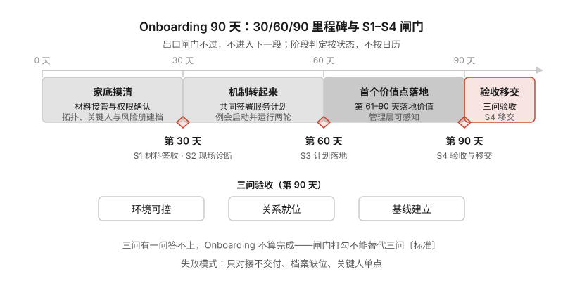

<!-- Diátaxis: How-to -->
# 第 17 章　客户全生命周期运营

> 外延篇开篇。内涵篇提供六项能力。本章把它们组织到时间轴上。一个客户从签约到续约，TAM 的工作按四个阶段展开。阶段是 Onboarding、采纳深化、稳态运营、续约与扩容。每个阶段先写清失败的样子。随后给出目标、交付物与节奏。生命周期运营的要义可以浓缩成一句。**每个阶段都为下一阶段存款，或者透支。**

> 与[附录 L](appx-l-project-onboarding-standard.md)的分工：附录 L 的 S1–S4 是项目导入的交付闸门。本章是客户关系与价值的阶段经营。同一段 90 天，两套视角，档案合并移交。

## 17.1 生命周期总览：四阶段与两条暗线

**阶段判定按状态，不按日历。** 日历只是参考节奏。进出阶段的依据是出口条件。90 天到了但条件没过，Onboarding 就不算结束。

| 阶段 | 参考时间窗 | 核心目标 | 出口条件 | 失败的样子 |
| --- | --- | --- | --- | --- |
| Onboarding | 第 0–90 天 | 环境可控、关系就位、基线建立 | 三问验证通过（见 17.2） | 只对接不交付，客户说不出你做了什么 |
| 采纳深化 | 第 4–12 月 | 从用起来到离不开 | 采纳漏斗升层且证据在册 | 停留在浅层，替换成本始终很低 |
| 稳态运营 | 持续 | 服务稳定兑现、风险持续清零 | 持续态，看 11.4 三纪律 | 服务变成背景音，续约前才想起客户 |
| 续约与扩容 | 到期前 180 天启动 | 技术信号支撑续约、识别扩容 | 续约风险定级与价值报告交付 | 到期前 30 天才发现客户在谈竞品 |

两条暗线贯穿四个阶段。它们不单独占阶段。

1. **信任账户**：每次兑现是存款，每次失约是取款。Onboarding 期利率较高。新客户会先给出一段信用额度。机制见[第 9 章](ch09-relationship-management.md)。
2. **健康分**：各阶段权重不同。Onboarding 看进度，深化期看采纳，稳态看 SLA 与风险，续约期看信号。口径见[第 34 章](ch34-measurement-system.md)。

### 17.1.1 前置条件与目标产物

运行生命周期运营前，先确认以下条件。缺项时先补齐，或将缺项登记为风险。

| 前置条件 | 检查内容 | 缺项处理 |
| --- | --- | --- |
| 合同与服务范围 | SLA、服务内容与责任边界 | 与服务负责人确认 |
| 技术档案 | 架构、版本、配置与故障史 | 按[附录 B](appx-b-tam-process-system.md) B.3.3 建档 |
| 关键人地图 | 决策链、影响链与防线初版 | 用[模板 11](../templates/11-key-person-map-canvas.md)建立 |
| 风险登记册 | 风险有 Owner 与复审日期 | 按[第 14 章](ch14-risk-compliance-practical.md)建立 |
| 业务日历 | 峰值、冻结与监管节点 | 按[第 7 章](ch07-business-insight.md)补建 |
| 采纳基线 | 当前用量与业务承接情况 | 上线或接手时记录 |
| 健康分机制 | 口径与更新节奏明确 | 按第 34 章确认 |

完成目标是让四个阶段都有可验证出口。目标产物包括五类。阶段判定记录与采纳证据。价值锚点台账。续约风险初判与交接档案。

| 目标 | 完成标志 | 主要产物 |
| --- | --- | --- |
| 阶段清晰 | 每次切换有出口条件核验 | 阶段判定记录 |
| 采纳可量 | 漏斗层级与证据可查 | 采纳证据台账 |
| 价值可证 | 每季度有可核验价值锚点 | 价值锚点台账 |
| 续约可控 | T-180 有风险初判与信号 | 续约风险记录 |
| 连续可交 | 人员变动有完整移交包 | 移交档案 |

### 17.1.2 阶段判定步骤

1. 列出当前阶段与候选阶段。
2. 对照出口条件逐项核验证据。
3. 找出未满足条件与对应 Owner。
4. 判断未满足条件是否阻断切换。
5. 阻断时留在原阶段。同步更新风险登记册。
6. 不阻断时记录带条件切换与复核点。
7. 更新阶段判定记录。同步双方接口人。

阶段判定按月复查。客户组织、业务目标或系统范围发生重大变化时，立即复查。

## 17.2 Onboarding：90 天窗口期

### 为什么前 90 天关键

新客户签约后有一段信任窗口期。管理层对换供应商或上新系统仍有疑虑。执行层在观察你的专业度。双方都在为这段关系估值。

窗口大约持续 90 天。窗口内交出可见价值，关系进入正循环。交不出，你很容易变成对接人群中的一个名字。

### 30/60/90 里程碑与 S1–S4 闸门

骨架按[模板 02](../templates/02-onboarding-90d-checklist.md)的 S1–S4 推进。出口闸门不过，不进入下一段。细则与验收锚点见[附录 L](appx-l-project-onboarding-standard.md)。里程碑按 30/60/90 自检。

| 里程碑 | 该拿下的状态 | 对应闸门动作 |
| --- | --- | --- |
| 第 30 天 | 家底摸清，拓扑与关键人有图 | S1 材料签收与 S2 现场诊断 |
| 第 60 天 | 机制转起来，服务计划与例会就位 | S3 计划落地 |
| 第 90 天 | 首个价值点落地，管理层可感知 | S4 验收与移交 |

三件事是骨架之上的魂。验收时逐条自问。

- **环境可控吗**：架构、配置基线与监控覆盖有档案可查。
- **关系就位吗**：关键人地图三类角色都接触过。至少一个技术关键人开始主动找你。
- **基线建立吗**：SLA 基线、容量水位与故障史有数。

三问有一问答不上，Onboarding 不算完成。闸门打勾不能替代三问。

| 验证问题 | 最低证据 | 常见伪证 |
| --- | --- | --- |
| 环境可控 | 拓扑图、监控覆盖清单、配置基线 | 只有合同附件中的旧拓扑 |
| 关系就位 | 三条链各有联系人且有过互动 | 通讯录里有名字但未接触 |
| 基线建立 | SLA 基线、容量水位与故障史 | 只抄合同 SLA 数字 |

证据需要可查与更新。伪证的共同点是存在文件，却无法支撑判断。验收时按证据抽查，不按口头说明。

### 操作步骤

1. 完成材料接管与权限确认。
2. 绘制环境拓扑与隐性依赖。核对监控覆盖。
3. 建立技术档案初版与关键人地图。
4. 完成风险识别，建立登记册初版。
5. 与客户共同签署服务计划。
6. 启动例会体系并运行至少两轮。
7. 在第 61–90 天落地首个价值点。
8. 用三问验收，随后完成 S4 移交。

### 失败的样子（三个模式）

1. **只对接不交付**：90 天开了无数对接会。客户可感知的交付物为零。首个价值点必须在第 61–90 天落地。
2. **档案缺位**：跳过技术档案建档。后面每个阶段都在补这一课。档案规范见附录 B.3.3。
3. **关键人单点**：只与一个接口人保持热络。此人调岗后关系归零。Onboarding 期应完成三条链的多点布局。

## 17.3 采纳深化期：从用起来到离不开

第 4 到 12 个月的主题是深度。客户已在生产环境使用。使用深度决定续约时的替换成本。

**采纳漏斗四层。** 逐层递进。证据入册才算到达。

| 层 | 标志 | TAM 动作 |
| --- | --- | --- |
| 用得上 | 一个功能、一个团队在跑 | 推广案例、排除使用障碍 |
| 用得全 | 核心功能覆盖，关键流程跑在产品上 | 性能调优与容量规划 |
| 用得深 | 客户数据与工作记录沉淀在平台 | 数据价值呈现、报表与洞察 |
| 用得广 | 多团队多场景扩散，周边系统集成 | 集成评审与变更治理联动 |

性能与容量方法见[第 5 章](ch05-technical-depth.md)与[第 23 章](ch23-financial-availability.md)。变更治理见[附录 T](appx-t-online-change-standard.md)。

阶段三件事如下。

1. **量化采纳**：功能覆盖率、活跃深度与承载业务量进月报。客户在用不算指标。用到第几层才算。
2. **价值锚点台账**：每季度至少一个由 TAM 主导的优化动作。性能、成本或架构选其一。每个动作登记可核验锚点，包含前后对比与客户确认人。台账是续约期 VBR 的原料。平时不记，T-120 就编不出来。
3. **赋能客户**：执行客户团队能力提升计划。参考[附录 J](appx-j-enablement-training-standard.md)的 T1/T2 培训。客户越会用，采纳越深，工单反而越少。

### 操作步骤

1. 记录采纳基线，确认当前漏斗层级。
2. 与客户确认本阶段采纳目标与时间窗。
3. 识别卡在当前层级的原因。区分能力、流程与利益问题。
4. 每月更新采纳指标并写入月报。
5. 每季度完成至少一个优化动作，登记价值锚点。
6. 升层后更新证据，进入下一层目标。
7. 命中停滞信号时登记风险，并给出干预动作。

**停滞信号采用三选二触发。** 连续两个月采纳层不升。用量横盘。关键人不再提新需求。命中两条即登记采纳停滞风险（流程 P9）。不要等到续约才发现。

## 17.4 稳态运营期：稳态不是静态

进入稳态的标志有三项。例会节奏稳定。SLA 持续达标。风险册正常滚动。这个阶段持续时间长，也容易松懈。危险不在出事，在没事。

### 节奏表

节奏与附录 B.3.1 一致。以下按生命周期视角强调。

| 节奏 | 动作 | 本阶段特别要求 |
| --- | --- | --- |
| 周 | 周例会与周报 | 风险册刷新是固定议程 |
| 月 | 月度服务评审与月报 | 健康分按月更新，趋势比单点重要 |
| 季 | QBR（[模板 08](../templates/08-qbr-ebr-template.md)） | 每季必须有一页本季新增价值 |
| 半年 | 服务计划滚动修订（流程 P1） | 组织与系统变化即时修订 |
| 年 | 年度体检与架构评审（[模板 03](../templates/03-architecture-review-checklist.md)） | 体检报告是续约价值叙事原料 |

### 反惰性三纪律

1. **锋度**：每季度至少一个主动价值动作。专项体检、成本优化或新能力导入均可。服务的锋刃要自己磨。
2. **扫描**：每半年对照附录 B.3.9 做全量自查。风险主动扫描不断档。稳态滑坡通常从自检松懈开始。
3. **价值重述**：每季 QBR 重述一次共同成果。原料来自价值锚点台账。管理层连续两季缺席 QBR，或月报无人回复，即触发**背景音警报**。

### 操作步骤

1. 按月维护节奏表。风险册刷新进入固定议程。
2. 按月更新健康分。关注趋势而不是单点。
3. 每季完成一个主动价值动作并登记锚点。
4. QBR 固定包含风险、计划与新增价值。
5. 每半年对照附录 B.3.9 自查并全量扫描。
6. 发现背景音警报时启动关系升温。
7. 业务、组织或系统重大变化时滚动修订服务计划。

### 背景音警报的处理顺序

背景音警报指客户对服务的注意力下降。表现形式包括连续缺席与长期不回应。它不等于客户一定流失，但说明关系信号减弱。

处理顺序分四步。先核实原因。区分业务忙碌、组织变化与真实不满。再安排一次高质量沟通。可以是一次专题汇报或价值回顾。随后调整服务节奏与沟通对象。随后观察两个周期，确认信号是否恢复。

警报期间不宜群发问候。低价值触达会进一步降低注意力。有效动作是带来新信息或解决真实问题。

## 17.5 续约与扩容：到期前 180 天启动

续约不是商务动作的最后 30 天。它是技术信号的前 180 天。流程编号为流程 P10。

### 操作步骤

1. T-180 完成续约风险初判。覆盖健康分、用量与关键人信号。
2. T-150 与销售完成信号同步。形成书面记录。
3. T-120 核对价值锚点台账。启动价值实现报告。
4. T-90 完成高层对齐或专项价值汇报。
5. T-60 完成扩容或续约的技术测算。
6. T-30 进入谈判技术支持。随时提供技术口径。
7. 到期后复盘信号准确率与实际结果。

### 180 天倒计时节奏表

| 时点 | 动作 | 交付物 |
| --- | --- | --- |
| T-180 | 续约风险初判。健康分、NPS、用量与关键人四信号 | 初判记录 |
| T-150 | 与销售信号同步会 | 共享纪要 |
| T-120 | 启动价值实现报告，原料来自价值台账 | VBR 初稿 |
| T-90 | 高层对齐或 EBR 汇报 | 汇报材料 |
| T-60 | 扩容机会技术测算 | 扩容技术方案 |
| T-30 | 谈判技术支持与即时响应 | 响应记录 |

信号口径与书面机制见[第 21 章](ch21-commercial-synergy.md)。信号共享纪律见[第 19 章](ch19-internal-collaboration.md)。

### 扩容是信号，不是目标

TAM 不背销售指标。职责是让三个技术信号不迟到。

- **容量水位持续上行**：直接的扩容论据。
- **采纳层升级诉求**：客户主动提出能否覆盖新业务。
- **新规划披露**：来自例会、高层对话与行业动态。捕获后第一时间做技术匹配分析。

信号晚到一周，商务动作就会延后。

### 流失预警与输单复盘

**流失预警采用三选二触发。** 健康分连续两月下行。管理层互动降级。出现竞品接触信号。命中两条即启动挽留动作并上报。

**输单必复盘。** 归因分为四类。技术信号漏报、价值呈现失败、关键人变动或产品力问题。结论写进案例库。复盘要求见[附录 R](appx-r-problem-retrospective-standard.md)。

## 17.6 阶段切换与移交纪律

四个阶段之间有三次切换。每次切换都是信息丢失高发点。

| 切换 | 交接物 | 接收方确认 |
| --- | --- | --- |
| Onboarding → 采纳深化 | 技术档案、风险册、采纳基线 | 服务计划修订版 |
| 采纳深化 → 稳态运营 | 采纳层级证据、优化清单、培训记录 | 稳态节奏表确认 |
| 稳态运营 → 续约期 | 健康分趋势、价值台账、关键人地图 | 续约风险初判 |

TAM 人员变动时执行**移交三件套**。技术档案、信任账户状态与风险登记册。二手项目另按模板 02 条款与附录 B.3.3 档案规范交接。**连续性不依赖某个 TAM 的记性，依赖档案与清单。**

### 移交验收与伴随期

移交完成需要接收方签收。签收前应核对三项内容。档案是否覆盖当前状态。关系状态是否写清。风险是否完成交接确认。

签收后建议设置伴随期。原负责人提供一段过渡支持。伴随期内客户与接收方共同确认接口。伴随期结束以接收方能独立推进为准，不以天数自动结束。

移交也应包含客户侧确认。客户需要知道新的接口与升级路径。否则人员变动会被客户感知为服务中断。

## 17.7 验收标准

用以下标准检查生命周期运营是否真实运行。标准针对证据与结果。

| 验收项 | 通过标准 | 验证方式 |
| --- | --- | --- |
| 阶段判定 | 每次切换有出口核验记录 | 抽查判定记录 |
| Onboarding | 三问有证据，S4 已完成 | 核对档案与移交记录 |
| 采纳深化 | 漏斗层级有证据，月报含采纳指标 | 抽查采纳台账 |
| 价值台账 | 每季度至少一个可核验锚点 | 核对前后对比与确认人 |
| 稳态运行 | 节奏不断档，三纪律有记录 | 核对例会与 QBR 材料 |
| 续约节奏 | T-180 启动，信号书面移交 | 核对信号单与初判记录 |
| 交接完整 | 移交三件套齐备且签收 | 抽查移交档案 |

验收发现缺项时，先补齐证据与动作。关键项包括 Onboarding 三问与续约信号移交。未通过前不进入下一阶段。

## 17.8 执行故障排查

| 症状 | 常见原因 | 处理动作 |
| --- | --- | --- |
| Onboarding 超期 | 出口条件不清或材料未接管 | 回到三问与 S4 条件 |
| 采纳层级停滞 | 未识别阻力类型 | 区分能力、流程与利益问题 |
| 价值锚点缺失 | 季度优化动作未执行 | 恢复季度动作并补记录 |
| 服务变成背景音 | 节奏断档或价值重述缺位 | 检查 QBR 出席与回应 |
| 续约信号迟到 | T-180 未启动或信号未书面化 | 立即补初判并同步销售 |
| 交接后服务波动 | 移交包缺关系与风险状态 | 补交并按伴随期跟踪 |
| 阶段判定反复 | 出口条件未双方确认 | 重新会签判定标准 |

反复出现的阶段性问题，应进入复盘流程。

## 17.9 执行检查清单

- [ ] 当前阶段与出口条件清晰，判定有记录
- [ ] Onboarding 三问有证据，S4 移交已完成
- [ ] 采纳漏斗层级与证据在册，月报含采纳指标
- [ ] 价值锚点台账本季度有新增并客户确认
- [ ] 稳态节奏无断档，三纪律均有执行记录
- [ ] T-180 续约盘点已启动，信号有书面移交
- [ ] 流失预警三选二触发机制已建立
- [ ] 人员变动移交三件套齐备且签收

## 17.10 AI 时代的执行增量

AI 先改续约风险的预判方式。模型把健康分、用量横盘与关键人互动合成为一张趋势图。T-180 初判先看趋势图，再写结论。

采纳度数据的归集交给模型。功能覆盖率、活跃深度与业务量按月自动汇总成月报底稿。TAM 只核对口径与证据，不再抄数。

Onboarding 材料的齐套核对也由 AI 先跑。拓扑图、配置基线与关键人名单缺哪项，模型直接列成清单。三问仍要人逐项抽查。

预测要回头校准。输单复盘时对比模型预警与实际结果。漏报的信号补进特征，误报的信号降权。健康分预测只是输入。

执行侧把 AI 挂进固定节奏。月报采纳指标由模型出初稿，价值锚点台账由模型提醒补齐。人改定后才发给客户。

没变的是商业判断。续不续约、扩不扩容，仍由人拍板。模型给的趋势不能替代一次当面确认，也不能替你签字。

一条边界：健康分预测不是承诺。取数断档时模型照样出数，数在说谎也看不出。口径唯一事实源在第 34 章，失真先查取数。

---

**本章要点回顾**

1. 四阶段按状态判定，不按日历。每阶段有出口条件与失败的样子。
2. Onboarding 走 30/60/90 里程碑与 S1–S4 闸门。三问验证环境、关系与基线。
3. 采纳漏斗分四层。价值锚点台账是 VBR 原料。停滞信号采用三选二触发。
4. 稳态的主要风险是没事。反惰性三纪律是锋度、扫描与价值重述。
5. 续约是 T-180 的技术信号工程。扩容是信号，不是目标。
6. 三次阶段切换各有交接物。人员变动执行移交三件套。连续性靠档案，不靠记性。