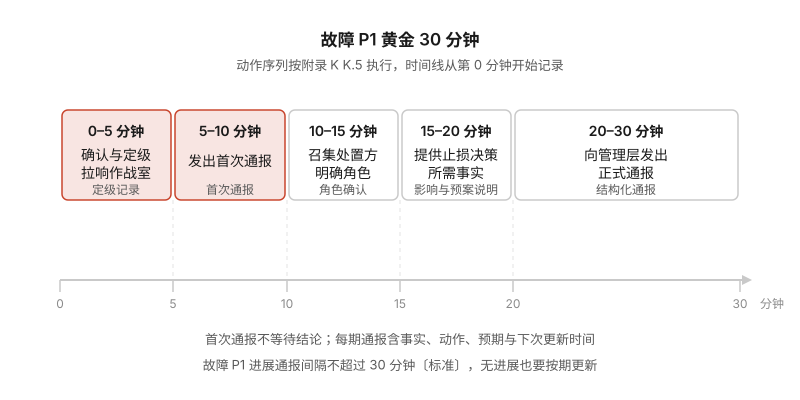

<!-- Diátaxis: How-to -->
# 第 18 章　升级与危机管理

> 危机是服务节奏被打断的时刻。平时积累的能力要在几十分钟内接受检验。技术纵深、信任账户与治理体系都会暴露真实水平。本章解决四类执行问题。升级机制如何运行。作战室如何指挥。客户沟通如何发声。事后信任如何重建。本章为 How-to。分钟级动作标准见[附录 K](appx-k-incident-emergency-drill-standard.md)，金融级技术流程见[第 25 章](ch25-financial-incident.md)。三者分工清晰。附录 K 管动作时限，第 25 章管事，本章管人。

## 18.1 前置条件与目标

危机机制需要在平时建成。事发后临时设计通道与角色，通常已经太晚。

| 前置条件 | 检查内容 | 缺项处理 |
| --- | --- | --- |
| 故障分级标准 | 定级依据与责任角色 | 按第 25 章确认 |
| 升级矩阵 | 三通道联系人、时限与授权 | 用[模板 06](../templates/06-major-incident-communication-matrix.md)建立 |
| 作战室机制 | 启动判据、角色与场地 | 先定义角色，再补工具 |
| 通报模板 | 首次、进展与恢复模板 | 按模板 06 补齐 |
| 值班与触达 | 值班安排与联系方式 | 按[附录 I](appx-i-on-duty-standard.md)建立 |
| 联系测证 | 路径电话与群组可用 | 定期实测并记录 |
| 监管报告路径 | 客户合规接口与口径流程 | 与客户合规确认 |

目标产物有五项。可用的升级矩阵。可启动的作战室。可复用的沟通脚本。可追溯的时间线。可验证的信任重建结果。

| 目标 | 完成标志 | 主要证据 |
| --- | --- | --- |
| 升级可控 | 触发条件书面化且路径实测 | 升级矩阵与测试记录 |
| 指挥有序 | 作战室按时启动且角色齐备 | 启动记录与时间线 |
| 通报稳定 | 每期通报按时且有下次时间 | 通报记录 |
| 事实完整 | 时间线与判断可回放 | 记录员日志 |
| 信任恢复 | 客户行为回到基线 | 互动与反馈记录 |

### 18.1.1 危机的责任边界

危机中容易出现两种越界。一种是 TAM 直接接管技术处置。另一种是 TAM 替客户做对外定性与商务承诺。

| 事项 | TAM 责任 | 授权角色 |
| --- | --- | --- |
| 技术处置 | 提供事实与客户影响 | 处置团队按指挥执行 |
| 客户信息流 | 统一发声与节奏 | TAM 或指定发言人 |
| 资源调度 | 提出需求与优先级 | 指挥官与管理通道 |
| 责任定性 | 提供证据与时间线 | 客户与公司按制度判断 |
| 商务与赔偿 | 提供技术影响口径 | 商务通道 |

边界清楚能提高处置效率。客户需要事实连续与责任明确。把所有角色混成一个人，反而降低协作效率。

## 18.2 操作一：运行升级机制

升级不是承认失败。它是风险管理工具。从不升级的服务体系通常不是没有问题。更常见的情况是问题在层层往下压。

### 18.2.1 三通道设计

升级矩阵包含三条通道。通道不混，时限刚性，降级显式。

| 通道 | 路径 | 解决什么 | 典型触发 |
| --- | --- | --- | --- |
| 技术通道 | 值班 → 专家 → 研发 oncall → 架构师 | 定位与修复 | 技术卡点与重大缺陷 |
| 管理通道 | TAM → 服务经理 → 双方管理层 | 资源、决策与安抚 | 资源不足与决策延迟 |
| 商务通道 | 服务经理 → 销售或商务 → 双方商务 | 责任、合同与赔偿 | 跨方责任与商务影响 |

一种常见的机制失败是只有技术通道。问题在专家手里转动，客户管理层却毫不知情。客户最后记住的往往不是原因，而是没人告诉我。

三通道也需要升级与降级记录。降级要显式说明条件与责任人。通道混用会让客户收到互相矛盾的信息。

### 18.2.2 触发条件

触发条件事先书面化，不靠临场判断。常见条件包括五类。

- 事件定级达到故障 P1 或 P2。定级标准见[第 25 章](ch25-financial-incident.md)。
- 处置超过时限阈值。例如故障 P1 超过 30 分钟未定位。
- 事件涉及资金、舆情或监管报告。
- 客户管理层主动询问。这本身就是信任信号变化。
- 跨厂商责任出现僵持，需要更高授权介入。

触发后按矩阵执行。TAM 不因担心升级而延迟动作。

### 18.2.3 操作步骤

1. 明确事件定级与当前通道状态。
2. 对照触发条件确认是否需要升级。
3. 按矩阵召集对应角色。说明现状、已做动作与所需支持。
4. 记录升级时间、接收人与响应结果。
5. 条件变化时更新等级。降级要留下显式记录。
6. 事件结束后复盘升级时机与路径有效性。

### 18.2.4 三条纪律

1. **早升级不丢人，晚升级毁信任**：升级成本是多几个人知道。晚升级的代价是客户从别处听说。
2. **升级带判断，不带恐慌**：升级信息包含三件套。已确认事实、已试过动作与建议下一步。裸抛问题会消耗升级通道。
3. **升级路径事先验证**：路径电话与群组定期实测。重保前夕必须复核一次。

### 18.2.5 通道时限与降级规则

时限按事件等级与值班标准设定。通道不同，响应要求不同。[附录 I](appx-i-on-duty-standard.md)提供值班触达基准。

| 通道 | 升级时限参考 | 降级条件 | 降级记录 |
| --- | --- | --- | --- |
| 技术 | 按事件等级快于客户节奏 | 卡点解除且风险可控 | 记录解除依据 |
| 管理 | 达到触发条件即启动 | 资源与决策到位 | 记录资源结论 |
| 商务 | 责任或金额影响明确后 | 商务议题另案处理 | 记录移交对象 |

降级必须显式。默默降级会让客户与内部都失去状态感。通道之间可以并行，但各自保留记录。

TAM 需要定期核对矩阵中的联系人与授权。人员变动后未更新矩阵，是危机中常见的失效点。

## 18.3 操作二：启动与运行作战室

作战室用于统一指挥与信息汇聚。启动判据包括三类。故障 P1 事件。重保窗口内的高危事件。出现舆情苗头的事件。

### 18.3.1 四个角色

四个角色缺一不可。角色应由不同人员承担。关键角色不建议兼任。

| 角色 | 职责 | 纪律 |
| --- | --- | --- |
| 指挥官 | 唯一决策人，定优先级并拍板 | 只能有一个指挥官 |
| 技术处置 | 排查与修复执行 | 只向指挥官汇报 |
| 沟通官 | 对内对外通报 | 唯一信息出口 |
| 记录员 | 时间线实录 | 时间线不可事后补记 |

两个指挥官的作战室比没有作战室更糟。多头指令会让处置动作互相冲突。

### 18.3.2 TAM 在作战室的三个位置

TAM 通常承担沟通官，但不只是传话筒。TAM 有三个固定位置。

- **客户信息流唯一出口**：每句话与每版时间线都有统一来源。客户收到的信息出自 TAM 或经 TAM 确认。
- **时间线守门人**：确保记录连续、来源清楚且版本一致。
- **决策事实供应商**：提供业务影响、历史背景与预案状态。

TAM 不替代技术处置。TAM 也不绕过指挥官调度全部资源。

### 18.3.3 两个反模式

**作战室变会议室。** 讨论越来越多，决策越来越慢。反模式信号是会议纪要很多，处置动作很少。指挥官应按节拍收束议题。

**英雄接管。** 资深工程师直接接手全部操作，绕过角色与记录。动作先出口再出手，对能力强的人同样成立。

### 18.3.4 操作步骤

1. 按判据确认启动，记录启动时间。
2. 明确四个角色与替补安排。
3. 建立固定同步节拍。示例为每 15 分钟对齐一次进展。
4. 建立单一信息源。时间线与当前判断保持同步。
5. 每次同步形成明确动作与责任人。
6. 领导进入作战室后服从指挥官。级别最高者的角色是给资源、拍决策。
7. 恢复确认后关闭作战室。记录关闭条件与遗留事项。

### 18.3.5 黄金 30 分钟

故障 P1 确认后的前 30 分钟决定事态走向。动作序列按[附录 K](appx-k-incident-emergency-drill-standard.md) K.5 执行。

| 时段 | 关键动作 | 输出 |
| --- | --- | --- |
| 0–5 分钟 | 确认与定级，拉响作战室 | 定级记录 |
| 5–10 分钟 | 发出首次通报 | 首次通报 |
| 10–15 分钟 | 召集处置方，明确角色 | 角色确认 |
| 15–20 分钟 | 提供止损决策所需事实 | 影响与预案说明 |
| 20–30 分钟 | 向管理层发出正式通报 | 结构化通报 |

时间线从第 0 分钟开始记录。事后补记无效。

### 18.3.6 作战室关闭与交接

关闭作战室需要明确条件。常见条件包括业务恢复并验证。风险影响不再扩大。处置动作转入常规流程。

关闭时完成三件事。确认恢复验证方式与观察期。整理时间线与未决风险。指定后续跟踪 Owner。

关闭后进入事件收尾。通报解决情况并说明复盘安排。时间线、通报与升级记录形成事实包，输入复盘与 RCA 流程。

过早关闭会丢失跟踪。长期不关闭会消耗团队资源。关闭条件提前写入启动清单，判断会更稳定。

## 18.4 操作三：执行客户沟通

### 18.4.1 三条铁律

**节奏重于内容。** 客户焦虑主要来自信息不确定。固定节拍能降低焦虑。没有进展也要按期通报。

**一个声音。** 对客户只有一个发声口。技术人员不绕过作战室直接对客户发布未经确认的信息。

**先讲确定项。** 先说已验证事实，再说初步判断。顺序反了，客户会把判断当作结论。

### 18.4.2 坏消息四句式

每期通报至少包含四句。事实、动作、预期与下次更新时间。

> 事实：X 日 HH:MM 起，某系统出现异常。
> 动作：已启动处置，当前在处理某环节。
> 预期：正在验证某项措施，暂不承诺恢复时间。
> 下次更新：HH:MM 前发布下一期。

四句式中的下次更新时间是必须项。它把客户反复追问，变成客户知道何时会有消息。

### 18.4.3 三段式脚本

**首次通报**在确认事件后按 SLA 时限发出。内容包含现象、已知影响、已启动动作、下次更新时间与接口人。没有结论也要通报已知情况。

**进展通报**按承诺时间发出。内容包含进展、新发现、影响变化与下次更新时间。没有突破也要发。仍在定位、范围无扩大、下次通报时间，是合格的一期。

**解决通报**包含恢复时间、影响回顾、初步根因与后续安排。根因标注待复盘确认。整改方式与时限说明清楚。

模板与完整节拍表见[模板 06](../templates/06-major-incident-communication-matrix.md)。

### 18.4.4 三条禁忌

1. **把猜测的根因当结论说**：说错一次，客户会质疑之后所有通报。
2. **模糊的时间承诺**：很快恢复是禁语。给不了恢复时间，就给下次通报时间。
3. **对管理层讲技术黑话**：说明影响多少用户、交易与网点。技术细节备而不报。

涉及监管报告的事件，对外口径必须先与客户对齐。报告路径与时限见第 25 章。厂商与客户各说各话，是危机中的次生灾害。

### 18.4.5 操作步骤

1. 确认发声口与通报模板版本。
2. 核对事实清单。区分已验证与待验证。
3. 按四句式生成通报。核对下次更新时间。
4. 按节拍发出。无进展也按期发送。
5. 每期更新影响范围与动作状态。
6. 恢复后发出解决通报，并说明复盘安排。
7. 涉及监管的事件先对齐口径再对外。

### 18.4.6 通报节拍按等级设置

| 事件等级 | 首次通报 | 进展间隔 | 通报对象 |
| --- | --- | --- | --- |
| 故障 P1 | 确认后尽快，不等待结论 | 不超过 30 分钟 | 技术接口与管理层 |
| 故障 P2 | 按 SLA 时限 | 不超过 60 分钟 | 技术接口，必要时升级 |
| 故障 P3 | 按常规工单沟通 | 状态变化时 | 技术接口 |
| 故障 P4 | 工单记录 | 不单独通报 | 按需 |

节拍可以更密，不能更疏。重大事件中，客户对节奏的感知往往强于对内容的要求。

节拍也要与监管时限衔接。涉及上报的事件，客户口径确认优先于外部发布。

## 18.5 操作四：重建事后信任

危机是信任账户的大额存取窗口。处理方式决定账户走向支取还是回充。

### 18.5.1 四步顺序

顺序铁律是先承认、先补救、再解释。标准动作按四步执行。

| 步骤 | 时间与动作 | 完成标志 |
| --- | --- | --- |
| 事实闭环 | 24 小时内与管理层沟通，说明事实与时间表 | 客户确认收到并知晓安排 |
| 当面复盘 | 按 RCA 时限交付并当面讲解 | 根因、时间线与整改经得起追问 |
| 改进可见 | 整改进登记册并按里程碑同步 | 客户看到具体变化 |
| 对等互访 | 整改关闭后回访，呈现前后对比 | 双方恢复常态互动 |

信任重建在第二步容易失分。解释放在补救之前，会像推责。高质量复盘汇报是账户回充的主要来源。

RCA 标准与时限见[第 25 章](ch25-financial-incident.md)。模板见[模板 07](../templates/07-rca-template.md)。改进项台账见[模板 16](../templates/16-problem-retrospective-template.md)。

### 18.5.2 操作步骤

1. 在 24 小时内完成管理层首次沟通。只承认事实与给出时间表。
2. 按标准完成 RCA。核对事实、根因与防线问题。
3. 整改项进入风险登记册并指定 Owner。
4. 按里程碑向客户同步整改进展。
5. 整改关闭后做一次高层回访。呈现前后对比数据。
6. 评估客户行为是否回到基线。未恢复时继续跟踪。

### 18.5.3 完成标志

信任重建的完成标志是客户行为回到基线。表现包括恢复常规互动。风险愿意提前讨论。决策时重新征询意见。

修复系统不等于修复关系。行为恢复才算重建完成。

### 18.5.4 信任未恢复时的处理

行为长期未回到基线，需要重新评估。常见原因有三类。改进动作未兑现。沟通层级不匹配。信任受损超出单次事件。

处理动作包括升级沟通层级。邀请更高角色参与复盘与回访。重新确认改进计划与时间表。必要时引入第三方评估。

关系修复不宜靠高频问候。有效动作是事实闭环与改进可见。客户看到变化，关系才会恢复。

## 18.6 验收标准

| 验收项 | 通过标准 | 验证方式 |
| --- | --- | --- |
| 升级矩阵 | 三通道齐备，触发条件量化 | 核对矩阵与实测记录 |
| 路径可用 | 路径电话与群组实测有效 | 抽查最近测试记录 |
| 作战室 | 启动及时，四角色齐备 | 核对启动与角色记录 |
| 时间线 | 从第 0 分钟记录且可回放 | 抽查最近事件时间线 |
| 通报质量 | 四句式齐全，按期发送 | 抽查通报记录 |
| 口径一致 | 监管事件先对齐后对外 | 核对口径确认记录 |
| 信任恢复 | 客户行为回到基线 | 互动与反馈核对 |

验收失败时先修机制。路径不通与时间线缺失属于关键项，未修复前不得视为合格。

## 18.7 执行故障排查

| 症状 | 常见原因 | 处理动作 |
| --- | --- | --- |
| 客户从别处听说故障 | 首次通报超时或等待结论 | 恢复按期通报，先给已知情况 |
| 作战室决策缓慢 | 多个指挥或角色不清 | 重申唯一指挥官 |
| 通报口径冲突 | 多发声口或未对齐 | 收口到唯一发声口 |
| 时间线无法回放 | 记录员缺位或补记 | 恢复第 0 分钟记录 |
| 升级通道失效 | 联系人或授权过期 | 重建矩阵并实测 |
| 复盘后信任未恢复 | 只修系统未做关系动作 | 按四步顺序补做 |
| 监管口径不一致 | 未与客户合规对齐 | 立即对齐并统一版本 |

反复出现的问题应进入复盘流程。复盘要求见[附录 R](appx-r-problem-retrospective-standard.md)。

## 18.8 常见误区

1. **捂**：想等有了结论再通报。客户从自己的监控发现故障，而你一直没有说话。这是信任账户的大额取款。
2. **猜**：压力下把初步猜测说成根因。复盘推翻后需要连本带利偿还信用。
3. **甩**：现场先分清责任再动手。定责是复盘的事。作战室里只有一个目标，就是恢复。
4. **升级恐惧**：把升级当认输。结果是问题层层往下压，直到无法收拾。
5. **英雄接管**：绕过角色与记录直接操作。短期救火，长期失去可追溯性。

## 18.9 执行检查清单

- [ ] 升级矩阵三通道书面化，触发条件量化
- [ ] 升级路径电话与群组近三个月实测过
- [ ] 作战室四角色明确，指挥官唯一，启动判据清晰
- [ ] 时间线从第 0 分钟记录，可回放
- [ ] 三段式通报模板在手，每期都有下次更新时间
- [ ] 监管相关事件的对外口径有对齐机制
- [ ] 最近一次事故按先承认、再补救、后解释执行
- [ ] 整改项有关闭跟踪，客户行为已回到基线

## 18.10 AI 时代的执行增量

作战室先用 AI 汇总态势。日志、工单与变更单自动聚类，指挥官看到的是分好组的事实。五个控制台不用来回切。

通报草稿交给 AI 起。四句式的事实、动作、预期与下次更新时间先由模型填好。沟通官只改措辞与确定项，定稿后才发出。

升级路径也能自动匹配。模型按事件定级与触发条件推荐通道和联系人。TAM 只核对矩阵与授权再拨号，不临场发挥。

聚类结果要人工校准。AI 漏掉的关联故障，靠记录员与技术处置在同步节拍上补。漏报一次，通报就少一块事实。

通报发出前照旧走人审。节奏、一个声音与先讲确定项三条铁律，AI 的草稿一样要过。AI 只出初稿，签发权在沟通官。

没变的是拍板权。对客户的通报措辞与升级决定由人定，模型只能提候选。指挥官唯一这条纪律不因工具改变。

一条边界：AI 聚类是线索，不是结论。聚类漏掉的关联故障必须靠人补。补不齐时按未查明不给结论处理，宁可少说。

---

**本章要点回顾**

1. 升级是风险管理工具。三通道为技术、管理与商务。通道不混，时限刚性，降级显式。
2. 作战室四角色缺一不可，指挥官唯一。TAM 的位置是信息出口、时间线守门人与事实供应商。
3. 沟通三铁律是节奏重于内容、一个声音、先讲确定项。坏消息按四句式发送。
4. 首次通报不等待结论。无进展也要按期更新。下次更新时间是必须项。
5. 信任重建按事实闭环、当面复盘、改进可见与对等互访推进。完成标志是客户行为回到基线。
6. 两个反模式是作战室变会议室与英雄接管。处理得好的危机，会让关系更深。