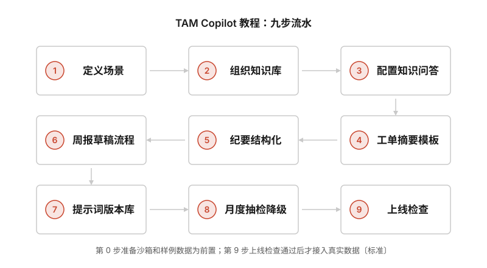

<!-- Diátaxis: Tutorial -->
# 第 29 章　TAM Copilot 搭建教程

> 本教程带你在授权环境中搭建一个最小可用的 TAM Copilot。完成后会得到四类可见成果。第一，一个可问答的知识库。第二，三类固定提示词模板。第三，一条周报草稿流程。第四，一份月度抽检台账。教程使用脱敏样本和虚构客户数据。接入真实客户数据前，必须完成三项确认。三项确认是工具授权、数据分级和人审角色。场景边界与治理口径见[第 28 章](ch28-ai-for-tam.md)。

## 学习目标

完成本教程后，你应能做到：

- 解释 TAM Copilot 的输入、检索、生成、人审和留痕链路；
- 搭建按客户和密级隔离的知识库空间；
- 配置知识问答、工单摘要、纪要结构化和周报初稿四个场景；
- 为每个场景设置人工复核点；
- 建立提示词版本库和月度抽检台账；
- 判断场景是否可以进入日常使用，或应降级为辅助检索。

## 前置条件

开始前逐项确认。任何一项缺失，先补齐后再继续。

| 前置条件 | 最低要求 | 缺失时的替代做法 |
| --- | --- | --- |
| 工具授权 | 企业批准的私有化或企业级检索增强工具 | 只用虚构样例，不接真实数据 |
| 数据授权 | 数据 Owner、分级和禁用字段确认 | 先用公开文档和虚构样例 |
| 人审角色 | 每类产出有一名复核人 | 自己复核，但不得外发 |
| 样本数据 | 10–20 份脱敏文档和 10 张模拟工单 | 手工构造教学样例 |
| 知识源 | 架构、变更、故障、会议和服务报告样例 | 每类至少准备一份 |
| 存储位置 | 团队库或受控目录 | 本地沙箱，不出个人设备 |
| 时间预算 | 首版 3–5 小时，稳定版另计 | 分三次完成 |
| 度量表 | 用时、错误和命中记录表 | 先用电子表格 |

检索增强生成（Retrieval-Augmented Generation，RAG）是本教程的核心能力。它先从授权知识库检索内容，再生成回答。不要把 RAG 当作权限系统。权限仍由工具、目录和数据分级控制。

## 成果验收总表

| 场景 | 最低验收标准 | 证据 |
| --- | --- | --- |
| 知识问答 | 10 个测试题中至少 8 个能指向正确原文 | 测试记录 |
| 工单摘要 | 三行摘要包含现象、影响、下一步 | 摘要与原工单对照 |
| 纪要结构化 | 行动项责任人和日期 100% 人工核对 | 纪要复核记录 |
| 周报初稿 | 数据可回链，判断和请求由人补写 | 周报底稿 |
| 提示词库 | 每个模板有版本、作者和适用范围 | 团队库截图或目录 |
| 月度抽检 | 每场景至少抽检 5 条 | 抽检台账 |



## 第 0 步　准备沙箱和样例数据

### 目的

先建立安全练习环境，避免把真实客户数据带入未授权工具。

### 操作

1. 申请或确认企业批准的 RAG、文档和生成工具账号。
2. 检查账号权限。确认你能上传文档、创建空间和查看调用日志。
3. 创建三个隔离空间：公开样例、虚构客户 A、虚构客户 B。
4. 准备 10–20 份样例文档。每类至少一份。类型包括架构说明、变更记录、故障复盘、会议纪要和服务报告。
5. 将真实客户名替换为 A 银行、B 保险等虚构代号。
6. 删除或替换个人信息：姓名、手机号、证件号、账号、IP 和内部域名。
7. 建立一份样例清单，记录文件名、主题、版本和脱敏状态。

### 预期结果

你有一个隔离沙箱。所有样例可上传、检索和删除，且不含真实客户数据。

### 常见错误与恢复

| 错误 | 后果 | 恢复动作 |
| --- | --- | --- |
| 直接上传生产日志 | 可能违反数据边界 | 停止上传，删除数据，报告数据 Owner |
| 所有文件放在同一空间 | 越权检索风险 | 重建隔离空间 |
| 文件名无日期和主题 | 后续无法维护 | 统一命名后重新入库 |

## 第 1 步　定义场景与成功标准

### 目的

避免把 Copilot 做成“什么都能问、什么都不可靠”的玩具。

### 操作

1. 选择四个首批场景：知识问答、工单摘要、纪要结构化、周报初稿。
2. 为每个场景写一句话目标。
   - 知识问答：5 秒内给出候选原文。
   - 工单摘要：三行话说清现象、影响、下一步。
   - 纪要结构化：抽出决定事项、行动项、风险与遗留。
   - 周报初稿：汇总摘要、聚类和行动项，供人工改写。
3. 为每个场景写两条失败标准。
   - 知识问答：引用不到原文，或引用过期文档。
   - 工单摘要：漏写业务影响。
   - 纪要结构化：责任人和日期错误。
   - 周报初稿：数字无法回链工单或系统记录。
4. 指定每类产出的复核人。
5. 建立“通过 / 待改 / 降级”三态判定表。

### 预期结果

你有一份一页场景说明。它包含目标、失败标准、复核人和数据范围。

### 常见错误与恢复

| 错误 | 后果 | 恢复动作 |
| --- | --- | --- |
| 目标写成“提高效率” | 无法验收 | 改成可测量任务 |
| 没有失败标准 | 质量争议无法裁决 | 补失败标准 |
| 没有复核人 | 错误外发无人负责 | 指定复核人 |

## 第 2 步　组织知识库

### 目的

让 Copilot 检索到正确版本、正确权限范围内的内容。

### 操作

1. 统一目录结构。建议按“客户／场景／年份”组织。
2. 统一文件命名：`YYYY-MM-DD_客户代号_主题_版本.md`。
3. 将样例文档转换为文本格式。Markdown 优先。
4. 删除重复、过期和失效文档。
5. 为每份文档补齐标题、日期、版本和状态。
6. 上传到对应隔离空间。
7. 记录每份文档的 Owner 和复审日期。
8. 建立季度清理任务。

### 预期结果

知识库中每个文件都要能回答三个问题。它属于谁？讲什么？是否仍有效？

### 验证

| 检查项 | 通过标准 |
| --- | --- |
| 命名 | 能按日期和主题排序 |
| 版本 | 能区分草稿、定稿和已废弃 |
| 权限 | 空间按客户和密级隔离 |
| 冗余 | 同一主题只有一个有效版本 |
| 溯源 | 每份文档有 Owner 和复审日期 |

### 常见错误与恢复

| 错误 | 后果 | 恢复动作 |
| --- | --- | --- |
| 只上传 PDF 扫描件 | 检索质量差 | 转为文本或补充摘要 |
| 保留多个旧版本 | Copilot 引用过期内容 | 标记废弃或移出索引 |
| 空间权限过大 | 越权检索 | 重建权限组 |

## 第 3 步　配置知识问答

### 目的

先做问答，再扩展摘要和工作流。问答不准时，先修数据，不先改模型。

### 操作

1. 在授权工具中创建知识问答应用。
2. 绑定第 2 步建立的隔离空间。
3. 设置检索范围。默认只允许当前客户空间。
4. 开启来源展示。要求回答列出文件名、日期和片段。
5. 配置拒答规则。检索不到原文时回答“未找到授权依据”。
6. 编写系统提示词，包含四条要求：
   - 只依据检索内容回答；
   - 引用文件名和日期；
   - 不确定时明确说明；
   - 不输出建议决策，只输出线索。
7. 准备 10 个测试问题。覆盖架构、变更、故障、责任和口径。
8. 逐题测试，记录回答、引用和人工判定。
9. 对答错的题目检查原因。常见原因有三类：文档缺失、文档过期、检索片段错误。

### 提示词样例

```text
角色：TAM 知识助手。
规则：
1. 只依据检索到的授权文档回答。
2. 每个要点标注文件名、日期和相关片段。
3. 检索不到依据时，回答“未找到授权依据”。
4. 不做商务承诺，不做故障定级，不替代人工判断。
输出：
- 结论线索
- 原文引用
- 需要人工确认的点
```

### 预期结果

10 个测试题中至少 8 个能给出正确线索和可核验引用。

### 常见错误与恢复

| 错误 | 后果 | 恢复动作 |
| --- | --- | --- |
| 回答流畅但无引用 | 不可核验 | 禁止无引用回答 |
| 引用到废弃文档 | 误导后续动作 | 清理旧版本并重建索引 |
| 权限外内容进入召回 | 合规风险 | 停用应用，修复空间隔离 |
| 问题太宽 | 答案发散 | 拆成具体问题 |

## 第 4 步　建立工单摘要模板

### 目的

把长工单压成晨会和交接班可读的三行摘要。

### 操作

1. 准备 10 张脱敏模拟工单。
2. 每张工单保留：编号、时间、现象、影响范围、已做动作、当前卡点。
3. 编写固定提示词。
4. 逐张生成摘要。
5. 人工核对三行内容是否与原工单一致。
6. 记录漏项、编造项和过度推断。
7. 修改提示词，明确禁止添加原文没有的信息。
8. 将通过版本保存到团队提示词库。

### 提示词样例

```text
角色：工单摘要助手。
输入：授权工单文本。
输出三行：
1. 现象：时间、对象、异常表现。
2. 影响：业务范围、用户或交易量、紧迫度。
3. 下一步：当前动作、卡点、需要的支持。
规则：
1. 只使用工单中的信息。
2. 原文没有的信息写“待确认”。
3. 不给根因结论，不设处理时限。
```

### 预期结果

至少 8 张工单摘要通过人工核对。漏项原因已记录。

### 常见错误与恢复

| 错误 | 后果 | 恢复动作 |
| --- | --- | --- |
| 编造影响范围 | 误导升级决策 | 提示词要求“待确认” |
| 根因当成事实 | 后续处置走偏 | 只允许写已验证现象 |
| 摘要过长 | 晨会不可读 | 限制每行不超过一个要点 |

## 第 5 步　建立纪要结构化模板

### 目的

从会议记录中抽出决定事项、行动项和风险。

### 操作

1. 准备两份脱敏会议纪要或转写文本。
2. 编写结构化提示词。
3. 要求输出四类字段：
   - 决定事项；
   - 行动项，含责任人和期限；
   - 风险与遗留；
   - 待人工确认。
4. 生成结构化结果。
5. 逐条核对行动项责任人和日期。
6. 补充口头达成但转写遗漏的内容。
7. 删除个人信息和商务敏感字段。
8. 将通过版本保存到团队提示词库。

### 提示词样例

```text
角色：会议纪要结构化助手。
任务：从会议文本抽取以下四类信息。
输出：
1. 决定事项。
2. 行动项：事项、责任人、期限。
3. 风险与遗留。
4. 待人工确认。
规则：
1. 不合并不同发言人的观点。
2. 原文不清晰时写入“待人工确认”。
3. 不推导责任人和日期。
```

### 预期结果

行动项字段须 100% 经人工核对。责任人和日期无 AI 推导值。

### 常见错误与恢复

| 错误 | 后果 | 恢复动作 |
| --- | --- | --- |
| 责任人推导错误 | 行动项无人执行 | 只保留原文明确姓名 |
| 期限缺失 | 无法跟踪 | 标记“待确认” |
| 商务敏感内容入库 | 数据边界违规 | 删除并调整模板 |

## 第 6 步　建立周报草稿流程

### 目的

把摘要、聚类和行动项汇成可改写的周报初稿。

### 操作

1. 收集本周已核对的工单摘要。
2. 收集纪要中的行动项和风险。
3. 用聚类结果整理三类趋势：重复、增长、关联。
4. 编写周报模板，建议分五段：
   - 本周服务事实；
   - 风险与趋势；
   - 行动项进展；
   - 需要客户或内部支持的事项；
   - 下周计划。
5. 让 AI 根据模板和输入生成初稿。
6. 人工补写判断、请求和下一步建议。
7. 核对每个数字能否回链工单号、纪要或系统记录。
8. 复核后再外发。

### 提示词样例

```text
角色：TAM 周报初稿助手。
输入：工单摘要、纪要行动项、聚类趋势。
输出五段：
1. 本周服务事实。
2. 风险与趋势。
3. 行动项进展。
4. 需要支持的事项。
5. 下周计划。
规则：
1. 数字必须来自输入，不得补算。
2. 判断和请求留空，由人工填写。
3. 每个事实尽量带来源编号。
```

### 预期结果

周报初稿能在 30 分钟内完成人工复核和补写〔目标值〕。所有事实可回链。

### 常见错误与恢复

| 错误 | 后果 | 恢复动作 |
| --- | --- | --- |
| AI 补写结论 | 事实变成推测 | 提示词禁止判断 |
| 来源编号缺失 | 客户追问无法回应 | 无来源的事实删除 |
| 报告只罗列活动 | 管理层不读 | 人工补充影响与请求 |

## 第 7 步　建立提示词版本库

### 目的

让个人实验变成团队资产。

### 操作

1. 建立受控目录或知识库空间。
2. 每个提示词单独建档。
3. 建档字段包括：场景、版本、作者、日期、适用范围、禁用场景、复核人。
4. 保存三个版本：初版、测试通过版、当前生产版。
5. 记录每次修改原因。
6. 每月评审一次。废弃版本标注状态，不立即删除。
7. 将知识库入库规则、抽检规则和工作流说明一并入库。

### 模板

```text
提示词名称：
场景：
版本：
作者：
日期：
适用范围：
禁用场景：
输入：
输出：
人工复核点：
测试结果：
变更原因：
```

### 预期结果

团队任何人都能找到当前可用版本，也知道为什么修改。

### 常见错误与恢复

| 错误 | 后果 | 恢复动作 |
| --- | --- | --- |
| 提示词留在个人聊天记录 | 人员变动即流失 | 迁移到团队库 |
| 只保存最终版 | 无法回滚 | 保留关键历史版本 |
| 无适用范围 | 可能误用于敏感数据 | 补写禁用场景 |

## 第 8 步　建立月度抽检与降级规则

### 目的

确认 Copilot 持续可用，而不是上线时合格、一个月后失真。

### 操作

1. 每月每场景至少抽检 5 条。
2. 记录样本编号、AI 产出、人工判定和错误类型。
3. 错误类型分为：事实错、引用错、遗漏、越权、格式错。
4. 统计每场景合格率。
5. 合格率低于约定红线时，场景降级为“仅辅助检索”。
6. 修复知识库、提示词或流程后重新测试。
7. 连续两轮通过后再恢复自动初稿。
8. 将结果同步给团队，并作为[附录 G](appx-g-tam-work-evaluation-standard.md) L1.7 证据。

### 抽检台账字段

| 字段 | 说明 |
| --- | --- |
| 日期 | 抽检时间 |
| 场景 | 知识问答、工单、纪要或周报 |
| 样本编号 | 可回链原始材料 |
| 判定 | 通过、待改、失败 |
| 错误类型 | 事实、引用、遗漏、越权、格式 |
| 处理动作 | 修数据、改提示词、降级或培训 |

### 预期结果

你有一份月度台账。每个场景的质量趋势和处置动作可追溯。

### 常见错误与恢复

| 错误 | 后果 | 恢复动作 |
| --- | --- | --- |
| 只统计“感觉不错” | 无法判断退化 | 改为样本抽检 |
| 错误不分类 | 无法定位原因 | 使用五类错误 |
| 发现问题不降级 | 错误外发 | 执行降级规则 |

## 第 9 步　接入真实数据前做上线检查

### 目的

教程沙箱通过后，不等于可以接入真实客户数据。上线前必须完成治理检查。

### 操作

1. 确认工具已按[附录 H](appx-h-tool-platform-acceptance-standard.md)验收。
2. 确认客户数据分级、授权范围和禁用字段。
3. 确认模型或工具不使用客户数据训练。
4. 确认调用日志、访问日志和导出日志可审计。
5. 确认知识库空间按客户和密级隔离。
6. 确认每类产出有复核人和替代人工流程。
7. 确认提示词、知识库规则和工作流已版本化。
8. 由数据 Owner 和安全接口人书面批准。
9. 先选一个低风险客户或低敏感场景试点。
10. 试点 30 天后复盘，再决定是否扩量。

### 上线检查表

| 检查项 | 通过标准 |
| --- | --- |
| 工具授权 | 有审批记录 |
| 数据边界 | 分级、脱敏和禁用字段书面化 |
| 权限 | 按客户和密级隔离 |
| 审计 | 调用与导出可追溯 |
| 人审 | 每类产出有复核人 |
| 回退 | 可退回人工流程 |
| 版本 | 提示词和知识库规则可追溯 |
| 试点 | 有 30 天观察结果 |

### 常见错误与恢复

| 错误 | 后果 | 恢复动作 |
| --- | --- | --- |
| 沙箱通过即上真实数据 | 合规风险 | 先完成数据 Owner 批准 |
| 只试一次就扩量 | 质量不稳定 | 保留 30 天试点 |
| 无替代人工流程 | 工具故障影响服务 | 建立人工回退路径 |

## 常见问题与排查

| 问题 | 可能原因 | 处理动作 |
| --- | --- | --- |
| 回答找不到原文 | 文档不可检索或空间未绑定 | 检查格式、索引和空间 |
| 回答引用旧文档 | 旧版本未清理 | 标记废弃并重建索引 |
| 跨客户内容混答 | 空间隔离失败 | 停用应用，重建权限 |
| 摘要编造影响 | 提示词允许推断 | 改为“待确认” |
| 行动项责任人错误 | AI 推导 | 只抽取原文明确字段 |
| 周报数字无法回链 | 输入缺来源编号 | 每条事实带工单或纪要编号 |
| 团队不愿使用 | 产出不可信 | 回到小场景，先修数据 |
| 成本异常升高 | 重复调用或上下文过长 | 设上限、裁剪上下文、查循环 |

## 收尾与维护

完成首版后，不要停在演示阶段。按以下节奏维护：

- 每日：新文档入库，重要摘要人工核对。
- 每周：周报初稿复核，行动项闭环检查。
- 每月：抽检 5 条，清理过期文档，评审提示词。
- 每季：复审权限、知识源和场景价值。
- 人员变动时：交接提示词库、知识库规则、抽检台账和已知问题。

Copilot 的价值不在工具数量。它在于把省下的时间投向后续工作。这些工作包括客户对话、风险预判、架构评审和现场验证。

## 学习效果清单

- [ ] 能说明沙箱、试点和真实数据上线的边界
- [ ] 能搭建按客户和密级隔离的知识库
- [ ] 能配置要求引用原文的知识问答
- [ ] 能用工单摘要模板生成现象、影响、下一步
- [ ] 能核对纪要行动项的责任人和日期
- [ ] 能建立可回链来源的周报草稿流程
- [ ] 能维护提示词版本库
- [ ] 能执行月度抽检和场景降级
- [ ] 能完成真实数据上线前检查
- [ ] 能解释为什么 AI 产出必须经过人工确认

---

**本教程要点回顾**

1. 先建沙箱和脱敏样例，再谈能力。
2. 每个场景先写成功标准和失败标准。
3. 知识问答必须引用原文；检索不到就拒答。
4. 工单摘要只写现象、影响、下一步；原文没有的信息写待确认。
5. 行动项责任人和日期必须人工核对。
6. 周报初稿只汇总事实；判断和请求由人补写。
7. 提示词、知识库规则和工作流是团队资产。
8. 月度抽检决定场景继续使用、修改或降级。
9. 真实客户数据上线前，必须通过治理检查和试点观察。