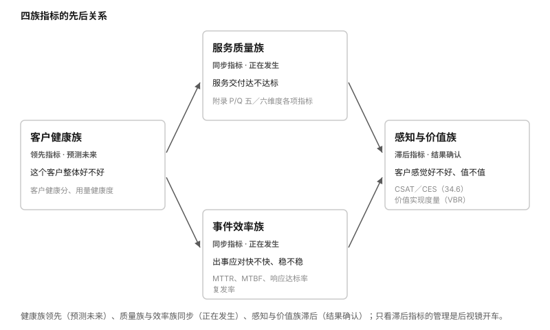
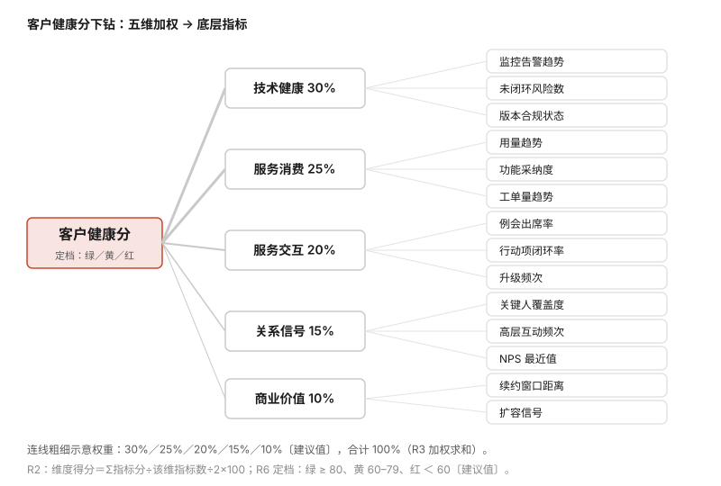

<!-- Diátaxis: Reference -->
# 第 34 章　度量体系

> 前面二十五章反复引用“口径见第 34 章”。服务等级协议（Service Level Agreement，SLA）的达成口径指向这里。平均修复时间（Mean Time To Repair，MTTR）的口径也是。净推荐值（Net Promoter Score，NPS）、客户健康分、SLA 赔偿（SLA Credit）同样在本章定义。本章是全书度量口径的唯一事实源。[附录 G](appx-g-tam-work-evaluation-standard.md) 的考核口径指向本章。[附录 P](appx-p-tam-service-quality-standard-public-cloud.md)/[附录 Q](appx-q-tam-service-quality-standard-dedicated-cloud.md) 的服务质量打分同样如此。[附录 I](appx-i-on-duty-standard.md)/[附录 K](appx-k-incident-emergency-drill-standard.md) 的响应与应急时限也一样。任何地方只引用、不重新定义。度量实施动作见[第 35 章](ch35-measurement-system-howto.md)。度量篇先讲度量，再讲[第 36 章](ch36-maturity-model.md)成熟度与[第 37 章](ch37-career-team-building.md)职业发展。没有口径一致的度量，后两章全是空中楼阁。

## 34.1 度量的目的与元规则

度量只有三个合法目的。**做决策**：资源往哪投、风险在哪。**建信任**：给客户和组织一个可核对的事实底座。**促改进**：找到下一个要修的东西。不能落到这三个目的上的指标，是工作量证明工具。它存在的理由通常是“总要考核点什么”。

三条元规则先于一切指标设计：

1. **口径先于数值**：指标落地前写清三件事。怎么算、从哪取数、谁仲裁争议，三件都要写明。分子分母要写明。取数以系统记录为准。争议仲裁机制是[第 11 章](ch11-service-governance.md) SLA 口径管理的泛化；
2. **取数只认系统**：手工填报的指标必然失真。这是统计学问题，不是道德问题。平台证据能力要求见[附录 H](appx-h-tool-platform-acceptance-standard.md)；
3. **每个指标配一个反异化条款**：指标一经考核就会异化（Goodhart 定律）。定义指标时就写明刷分手法与防线。通用机制见 34.8。

## 34.2 指标体系总览

按度量对象分四族，各自回答一个问题：

| 族 | 回答的问题 | 核心指标 | 主要消费方 |
| --- | --- | --- | --- |
| 客户健康族 | 这个客户整体好不好 | 客户健康分（Customer Health Score）（34.3）、用量健康度（[第 21 章](ch21-commercial-synergy.md)） | TAM 自管、服务经理 |
| 服务质量族 | 服务交付达不达标 | [附录 P](appx-p-tam-service-quality-standard-public-cloud.md)/[附录 Q](appx-q-tam-service-quality-standard-dedicated-cloud.md) 五/六维度各项指标（本章供口径） | 服务经理、客户（QBR 公开） |
| 事件效率族 | 出事应对快不快、稳不稳 | MTTR、平均故障间隔（Mean Time Between Failures，MTBF）、响应达标率、复发率（34.5） | 全体，监管场景客户 |
| 感知与价值族 | 客户感觉好不好、值不值 | 客户满意度（Customer Satisfaction Score，CSAT）/费力度（Customer Effort Score，CES）（34.6）、价值实现度量（34.7） | 管理层、续约场景 |

四族的关系有先后。健康族是**领先指标**（预测未来）。质量族与效率族是**同步指标**（正在发生）。感知与价值族是**滞后指标**（结果确认）。只看滞后指标的管理是后视镜开车。

## 34.3 客户健康分口径

客户健康分（[模板 10](../templates/10-customer-health-scorecard.md)）是 TAM 最重要的自管指标。它也是[第 17 章](ch17-customer-lifecycle.md)生命周期运营和[第 21 章](ch21-commercial-synergy.md)续约预测的输入。

**构成（建议权重，按业务校准）**：

| 维度 | 权重 | 数据来源 |
| --- | --- | --- |
| 技术健康 | 30% | 监控告警趋势、未闭环风险数、版本合规状态 |
| 服务消费 | 25% | 用量趋势、功能采纳度、工单量趋势（异常低也是信号） |
| 服务交互 | 20% | 例会出席率、行动项闭环率、升级频次 |
| 关系信号 | 15% | 关键人覆盖度（[模板 11](../templates/11-key-person-map-canvas.md)）、高层互动频次、NPS 最近值 |
| 商业价值 | 10% | 续约窗口距离、扩容信号（只作参考，不考核金额，见[附录 G](appx-g-tam-work-evaluation-standard.md)） |

**口径约束**：

- 分数必须**可解释**：每个维度能下钻到原始证据。“系统算的 72 分”不可接受；
- 阈值分绿/黄/红三档。每档触发预定义动作。动作清单见[第 35 章](ch35-measurement-system-howto.md)；
- 防异化：健康分不得作为唯一续约预测依据。它测技术关系温度，测不到采购流程与预算周期（[第 21 章](ch21-commercial-synergy.md)）。

## 34.4 SLA 达成与 SLA Credit 口径

**口径定义**（[附录 P](appx-p-tam-service-quality-standard-public-cloud.md) 的 P5.5-1 与[附录 Q](appx-q-tam-service-quality-standard-dedicated-cloud.md) 的 Q5.2-1 引用本节）：

- **统计周期**：自然月。按服务、按客户分别计算，不做全平台混算。混算会淹没单客户违约；
- **可用性口径**：可用性 =（周期总分钟 − 不可用分钟）/ 周期总分钟。不可用分钟从故障确认起算，到服务恢复验证止。起算点不取客户报障时刻。**计划内维护是否剔除必须写进合同**。不写明就是争议地雷；
- **响应类 SLA**：以系统时间戳为准。计时从工单创建到首次有效响应。有效响应须包含实质性处置动作。自动回复不算；
- **SLA Credit**：违约确认后协助客户申领，时限建议 ≤ 5 个工作日（[附录 P](appx-p-tam-service-quality-standard-public-cloud.md) 的 P5.5-2）。Credit 是止损，不是补偿。TAM 的责任是不让客户自己发现违约。监测覆盖 100% 是服务质量项。

达成率月报化与预警线动作见[第 35 章](ch35-measurement-system-howto.md)。

## 34.5 事件效率指标口径

**口径定义**（[附录 I](appx-i-on-duty-standard.md)、[附录 K](appx-k-incident-emergency-drill-standard.md)、附录 P/Q 引用本节）：

| 指标 | 口径 | 注意 |
| --- | --- | --- |
| 平均确认时长（Mean Time To Acknowledge，MTTA） | 事件触发 → 值班人确认介入 | 附录 I 响应达标率的分子 |
| 平均修复时间（MTTR） | 确认介入 → **业务恢复**（非工单关闭） | 工单关闭晚于恢复，用关闭时间会虚高 |
| 平均故障间隔（MTBF） | 相邻两次同级故障的业务恢复点间隔 | 分级别算，P3/P4 混入会稀释信号 |
| 复发率 | 90 天内同根因事件再发生占比 | [附录 R](appx-r-problem-retrospective-standard.md) 的闭环质量锚点。目标 0 |

**防异化条款**：

- MTTR 分级分客户看趋势，不做绝对值横比。金融核心系统与测试环境没有可比性；
- 防“降级定级”：把 P1 记成 P2 让数字好看。防线是[第 25 章](ch25-financial-incident.md)定级标准与[附录 R](appx-r-problem-retrospective-standard.md)复盘核查；
- MTBF 长期走高要审计告警阈值。阈值调钝会造成假稳定（[附录 I](appx-i-on-duty-standard.md) 告警质量审计）。

指标使用与审计动作见[第 35 章](ch35-measurement-system-howto.md)。

## 34.6 感知度量口径

| 指标 | 问法 | 适用场景 | 频率 |
| --- | --- | --- | --- |
| CSAT（客户满意度） | “本次服务你满意吗”（5 分制） | 单次交互：工单、重保、评审后 | 事件后即时 |
| CES（费力度） | “办成这件事你费了多少劲” | 流程体检：客户觉得哪累 | 季度抽样 |
| NPS（净推荐值） | “你愿意把我们推荐给同行吗”（0–10） | 关系温度与续约先行指标 | 半年/年度 |

**口径约束**：

- 三指标互补不可互替：CSAT 管单次、CES 管流程、NPS 管关系。NPS 高而 CSAT 走低，说明关系存量在兜底、服务增量在恶化；
- 样本量口径：单客户 NPS 样本 < 5 时只看不考核。小样本波动是噪声；
- 防异化：禁止求高分话术与挑客户投放问卷（[附录 G](appx-g-tam-work-evaluation-standard.md) 红线 R3）。

低分回访与复盘触发规则见[第 35 章](ch35-measurement-system-howto.md)。

## 34.7 价值实现度量口径

续约时客户买的不是 SLA 绿条，是“这东西给我带来了什么”。价值实现度量分三类。结果沉淀为价值实现报告（Value Realization Report，VBR）。

1. **风险规避类**：重保零事故、演练拦住的隐患数。通告触达避免的停服也算。证据锚点见[附录 P](appx-p-tam-service-quality-standard-public-cloud.md) 的 D3。换算要有测算依据；
2. **效率与成本类**：包含三项。用量优化节省金额（[第 21 章](ch21-commercial-synergy.md)云成本优化）。MTTR 改善折算的业务时间。自动化替代的人日；
3. **业务结果类**：客户业务指标中可归因的部分。例如峰值承载、上线周期缩短。归因要谨慎。**写“贡献”不写“功劳”**。夸大归因，客户识破一次，价值报告信用清零。

价值度量进 QBR/EBR。季度业务回顾（Quarterly Business Review，QBR）与高管业务回顾（Executive Business Review，EBR）共用[模板 08](../templates/08-qbr-ebr-template.md)。一年至少沉淀一份 VBR。它是[附录 G](appx-g-tam-work-evaluation-standard.md) L3.7（价值证明交付）的考核证据。

## 34.8 指标异化与防异化

Goodhart 定律的标准剧本：指标变目标 → 行为变形 → 数据失真 → 决策失效。四个通用机制：

1. **配对制衡**：任何效率指标配一个质量指标。MTTR 配复发率，响应速度配一次解决率。单押一边必然变形；
2. **抽查审计**：季度按比例抽查原始记录，与上报值核对。造假适用[附录 G](appx-g-tam-work-evaluation-standard.md) 红线 R2/R3；
3. **趋势优于绝对值**：考核锚点用“逐季改善或优于基线”。[附录 P](appx-p-tam-service-quality-standard-public-cloud.md)/[附录 Q](appx-q-tam-service-quality-standard-dedicated-cloud.md) 已采用此锚点。绝对值横比逼出数字游戏；
4. **指标退休**：达标四季又无决策价值的指标降级为监测项。指标只增不减，三年后团队在为报表打工。

## 34.9 口径变更与引用纪律

- **唯一事实源**：本章定义口径，别处只引用不重定义。附录与模板中的同名指标，口径必须与本章一致；
- **变更留版本**：口径调整须记录生效日期与变更原因。历史数据按旧口径可比，不追溯重算；
- **变更通知**：口径变更同步附录 G/I/K/P/Q 与模板 10/15 的引用方。实施动作见[第 35 章](ch35-measurement-system-howto.md)。

## 34.10 这套体系在什么时候失效

前面九节讲怎么建。这一节讲怎么坏。五种失效，每种给一个识别信号。文中样本量均为演示值，不对应真实客户。

**失效一：分母靠估算。** 比率类指标全要分母。可用性要总时长。达标率要总单量。覆盖率要总资产数。分母一旦靠人工估算，比率就不是测量，是编造。识别信号：问一句“这个数的分母从哪来”。回答里出现“大概”“按经验”“按人头乘”。有这三句，这个指标先别进考核。

**失效二：小样本客户。** 一个客户一年出 2 次故障，满意度回收 3 份问卷。这类样本上算比率，波动全是噪声。五个人的团队做净推荐值，一条差评能把分数拉低 20 分。识别信号：分母小于 30。此时看个案，不看分数。

**失效三：转型期没有基线。** 新业务上线三个月。同比没有去年。环比基数太小。此时算增长率，第一个月永远最好看。识别信号：你在为一个上线不足半年的东西做同比汇报。改看绝对值，改看趋势形状。

**失效四：客户不认你的口径。** 服务等级协议（Service Level Agreement，SLA）争议时，口径就是政治。本章给了统一算法，但仲裁权在合同。合同写“不可用从客户报障起算”，本章写“从确认到恢复验证”。两个口径能差出几小时。识别信号：季度业务回顾（QBR）会上客户提异议。你一解释算法，方向就错了。此时该回合同，不是说服客户。

**失效五：全绿。** 真实系统有噪声。连续四个季度所有指标全绿，只有三种可能。数据没接对。有人在粉饰。业务真的太平。识别信号：全绿且无人解释为什么太平。

**这套体系还有一个前提。** 它要求平台能出证据。取证、留痕、可回溯，缺一样，指标就退化成填表。没有平台的组织强行上这套体系，会走三步。先是手工填报。然后是按月补录。最后是开会念报表。三步走完，指标体系就成了仪式。

此时正确的做法不是加指标，是先补证据能力（[附录 H](appx-h-tool-platform-acceptance-standard.md)）。补不了，就先只留三个指标。事件数、恢复时长、客户投诉数。三个都从系统取，比三十个手工填报有用。

## 34.11 健康分计算规则 R1–R7 与分档动作

34.3 给出五个维度的权重与取数来源。本节给出把权重算成分数的规则，编号 R1–R7。[模板 10](../templates/10-customer-health-scorecard.md) 第 2 节的公式与定档阈值和本节一致，只落地、不改算法。R 编号只在本节内有效，与模板 10 的指标行号（T/C/I/R/V）不通用。

| 规则 | 内容 | 计算式或阈值 |
| --- | --- | --- |
| R1 打分锚点 | 每个底层指标按三档打分：2 分健康、1 分关注、0 分告警〔建议值〕 | 每项须附证据来源，“系统算的”不算证据 |
| R2 维度得分 | 维度得分 = Σ 指标分 ÷ 该维指标数 ÷ 2 × 100（算术可复算） | 免评项从分母剔除（34.6 小样本纪律） |
| R3 加权求和 | 总分 = Σ（维度得分 × 权重） | 权重沿用 34.3：30%/25%/20%/15%/10%〔建议值〕，合计 100% |
| R4 缺数处理 | 整维当月无数据，该维不参与计分 | 其余维度权重重归一到 100%（算术可复算）；缺数超过两维〔建议值〕时只报“数据不全”，不定档 |
| R5 取数周期 | 每月结算一次〔建议值〕，数据截至当月最后一个自然日 | 月中波动只监测、不改档〔建议值〕；历史分不追溯重算（34.9） |
| R6 定档 | 绿 ≥ 80、黄 60–79、红 < 60〔建议值〕 | 档位由总分直接判定；人工改档须留痕并写原因（34.9） |
| R7 动作分流 | 档位触发预定义动作，明细见下表 | 执行动作见[第 35 章](ch35-measurement-system-howto.md) |

定档后的动作按档位分流。下表给触发层口径：每档触发什么、多久启动、明细在哪。动作明细以[模板 10](../templates/10-customer-health-scorecard.md) 第 3 节为准，执行动作见[第 35 章](ch35-measurement-system-howto.md)。

| 档位 | 触发什么 | 时限 | 明细见 |
| --- | --- | --- | --- |
| 绿 | 维持常规节奏，当月留档，无专项动作 | 当月 | — |
| 黄 | 定向健康检查，定位走弱维度；约客户管理层沟通 | 48 小时内〔建议值〕 | 模板 10 第 3 节 |
| 红 | 上报服务总监；一周内输出改善计划并进周会；评估是否触发附录 R 客情类复盘 | 24 小时内上报〔建议值〕 | 模板 10 第 3 节 |
| 黄或红转绿 | 核对上轮动作全部完成且有证据，方准定绿 | 当月 | 模板 10 第 3 节 |
| 连续两月降档 | 强制附录 R 客情类复盘，结论报服务总监 | 第二个降档月起 | 模板 10 第 3 节 |

**失效边界。** R4 的缺数重归一是权宜口径。缺维越多，分数越不可比，缺过半就只报“数据不全”。权重也要活：按业务季度校准一次（模板 10 第 4 节）。连续两季某维没有区分度，改它的指标构成。不顺手改定档阈值——阈值一动，历史趋势全断。

## 34.12 SLA 达成预警线与升级路径

达标不等于安全。月达成率贴着目标值走，说明余量已经耗尽。本节给预警线：**月达成率低于目标值的 95%〔建议值〕即触发预警**。预警是余量信号，不是违约结论，违约认定仍按 34.4 执行。

预警线按比例缩放，不设固定差值。因为各服务的目标值不同。固定差值对 99.9% 的目标和对 95% 的目标，含义完全不同。缩放后所有服务共用一条规则。算术示例：目标值取 98%〔案例虚构值〕，预警线 = 98% × 95% = 93.1%（算术可复算）。

预警最容易引来改口径的冲动。此时若调整算法，必须新旧口径双跑一个统计周期〔建议值〕。两版结果同表并列，差异逐条归因，归因完成后才切换。切换的评估步骤见 34.15。失效条件：预警源于取数故障时，双跑没有意义。先修取数（[附录 H](appx-h-tool-platform-acceptance-standard.md)），再谈口径。

升级路径分四级。低级别自己消化，升级条件写死在表里。防止一出预警就直接上抛。

| 层级 | 触发 | 动作 | 升级条件 |
| --- | --- | --- | --- |
| 一级 | 月达成率低于预警线 | TAM 核对取数与事件清单，随月报附预警说明 | 取数无误，且连续两月触发〔建议值〕 |
| 二级 | 连续两月触发〔建议值〕 | 服务经理复核，输出改善动作并按月跟踪 | 跟踪一个周期后仍触发 |
| 三级 | 争议涉及口径或算法 | 按[第 11 章](ch11-service-governance.md) SLA 口径管理机制仲裁 | 客户不接受仲裁结论 |
| 四级 | 客户不接受仲裁结论 | 回合同条款定夺（34.10 失效四） | — |

这条缩放规则适用于可用性与响应类 SLA。各服务目标值不同，95% 的比例不变〔建议值〕。统计仍按服务、按客户分别出，不做全平台混算，理由见 34.4。

## 34.13 MTTR 分位口径（P50/P90）

MTTR 报告只给均值会骗人。本节定分位口径：对外沟通与考核用 P50 与 P90。均值只留在报表里作趋势参考。[附录 U](appx-u-ticket-management-standard.md) “不只看均值”的要求与本节同源。

修复时长的分布天然右偏。多数小故障很快恢复，少数大故障拖上一天。少数慢样本把均值抬起来。结果均值描述不了任何一次真实体验。演示数据：十次修复里九次 1 小时、一次 24 小时〔案例虚构值〕。均值 3.3 小时，P50 只有 1 小时（算术可复算）。均值说了不算，分位才说得清。

P90 回答一个问题：最慢的一成事件，大概要修多久。客户骂服务，骂的通常是长尾那次，不是中位那次。所以 P90 是体验底线的刻度。前提写明：样本达标时 P90 才有意义。样本不够，分位全是噪声。

样本量下限按月定档：

| 当月样本量 | 出什么 | 报表标注 |
| --- | --- | --- |
| ≥ 30〔建议值〕 | P50 与 P90 同出 | 无 |
| 10–29 | 只出 P50 | “样本不足，P90 不出”〔建议值〕 |
| < 10〔建议值〕 | 只列个案明细 | “样本不足，不报分位”〔建议值〕 |

30 这条线与 34.10 失效二同源。分母不到 30 时，比率类数字全是噪声。分级分客户之后（34.5），单客户月样本经常不足。此时把同一客户相邻三个月聚合，再算分位〔建议值〕。代价是时效变慢一档。更稳的做法是只做事件级看板，客户级分数留到季度再算。除非样本达标，否则任何 P90 都不进考核表。

## 34.14 度量反例四则

前面各节给正口径。本节给四个真实手法。每则配一条失效条件：手法得逞的前提，是对应的防线没接上。文中演示数字均为虚构值。

**手法一：达成率刷分。** 达成率盯的是按时完成。月报前专挑响应类小单集中关单，复杂单压到下月。当月达成率抬到 97%〔案例虚构值〕，客户的真实体验没有变化。数字上去了，服务没变。失效条件：达成率与 MTTR、复发率同表考核时，挑单立刻失去意义。34.8 的配对制衡就是为这一手法设计的。

**手法二：口径漂移。** 上月分母含全部工单，本月悄悄剔除咨询类。达成率凭空涨 6 个百分点〔案例虚构值〕。数字变好，口径变了，没人收到通知。失效条件：变更先双跑一期，记录留痕，引用方收到通知（34.15）。分母变更当期暴露，漂移过不了审计。

**手法三：NPS 小样本失真。** 三份问卷里一条差评，单条权重占三分之一〔案例虚构值〕。推荐率当场塌掉，客户自己都没当回事，报表却难看了。失效条件：样本 < 5 不考核的既有规则（34.6）把这类波动挡在考核外。样本放大到 30 份，同一条差评只占约 3%（1 ÷ 30，算术可复算）。单条杠杆按比例衰减。

**手法四：MTTR 压单。** 修复其实早已完成。操作者把单子挂起等客户确认，申报时长只算处理段。4 小时的真实修复记成 1 小时〔案例虚构值〕，客户还没恢复使用。失效条件：口径从确认介入连续计到业务恢复（34.5）。挂起不暂停计时。按月抽查时间戳（34.8），压单当场现形。

## 34.15 口径变更影响评估

口径变更最贵的代价不是算错，是历史断层。同名指标换了算法，趋势图上分不清“变差”与“变口径”。所以变更走三步：盘点、双跑、切换。留痕与通知的既有纪律见 34.9，本节给评估动作。

| 步骤 | 动作 | 输出 | 通过判据 |
| --- | --- | --- | --- |
| 1 盘点 | 逐个核对引用方：附录 G/I/K/P/Q、模板 10/15、第 11/21/35 章 | 影响面清单 | 引用方列全（清单见 34.9） |
| 2 双跑 | 新旧口径并行一个统计周期〔建议值〕，两版同表并列 | 双跑对比表 | 差异逐条归因完成 |
| 3 切换 | 留痕（生效日期、变更原因、旧口径归档）后切换，通知全部引用方 | 变更记录 | 通知送达并有回执〔建议值〕 |

为什么要双跑。单跑直接切换时，趋势断层没法归因。双跑把两版放在同一周期里对照。差异是口径造成的还是表现造成的，一目了然。代价也认：同一周期出两版报表，工作量至少翻一倍〔经验值〕。小改动可以免双跑。限于取数字段改名、公式等价变换这类不改数值的变更。且要书面记下“等价”的依据〔建议值〕。失效边界：免双跑的口子一开，任何变更都能自称等价。所以免双跑须服务经理书面确认〔建议值〕。

## 34.16 AI 增量与边界

AI 进入度量体系，改变的是取数与预警的速度。口径的归属不变。本节讲清三件变、三件不变、一条边界。结构与各附录的“AI 增量”小节（如[附录 I](appx-i-on-duty-standard.md)）一致。

改变的第一件是自动取数与异常检测。取数从人工拉报表变成平台推送，异常先由模型筛一遍。前提是取数链路可审计（[附录 H](appx-h-tool-platform-acceptance-standard.md)）。模型筛过的记录，底层证据仍要可回查。改变的第二件是预测性预警。发现时点提前一个统计周期〔建议值〕，处置窗口随之前移。代价是误报。误报多了，预警就没人信。阈值须按月复核〔建议值〕。改变的第三件是归因草稿。复盘归因与 QBR 分析先出草稿，人改后定稿。草稿不进考核。进考核的每个数字，仍按本章口径手工可复算。

没变的第一件是口径定义权。模型不改口径。改口径走 34.15 的评估流程。没变的第二件是考核签字。数字进考核表要人签字，担责的是人不是模型。防异化红线见[附录 G](appx-g-tam-work-evaluation-standard.md)。没变的第三件是防异化纪律。34.8 四机制照旧。模型刷分比人快，抽查频率只能升不能降。

一条边界要钉死。AI 预测的预警必须回对原始口径。预警值要能按 34.4 与 34.5 的定义手工复算一遍。算不出来的预警，不进报表。模型还习惯把相关当因果。健康分与续约相关，不等于健康分导致续约。归因结论只写“贡献”不写“功劳”（34.7），因果要回证据。失效条件：数据量太小的客户，预测方差大。此类预测只作提示、不作依据〔建议值〕。

AI 不改成熟度的判定方式：M 级仍按证据判（[第 36 章](ch36-maturity-model.md)）。没有口径一致的度量，AI 只会更快地算错数。度量实施动作见[第 35 章](ch35-measurement-system-howto.md)。

---

**本章要点回顾**

1. 度量三目的：决策、信任、改进。元规则有三：口径先于数值、取数只认系统、每指标配防异化。
2. 四族有先后：健康领先，质量和效率同步，感知与价值滞后。只看滞后指标是后视镜开车。
3. 关键口径：SLA 按月分客户，不可用从确认到恢复验证。MTTR 止于业务恢复，不是工单关闭。MTBF 分级计算。健康分可下钻解释。
4. 感知三件套分工：CSAT 管单次、CES 管流程、NPS 管关系。小样本不考核，低分必回访。
5. 价值度量三类：风险规避、效率成本、业务结果。归因写贡献不写功劳。
6. 防异化四机制：配对制衡、抽查审计、趋势锚点、指标退休。实施动作见第 35 章。
7. 新增口径六条：健康分按 R1–R7 规则计算，绿 ≥ 80、黄 60–79、红 < 60〔建议值〕分档触发动作；达成率低于目标值 95%〔建议值〕即预警；MTTR 用 P50/P90 分位，样本不足不出数；口径变更先双跑再切换；AI 只改速度，不改口径归属。
